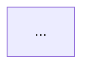

# 흐름 요약

흐름 요약은 사용자가 나중에 다시 볼 때 읽는 글이다. 결론만이 아니라 거기에 이른 과정을 적는다. 같은 이슈에 대한 글이 셋 있고 쓰임이 다르다.

| 글 | 있는 곳 | 쓰임 |
|---|---|---|
| 요약 | 이슈 마무리 댓글의 맨 위 | 닫을 때 훑고 넘어간다. 다섯 줄쯤 |
| 흐름 요약 | `history/stageN/<이슈 브랜치 이름>.md`와 `.html` | 다시 볼 때 읽는다. 흐름과 의사결정 과정 |
| 자세한 기록 | 마무리 댓글의 접힌 부분, `decisions/` | 확인이 필요할 때 찾아본다 |

## 언제

- 이슈를 닫을 때 한 번 만든다. 자리는 Codex 2차 검토를 반영한 뒤, 사용자가 닫기 전이다(`STEPPER.md` "단계를 닫는 절차" ⑤).
- 항상 만든다. 사용자가 필요 없다고 하면 그 이슈에서는 건너뛴다. 먼저 건너뛰자고 하지 않는다. 다짐으로 둔 일은 지켜지지 않기 때문이다.
- 같은 이슈를 하다가 세션만 넘길 때와 이슈 없이 하는 `chore-` 손질에는 만들지 않는다.

## 순서

1. **기록을 읽는다.** 기억이 아니라 적힌 것으로 쓴다. 이 이슈에서 나온 결정 줄(`DECISIONS.md`에서 파일을 찾는다), `decisions/judgments.md`의 해당 줄, 이슈 본문과 체크리스트(`gh issue view`), `git log --grep="(#번호)"`, 있으면 `CODEX_REVIEW.md`, 미정 목록에 더하거나 지운 줄을 읽는다. 숫자(결정 줄, 커밋, 지적)는 세어서 적는다.
2. **묶음을 잡고 결정을 고른다.** 결정을 낱개로 늘어놓지 않고 두세 묶음으로 나눈다(1단계는 질문, 채점, 집계와 비교였다). 묶음마다 방향을 정한 결정, 도중에 바뀐 결정, 뒤 단계가 기대는 결정을 고른다. 전부 싣지 못했으면 몇 줄 가운데 몇 개를 실었는지 사용자에게 알린다.
3. **마크다운을 쓴다.** 아래 "마크다운 양식"을 따른다. 변환 스크립트가 이 양식을 읽는다.
4. **그림을 그린다.** 마크다운의 Mermaid가 원본이다. `diagram-design` 스킬로 같은 내용을 다시 그려 `<이슈 브랜치 이름>-flow.svg`로 같은 폴더에 둔다. 폭은 핸드폰에 맞춘다(견본은 `viewBox` 폭 480, 제목 16px, 항목 12px). Mermaid를 고치면 그림도 다시 그린다. 이 일치는 스크립트가 보장하지 못하므로 직접 대조한다.
5. **HTML을 만든다.** `python3 tools/flow_summary_html.py history/stageN/<이름>.md`. HTML을 직접 고치지 않는다. 내용은 마크다운을, 모양은 스크립트의 틀을 고치고 다시 만든다. 만든 뒤 브라우저로 연다(`open`).
6. **사용자가 읽고 묻는다.** 사용자에게 시험처럼 묻지 않는다. 사용자가 이해가 안 되는 곳을 물으면 그 자리에서 설명하고, 글이 모자랐던 것이면 마크다운을 고쳐 다시 만든다. 사용자가 물은 곳과, 결정 표에 "정확히 이해하지 못한 채 정했다"고 적힌 곳은 "다시 볼 곳"에 적는다.
7. **커밋한다.** 마크다운, HTML, 그림을 경로로 지정해 한 커밋에 담는다: `docs: N단계 흐름 요약을 쓴다 (#번호)`.

## 마크다운 양식

```
# N단계 흐름 요약: <단계 이름>

이슈 #<번호> · <시작 날짜> ~ <끝 날짜>

<이 이슈에서 무엇을 정했는지 한 문단>

<결과물과 이 글의 쓰임을 한 문단. 없어도 된다>

| 숫자 | 값 |
|---|---|
| <세어서 적은 것> | <값과 풀이> |

## 흐름



<순서가 그렇게 된 이유를 한 문단>

## 1. <묶음 이름>

### <결정의 제목> (<꼬리표>)

> <접힌 상태에서 보이는 한 줄 결론>

- **<라벨>**: <내용>
- **예**: <예 하나>

## <그 밖의 절>
```

- **묶음**은 번호로 시작하는 `##` 절이다(`## 1. …`). 그 안의 `###`마다 접히는 카드가 된다.
- **꼬리표**는 제목 끝의 괄호에 적는다. 누가 방향을 바꿨는지를 적는다: `사용자 지적`, `Codex 지적`, `완료 기준 대조 중 발견`, `어드바이저 지적`. 둘이면 쉼표로 잇는다. 없으면 괄호를 쓰지 않는다.
- **한 줄 결론**은 제목 바로 아래 `>` 줄이다. 카드마다 꼭 적는다.
- **라벨**은 `정한 것`, `버린 것`, `이유`, `과정`, `한계`처럼 그 줄이 무엇인지를 적는다. `예`는 따로 상자로 그려진다.
- **바뀐 결정**은 `처음`, `걸린 것`, `정한 것`의 순서로 적는다. 첫 라벨이 `처음`으로 시작하는 목록은 단계로 그려진다. 여러 번 바뀌었으면 `첫 번째 변경`, `두 번째 변경`처럼 잇는다.
- **그 밖의 절**은 번호 없이 적는다. 이슈에 맞는 것만 쓴다: `검토에서 있었던 일`, `계획과 달라진 것`, `뒤 단계가 기대는 것`, `남은 것`, `다시 볼 곳`, `원본`. `다시 볼 곳`은 `| 내용 | 상태 | 쓰이는 곳 |` 표로 적는다.

견본은 `history/stage1/1-evaluation-frame.md`다.

## 쓰는 규칙

- `CLAUDE.md` 12번(사용자에게 설명할 때)을 지킨다. 개념 하나에 예 하나를 든다.
- **지어내지 않는다.** 버린 선택지나 이유가 기록에 없으면 쓰지 않는다. 숫자는 저장된 기록에서 센 값만 쓴다.
- **줄이지 않는다.** 고른 결정과 계획에서 달라진 것은 전부 적는다. 길이를 맞추려고 빼지 않는다.
- **결정 표를 옮겨 적지 않는다.** 원본은 `decisions/`이고 흐름 요약은 `원본` 절에서 그 파일을 가리킨다.
- **과정을 적는다.** 처음에 어떻게 정했고, 무엇이 걸렸고, 누가 지적했고, 그래서 어떻게 바꿨는지다. 사용자가 정할 때 한 말이 기록에 있으면 그 말을 싣는다.

## 하지 않는 것

- 사용자에게 기억으로 답하게 하는 퀴즈를 내지 않는다. 2026-10-13에 해 보고 뺐다(`decisions/common.md`).
- 무엇이 어려웠고 다음에 무엇을 바꿀지를 묻는 회고를 붙이지 않는다.
- 결정 파일을 `history/`로 옮기지 않는다. 옮길지는 미정 목록에 있다.
- 최종 평가용 질문과 정답을 적지 않는다.
- PDF를 만들지 않는다. 사용자가 직접 내보낸다.
