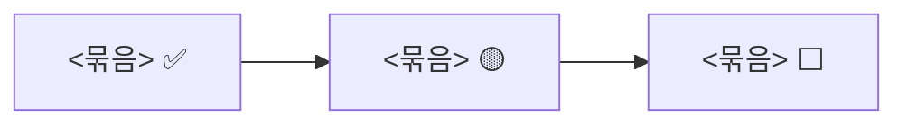

# 세션 시작

작업의 단위는 이슈이고, 한 세션에서는 이슈 하나만 다룬다. 이 스킬은 위치를 복원하고 알리는 데까지만 한다. 새 작업을 스스로 시작하지 않는다.

## 순서

1. **`HANDOFF.md`를 읽는다.** 질문 작업 폴더(`MultilingualAgentRAG-questions`)에서는 `HANDOFF-questions.md`를 읽는다. 이 스킬에서 `HANDOFF.md`라고 쓴 것은 이 폴더의 인계 파일이다(`decisions/common.md` 2026-10-22 "Claude 세션 두 개로 동시에" 줄). 없으면 그 사실을 알리고 2번으로 간다. 이전 대화의 기억에 기대지 않는다. 적혀 있는 것만 사실로 본다.
2. **실제 상태와 대조한다.** 아래를 확인해서 `HANDOFF.md`의 내용과 맞는지 본다.
   - `git branch --show-current`, `git status --short`, `git log --oneline -5`
   - `git worktree list`로 다른 폴더가 어느 브랜치에 있는지
   - 진행 중인 이슈가 있으면 `gh issue view <번호>`로 체크리스트와 열림 상태
   - `HANDOFF.md`가 가리키는 파일이 실제로 있는지
3. **어긋나는 것을 가른다.** 기록과 실제가 다르면 어느 쪽이 맞는지 추측하지 말고 무엇이 다른지 그대로 알린다. 커밋되지 않은 변경이 있는데 `HANDOFF.md`에 설명이 없으면 손대지 말고 묻는다.
4. **필요한 것만 더 읽는다.** `STEPPER.md`에서는 지금 단계의 줄, 결정은 `DECISIONS.md`(인덱스)에서 파일을 찾아 `HANDOFF.md`가 가리키는 것만 읽는다. 전체를 습관적으로 읽지 않는다.
5. **사용자에게 알린다.** 한국어로 짧게, 이 순서로.
   - 지금 위치: 어느 단계의 어느 이슈인지, 브랜치, 어디까지 끝났는지
   - 확인한 것과 확인하지 못한 것 (파일로 확인 / 직접 실행 / 기록에만 있음)
   - 기록과 실제가 어긋난 것 (없으면 없다고)
   - 바로 할 작은 작업 하나
   - 이번 세션의 작업 흐름과 작업마다 추천 effort: 작업마다 한 줄로 쓰고, 사용자 할 일이 있으면 그 줄에 적는다. 기본은 high다. max는 AI 혼자의 판단이 그대로 결과가 되는 일(예: 원문을 하나씩 대조해 판정 파일을 채우는 일)에만 추천하고, 그때만 까닭을 한 줄 붙인다. 세션 중에 effort를 바꿀 자리에 오면 멈추고 알린 뒤, 사용자가 바꿨다고 하면 이어간다.
6. **사용자의 답을 기다린다.** 이어가라는 답을 받은 뒤에 작업한다.

## 경우별

- **이슈가 진행 중일 때**: 같은 브랜치에서 멈춘 지점부터 이어간다. 다른 폴더의 이슈가 닫혀 `main`이 이 브랜치보다 앞서 있으면, 이어가기 전에 `git rebase main`으로 옮기고(예외: 질문 작업 폴더의 `9-dev-questions`는 이슈 #9를 닫기 직전까지 옮기지 않는다. `decisions/common.md` 2026-10-26) 부딪힌 줄을 정리해 알린다. 합치는 커밋은 훅이 막고, 이슈 브랜치는 푸시하지 않으므로 고쳐 써도 된다. 맨 위 커밋이 `[진행 중]` 커밋이면, 그 작업을 끝냈을 때 정식 커밋으로 고쳐 쓴다(`git commit --amend`, 푸시되지 않은 커밋일 때만).
- **진행 중인 이슈가 없을 때**: `HANDOFF.md`에 적힌 다음 이슈를 알리고 시작할지 묻는다. 승인을 받으면 이슈를 만들고(`[N단계] 이름`, 본문은 아래 "이슈 본문 양식") `main`에서 브랜치(`이슈번호-짧은-영문-이름`)를 만든다(`git switch -c <브랜치> main`. 질문 작업 폴더는 `main`을 꺼내지 않는다). 서브이슈를 만들면 큰 이슈 맨 위 "지금 어디까지" 표의 그 줄에 서브이슈 번호와 상태(🟡)를 적는다(`decisions/common.md` 2026-10-26 "큰 이슈 본문 맨 위에" 줄). 체크리스트에는 `STEPPER.md`의 그 단계 줄과 함께, `DECISIONS.md` 미정 목록에서 "다룰 단계"가 그 단계인 줄을 전부 옮긴다. 미정 목록에는 앞 단계의 결정 때문에 뒤 단계에 새로 생긴 일이 적혀 있고, 스텝퍼만 옮기면 그 일이 체크리스트에서 빠진다.
- **이슈를 만들지 않는 작업**: 과제를 만드는 작업(스텝퍼의 단계와 그 서브이슈)이 아닌 문서·설정 손질은 이슈를 만들지 않는다. 이슈 목록이 과제 작업의 기록으로 읽히게 하기 위해서다. `main`에서는 커밋할 수 없으므로 브랜치는 만든다. 이름은 `chore-짧은-영문-이름`이고 커밋 메시지에는 이슈 번호를 붙이지 않는다.
- **6단계 워크플로우 작업일 때**: 전체 그림(`history/stage6/13-workflow-diagram.html`)을 열어 지금 붙일 칸과 끝난 칸을 확인하고, 사용자에게 알릴 때 그림의 칸 이름으로 위치를 말한다. 새 기능 서브이슈를 열면 전체 그림에 진행 중인 칸을 표시하고, 그 칸만 뽑은 확대 페이지를 만든다(`decisions/common.md` 2026-10-26). 그 서브이슈의 체크리스트에는 설계 뒤, 만들기 앞에 "Codex 설계 검토(1차·2차)를 받고 지적을 고친다" 줄을 넣는다(`decisions/common.md` 2026-10-26 "기능 서브이슈마다" 줄).
- **구현용 서브에이전트의 effort**: 이슈마다 `high`로 시작한다. `HANDOFF.md`에 이 이슈에서 올라간 단계가 적혀 있으면 그 값을 쓴다.

## 이슈 본문 양식

사용자가 이슈 페이지만 보고 무슨 작업인지 알 수 있게 쓴다. 파일 이름과 세부 조건은 완료 기준 줄로 내린다. "하는 일" 체크리스트는 실제로 하는 순서대로 적는다. 결과가 있어야 할 수 있는 확인은 그 결과를 내는 작업 뒤에 둔다(예: 실행 기록을 보는 확인은 실행 뒤). 사용자가 이슈 페이지로 지금 할 일과 다음 할 일을 따라가기 때문이다. 순서가 바뀌면 이슈 본문을 바로 고치고, 작업이 끝날 때마다 체크와 진행 댓글을 갱신한다(`decisions/common.md` 2026-10-24).

맨 위에 "지금 어디까지"(진행 몇/몇, 지금 줄, 예정일)와 묶음별 흐름 그림(mermaid)을 두고, 하는 일은 묶음(작은 제목, 상태, 예정일)으로 나누고, 줄마다 굵은 번호·제목과 그 아래 완료 기준을 그대로 적는다. 줄 사이는 한 줄 띄운다. 사용자가 맨 위만 보고 지금 위치와 날짜를, 체크리스트로 흐름을 한눈에 보게 하려는 것이다. 세션을 마칠 때 맨 위와 그림의 상태를 갱신한다(`decisions/common.md` 2026-10-26 "서브이슈 본문도" 줄).

````
## 지금 어디까지 (마지막 갱신 <날짜>)

**진행 <끝낸 수>/<전체>** · 지금: <몇 번째 줄 무엇> · 예정 <날짜>



## 목표

<무엇을 왜 하는지 쉬운 말로 두세 문장>

## 하는 일

### <묶음 이름> <상태> <예정일>

- [ ] **1 <하는 일을 짧게>**
  - 완료 기준: <무엇이 되어 있으면 끝난 것인지>

## 하지 않는 것

- <이 이슈의 범위 밖인 것>

## 참고

- <읽을 문서와 결정>
````

## 하지 않는 것

- 재개만으로 새 기능 구현, 설치, 이슈 생성, 합치기를 시작하지 않는다.
- 끝난 작업을 다시 하지 않는다.
- 최종 평가용 질문을 찾거나 열지 않는다. 프로젝트 밖에 있다.
- `git push`를 하지 않는다.
