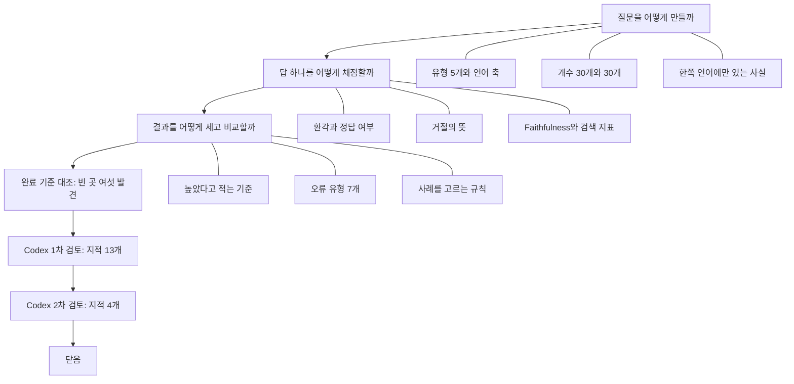

# 1단계 흐름 요약: 평가의 틀

이슈 #1 · 2026-10-12 ~ 2026-10-13 · 2026-10-13에 닫은 뒤 되짚어 씀

시스템을 만들기 전에 평가 방법부터 정했다. 정한 것은 세 묶음이다. 질문을 어떻게 만들까, 답 하나를 어떻게 채점할까, 여러 답의 결과를 어떻게 세고 비교할까.

결과물은 `EVALUATION.md` 한 문서와 빈 양식 두 개, 최종 평가셋 지시서다. 이 글은 그 과정을 다시 볼 때 읽는 글이다. 결론만이 아니라 처음에 어떻게 정했고, 무엇이 걸렸고, 그래서 어떻게 바꿨는지를 적는다. 규칙의 정확한 문장은 `EVALUATION.md`에 있다.

| 숫자 | 값 |
|---|---|
| 결정 줄 | 78 (질문셋 25, 채점 30, 집계와 분석 23) |
| 커밋 | 107 |
| Codex 지적 | 17 (검토 2번. 1차 13, 2차 4, 전부 반영) |

## 흐름

순서가 이렇게 된 이유: 채점 방법이 정해져야 그 계산에 필요한 칸(형식)을 정할 수 있다. 그래서 유형과 개수를 정한 뒤 채점을 먼저 정하고, 형식과 지시서를 뒤에 정했다.

## 1. 질문을 어떻게 만들까

### 질문 유형은 다섯 개, 교차 언어는 유형이 아니라 축

> 교차 언어는 유형에 넣지 않고, 질문마다 두 언어를 따로 적는다.

- **정한 것**: 유형은 단일 사실, 표·수치·조건, 여러 문서 연결, 답 없음, 표현 불일치다. 교차 언어(질문의 언어와 문서의 언어가 다른 경우)는 유형에 넣지 않았다. 대신 질문마다 질문 언어와 근거 문서 언어를 따로 적는다.
- **버린 것**: 교차 언어를 유형 하나로 두는 것.
- **이유**: 교차 언어는 어느 유형에서도 생긴다. 유형으로 두면 한 질문이 두 유형에 걸린다.
- **예**: 영어 문서에만 있는 사실을 한국어로 묻는 질문은 “단일 사실”이면서 “한국어 질문·영어 문서”다.

### 답 없는 질문의 뜻을 바꿨다 (사용자 지적)

> 문서를 보든 안 보든 답할 수 없는 질문으로만 만든다.

- **처음**: 코퍼스(모아 둔 문서 묶음)에 답이 없는 질문.
- **걸린 것**: 사용자가 지적했다. Baseline은 문서를 보지 않는다. 그래서 코퍼스에만 없고 세상에는 답이 있는 질문은 Baseline에게 답이 있는 질문이다.
- **정한 것**: 문서를 보든 안 보든 답할 수 없는 질문으로만 만든다. 이런 질문에 답을 냈으면 두 시스템 모두 오답이고 환각 있음이다.
- **예**: 코퍼스가 축구 문서뿐일 때 “농구는 한 팀이 몇 명인가”는 쓰지 않는다. Baseline이 “5명”이라고 맞게 답해도 환각으로 세어지기 때문이다.

### 개수: 최종 평가용 30개, 개발용 30개

> 개발용을 20개로 줄이라는 추천과 권고를 따르지 않았다.

- **정한 것**: 최종 평가용은 답 있는 질문 24개와 답 없는 질문 6개다. 24개는 언어 조합 네 개에 6개씩 똑같이 나눈다(단일 사실 1, 표·수치·조건 1, 여러 문서 연결 2, 표현 불일치 2). 개발용도 같은 구성으로 30개다.
- **버린 것**: 답 없는 질문 4개 안과 3개 안. 개발용 20개 안과 12개 안.
- **과정**: 개발용은 AI가 20개를 추천했고 Codex도 20개를 권했다. 사용자가 30개를 골랐고 검토 뒤에도 유지했다.
- **이유**: 20개로 줄이면 빠지는 것이 여러 문서 연결과 표현 불일치의 절반이다. 이 두 유형이 Agent의 재검색과 여러 청크 합성을 시험한다. 줄여서 아끼는 품은 Codex의 계산으로 1시간쯤이었다.
- **한계**: 표·수치·조건은 합계 4개라 이 유형만의 결론은 약하다.

### 답 있는 질문은 한쪽 언어 문서에만 있는 사실로 만든다

> 조건은 “문서 하나”가 아니라 “언어 하나”다.

- **정한 것**: 한 질문의 근거 구절은 모두 한 가지 언어의 문서에서 나와야 한다. 문서는 여러 개여도 된다. 반대 언어 문서에는 같은 사실이 없어야 한다.
- **이유**: 같은 사실이 두 언어 문서에 다 있으면, 시스템이 질문과 같은 언어의 문서만 찾아도 맞힌다. 그러면 다른 언어의 문서를 찾는 능력을 알 수 없다.
- **예**: 한국어 질문의 답이 한국어 문서와 영어 문서에 다 있으면, 영어 문서를 찾을 수 있는지는 이 질문으로 확인되지 않는다.
- **이 설계로 볼 수 없는 것**: 같은 사실이 두 언어에 다 있을 때 시스템이 어느 언어의 문서를 고르는가. 한국어 문서의 사실과 영어 문서의 사실을 합쳐야 하는 질문.
- **뒤에 생긴 일**: 코퍼스는 근거 문서 언어마다 이런 사실을 36개 내놓아야 한다. 처음에 24개로 계산했다가, 후보를 2배로 받는 것을 빼먹은 것이 드러나 36개로 고쳤다.

### 표·수치·조건의 뜻을 좁혔다 (Codex 지적)

> 답이 숫자이기만 한 질문은 이 유형이 아니다.

- **처음**: 답이 표에 있거나 수치이거나 조건이 붙은 질문.
- **걸린 것**: 답이 숫자인 질문이 전부 이 유형에 걸렸다. 단일 사실의 예로 적어 둔 창단 연도 질문부터 두 유형에 걸쳤다.
- **정한 것**: 답이 표에 있거나, 값이 여러 개 있어서 조건에 맞는 것을 골라야 하는 질문만 넣는다. 4개 가운데 답이 표에 있는 질문을 근거 문서 언어마다 1개 이상 넣는다.
- **사용자가 보탠 것**: 내가 정한 표 분할 규칙에 맞는 질문으로만 치우치면 안 된다. 그래서 어떤 모양의 표에서 만들지는 정하지 않았다.

### 질문 파일과 청크 번호를 나눴다 (완료 기준 대조 중 발견)

> 청크 번호는 코드가 만드는 연결 파일에 따로 적는다.

- **처음**: 질문 파일에 근거 청크의 번호(`chunk_ids`)를 적는 칸이 있었다.
- **걸린 것**: 최종 평가용 질문 파일은 3단계에서 해시(파일 내용에서 계산한 짧은 값)로 고정한다. 7단계에서 청크 번호를 채우면 파일이 바뀌어 해시가 달라진다.
- **정한 것**: 청크 번호는 질문 파일에 적지 않고, 코드가 만드는 연결 파일에 따로 적는다.

### 최종 평가셋은 사용자가 혼자 만든다 (사용자 지적)

> 후보를 2배로 받고, 막혔을 때 할 일을 미리 적어 두었다.

- **정한 것**: 웹 AI에게 후보를 칸마다 필요한 수의 2배(합쳐서 60개) 받는다. 글을 두 개 둔다. 웹 AI에게 주는 지시서와, 사용자가 따라갈 진행 안내다.
- **과정**: 사용자가 지적했다. 최종 평가용은 Claude가 볼 수 없으므로 문제가 생겨도 다시 물을 수 없다. 그래서 막혔을 때 할 일을 미리 적어 두었다.
- **순서**: 개발용을 먼저 만들어 규칙을 다듬고, 웹에서 연습을 한 번 한 뒤, 본 작업을 한다.

## 2. 답 하나를 어떻게 채점할까

### 환각과 Faithfulness는 다른 기준으로 잰다

> 환각은 정답과 근거 구절에, Faithfulness는 검색해 온 청크에 비춘다.

| | 무엇에 비추나 | 어느 시스템 |
|---|---|---|
| 환각 | 사람이 적어 둔 정답과 근거 구절 | 두 시스템 모두 |
| Faithfulness | 시스템이 실제로 검색해 온 청크 | Agent-RAG만 |

- **이유**: Faithfulness는 검색한 청크가 있어야 잴 수 있다. Baseline과 Agent-RAG의 환각을 비교하려면 두 시스템에 같은 기준이 있어야 한다.
- **예**: 문서에 기반하지 않고 맞힌 답은 환각이 아니고 정답이다. 대신 Faithfulness에서 드러난다.

### 환각 여부와 정답 여부를 따로 판정한다 (사용자 지적)

> 오답이라고 환각이 아니고, 정답에 섞인 환각도 센다.

- **정한 것**: 답마다 환각 여부(있음, 없음)와 정답 여부(네 값)를 따로 적는다. 오답이라고 환각으로 세지 않는다. 답은 맞지만 지어낸 내용이 섞인 답은 환각으로 센다.
- **환각의 뜻**: 주장을 정답과 근거 구절에 비춰 맞음, 어긋남, 확인 불가로 가른다. 어긋남만 환각이다. 확인 불가가 있는 답의 수는 따로 적는다.
- **버린 것**: 근거 구절에 없는 주장을 전부 환각으로 세는 것. Baseline이 사실을 말해도 전부 환각이 되기 때문이다.
- **예**: 근거 구절이 “1983년 창단”일 때 “1985년 창단”은 어긋남이다. “홈구장은 서울”은 확인 불가다.
- **한계**: 환각 비율이 실제보다 낮게 나올 수 있다.

### 정답 여부는 필수 사실로 판정한다

> 정답에 꼭 들어가야 하는 사실을 질문마다 목록으로 적는다.

- **정한 것**: 질문마다 정답에 꼭 들어가야 하는 사실을 목록으로 적는다. 다 있으면 정답, 일부만 있으면 일부만 답함, 하나도 없으면 오답이다.
- **이유**: 무엇이 다 들어 있어야 정답인지가 적혀 있어야 누가 판정해도 같게 갈린다.
- **근거 구절**: 필수 사실마다 붙여 적는다. 사용자가 정했다. “손이 더 가는 것은 중요하지 않고, 평가와 질문셋은 정확하고 근본적인 방법으로 해야 한다.”

### 거절의 뜻은 세 번 바뀌었다 (완료 기준 대조 중 발견, Codex 지적)

> 답하지 못한다는 말이 있고, 물은 것의 답을 내놓지 않은 답만 거절이다.

- **처음**: 주장이 없는 답.
- **첫 번째 변경**: 물은 것에 대한 답을 내지 않은 답. 전제가 틀린 질문에 “그런 것은 없다. 실제로는 이렇다”고 한 답에는 주장이 들어 있어서 처음 뜻으로는 정해지지 않았다. 거절에 붙은 설명은 보통의 주장처럼 채점한다.
- **두 번째 변경 · 완료 기준 대조 중 발견**: “확실하지 않지만 아마 1983년”처럼 모른다는 말과 답이 함께 있으면 답으로 본다. 거절로 보면 모든 답 앞에 그 말만 붙이는 시스템이 환각 0건이 된다.
- **세 번째 변경 · Codex 지적**: 거절은 답하지 못한다는 뜻의 말이 있고, 물은 것의 답을 내놓지 않은 답이다. 상관없는 이야기만 한 답은 거절이 아니라 오답이다. 고치기 전에는 답 없는 질문에 딴 이야기만 한 답이 거절로 세어져 성공이 됐다.
- **이름도 바꿨다**: “맞는 거절”은 “답이 없어서 거절”로, “틀린 거절”은 “답이 있는데 거절”로 했다. 사용자가 이름만 읽어도 상황이 보여야 한다고 했다.

### 검색 지표 두 개는 서로 다른 방법으로 낸다

> Precision@k는 코드가, 관련성 비율은 사용자가 읽고 판정한다.

| 지표 | 무엇으로 계산하나 | 누가 |
|---|---|---|
| Precision@k | 가져온 청크 가운데 근거 청크의 비율 | 코드 |
| 관련성 비율 | 가져온 청크 가운데 관련 있는 청크의 비율 | 사용자가 하나씩 읽고 판정 |

- **이유**: 과제가 두 지표를 따로 요구한다. 둘 다 근거 청크로 세면 거의 같은 숫자가 된다.
- **예**: 청크 5개 가운데 적어 둔 근거 청크가 1개, 적어 두지 않았지만 답에 쓸 수 있는 청크가 1개면 Precision@k는 1/5, 관련성 비율은 2/5다.
- **조건**: 둘 다 Agent-RAG만 잰다. 답 없는 질문은 뺀다. 검색이 여러 번이면 최종 답을 쓸 때 들어간 청크로 계산한다.

### “청크가 뒷받침한다”의 범위를 넓혔다 (Codex 지적 · 심각)

> 청크의 값으로 맞게 계산하거나 비교한 주장도 뒷받침되는 것이다.

- **처음**: 청크에 같은 내용이 적혀 있어야 뒷받침되는 주장이다.
- **걸린 것**: 답이 청크에서 벗어났는지가 아니라 글자를 그대로 옮겼는지를 재게 된다. 두 문서를 맞게 찾아 “축구가 더 많다”고 비교한 정답이 뒷받침 없음이 된다.
- **정한 것**: 청크에 적힌 값만으로 계산이나 비교를 해서 나오고 그 결과가 맞는 주장도 뒷받침되는 것이다. 청크 밖의 지식이나 해석이 필요하면 뒷받침되지 않는 것이다.

### 필요한 근거를 “다” 가져왔는지 본다 (Codex 지적 · 심각)

> 근거 청크가 하나라도 있는지가 아니라 전부 채워졌는지로 본다.

- **처음**: 근거 청크가 하나라도 있으면 검색에 문제가 없다고 봤다.
- **걸린 것**: 여러 문서 연결 질문에서 필요한 둘 가운데 하나만 가져와도 문제없음이 된다.
- **정한 것**: 필수 사실이 전부 채워져야 한다. 첫 검색은 전부 채워짐, 일부만 채워짐, 하나도 채워지지 않음 셋으로 나눈다.
- **보탠 것**: 채점하다가 질문 파일에 적어 두지 않은 근거를 발견하면 채점 기록(`other_evidence`)에 적고 인정한다. 사용자의 말로는 “미리 정한 해설 말고 다른 해설로도 풀 수 있는 것”이다. 질문 파일은 고치지 않는다.

### 질문과 다른 언어로 답한 경우

> 내용이 맞으면 정답으로 두고, 언어 혼동은 따로 판정한다.

- **정한 것**: 내용이 맞으면 정답으로 두고, 언어 혼동은 따로 판정한다. 이름(고유명사)을 원어로 쓴 것은 언어 혼동으로 세지 않는다.
- **이유**: 오답으로 판정하면 정답 비율이 내려갔을 때 내용 때문인지 언어 때문인지 알 수 없다.

## 3. 결과를 어떻게 세고 비교할까

### “높았다”고 적는 기준 (Codex 지적)

> 두 시스템의 비교는 결과가 갈린 질문이 한쪽으로 쏠린 정도로 판단한다.

- **처음 (잠정)**: 모든 비율에 흔들리는 범위(Wilson 구간, 95%)를 적고, 두 범위가 겹치지 않을 때만 “높았다”고 적는다.
- **걸린 것**: 범위끼리 비교하면 두 시스템이 서로 다른 질문을 푼 것처럼 계산된다. 같은 질문에서 누가 나았는지를 쓰지 않는다.
- **정한 것**: Baseline과 Agent-RAG의 비교는 결과가 갈린 질문이 얼마나 한쪽으로 쏠렸는지로 판단한다(McNemar 검정). 우연히 그만큼 쏠릴 확률이 5%보다 작을 때만 “높았다”고 적는다. 5%는 결과를 보기 전에 정한 기준이고 바꾸지 않는다.
- **예**: 결과가 갈린 질문이 6 대 0이면 우연히 그렇게 될 확률이 3.1%다. 그런데 두 범위는 겹쳐서, 처음 기준으로는 차이가 없다고 적게 된다.
- **따로 다루는 네 지표**: 주장이나 청크를 세는 네 지표(Faithfulness, 관련성 비율, Precision@k, 첫 검색의 Precision@k)는 범위를 질문을 통째로 다시 뽑는 방식으로 내고, 보여 주기만 하며 “높았다”의 판단에는 쓰지 않는다.

### 오류 유형 일곱 개 (완료 기준 대조 중 발견)

> 체크리스트에 처음부터 없던 일이다. 여러 개가 붙으면 전부 센다.

- **과정**: 이 이슈의 체크리스트에 처음부터 없던 일이다. 완료 기준을 대조하다가, 과제가 요구하는 오류 유형별 분류의 기준이 어디에도 없는 것을 발견했다.
- **정한 것**: Hallucination, 언어 혼동, 잘못된 청크 검색, 근거 부족, 답이 있는데 거절, 일부만 답함, 질문을 벗어난 답. 한 답에 여러 개가 붙으면 전부 센다.
- **사용자 지적**: “근거 부족”은 어떤 근거가 부족한지 명확히 정해야 한다. 그래서 둘로 갈랐다. 필요한 청크를 가져오지 못한 것은 잘못된 청크 검색(검색의 잘못)이고, 청크에 없는 말을 한 것은 근거 부족(답을 쓰는 모델의 잘못)이다.
- **버린 것**: 남는 실패를 “기타”로 묶는 것. 거절, 빠뜨림, 딴 이야기는 고칠 곳이 서로 다르기 때문이다.

### 한 숫자만 내세우지 않는다

> Hallucination 비율 옆에 정답 비율과 거절 비율을 나란히 적는다.

- **정한 것**: Hallucination 비율을 적는 곳에는 같은 시스템의 정답 비율과 거절 비율을 나란히 적는다.
- **이유**: 무엇을 물어도 거절하는 시스템은 Hallucination 비율이 0이라 그 숫자만 보면 가장 좋아 보인다.

### 심화 분석할 사례는 미리 정한 규칙으로 고른다

> 결과를 본 뒤에 설명하기 좋은 사례만 뽑지 않기 위해서다.

- **정한 것**: 성공은 정답 여부, 환각 여부, 언어 혼동 셋 다 문제없는 답이다. 실패 사례는 오류 유형마다 질문 번호가 가장 앞선 것을 고른다.
- **이유**: 결과를 본 뒤에 마음대로 고르면 설명하기 좋은 사례만 뽑게 된다.
- **3건이 안 될 때**: 개발용에서 채우고, 그래도 안 되면 멈추고 채우지 못했다고 리포트에 밝힌다.

### 결론의 범위와 기록의 원칙 (사용자)

> 관측한 결과로만 적고, 단계마다 따로 기록한다.

- 결론은 이 프로젝트의 코퍼스, 질문, 모델, 설정에서 관측한 결과로만 적는다. Agent-RAG 일반으로 넓히지 않는다.
- Agent-RAG는 단계마다 입력, 출력, 판단의 이유, 걸린 시간을 따로 기록한다. 어디가 문제인지 짚을 수 있어야 고칠 수 있기 때문이다.
- 응답 시간에는 판정 모델의 검사 시간을 넣는다. 불리한 결과이지만 그대로 적는다.

## 검토에서 있었던 일

- **검토의 제한을 풀었다.** 원래 Codex에게 “사용자가 이미 정한 결정은 뒤집으라고 하지 마라”는 제한이 있었다. 사용자가 “내가 정한 것에도 근본적인 문제가 있을 수 있지 않느냐”고 물었고, 1단계에 한해 제한을 풀었다.
- **1차**: 지적 13개(심각 5, 보통 8). 결정 자체에 대한 지적이 6개였다. 틀린 지적은 없었고 전부 반영했다.
- **2차**: 지적 4개(심각 2, 보통 2). 넷 가운데 셋은 1차 지적을 반영하며 하루 전에 넣은 규칙에서 나왔다. 전부 반영했다.
- **따르지 않은 권고**: 개발용 질문을 20개로 줄이라는 권고.

## 계획과 달라진 것

- 오류 유형 분류 기준을 더 정했다. 스텝퍼와 이슈 체크리스트에 없던 일이다.
- 2차 검토의 보통 지적 둘은 규칙대로면 미정 목록으로 넘길 것이었다. 지금 정할 수 있는 것은 미루지 않는다는 사용자의 판단으로 반영했다.
- 절차가 바뀌었다. 앞 단계의 결정 때문에 뒤 단계에 생긴 일은 미정 목록에 단계와 함께 적는다. 단계를 닫는 절차에 어드바이저 점검과 2차 검토 뒤의 반례 확인을 넣었다.

## 뒤 단계가 기대는 것

| 단계 | 1단계에서 가져다 쓰는 것 |
|---|---|
| 2 문서 | 한쪽 언어에만 있는 사실을 언어마다 36개, 언어마다 표 |
| 3 질문 | 유형의 뜻, 개수표, 질문 파일의 형식, 지시서와 진행 안내 |
| 4 설계 | 환각의 정의, 주장을 끊는 단위, 단계마다 기록한다는 원칙 |
| 5 지식 베이스 | 근거 구절을 청크에 잇는 연결 파일 |
| 6 시스템 | 개발용 답의 채점, 주장을 끊는 예를 보태는 일 |
| 7 평가 | 채점 기록의 칸, 지표 계산, “높았다”의 기준, 사례를 고르는 규칙 |

## 남은 것

- 2차 검토 뒤에 고친 네 곳은 다시 검토받지 않았다.
- 다시 채점해도 같은 결과가 나오는지는 답이 생기는 6단계에서 확인한다.
- 주장을 끊는 방법의 표는 완성이 아니다. 6단계에서 보태고 7단계 전에 고정한다.

## 다시 볼 곳

2026-10-13에 이 단계를 되짚으며 드러난 곳이다. 앞의 다섯 줄은 질문에 답해 본 결과이고, 뒤의 두 줄은 결정 표에 적혀 있던 것이다.

| 내용 | 상태 | 쓰이는 곳 |
|---|---|---|
| 답 없는 질문의 뜻과 바꾼 이유 | 기억나지 않음 | 3단계 |
| 한쪽 언어에만 있는 사실 조건 | “문서 하나”로 기억함. 실제는 “언어 하나” | 3단계 |
| 환각과 Faithfulness의 차이 | 같은 것으로 기억함 | 4단계 |
| 얼버무린 답을 답으로 보는 이유 | 결정은 기억함. 이유는 빠짐 | 6단계 |
| 관련성 비율 | 기억나지 않음 | 7단계 |
| 질문을 통째로 다시 뽑아 범위를 내는 방법 | 정할 때 방법을 정확히 이해하지 못한 채 정함(결정 표에 적힘) | 계산 코드를 만들 때 (실제 숫자로 다시 설명하기로 함) |
| 웹 연습에서 개발용이 물은 사실만 쓰는 조건 | 정할 때 설명을 정확히 이해하지 못한 채 정함(결정 표에 적힘) | 3단계 |

## 원본

- 규칙의 정확한 문장: [`EVALUATION.md`](../../EVALUATION.md)
- 결정과 이유: [`decisions/stage1-questions.md`](../../decisions/stage1-questions.md), [`decisions/stage1-scoring.md`](../../decisions/stage1-scoring.md), [`decisions/stage1-analysis.md`](../../decisions/stage1-analysis.md)
- 검토의 판단: [`decisions/judgments.md`](../../decisions/judgments.md)의 2026-10-12, 2026-10-13 줄
