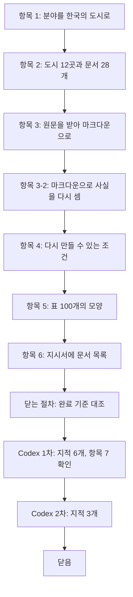

# 2단계 흐름 요약: 문서

이슈 #4 · 2026-10-13 ~ 2026-10-15

앞 단계에서 한 것: 평가의 틀을 정했고, 코퍼스(모아 둔 문서 묶음)가 근거 문서 언어마다 "한쪽 언어 문서에만 있는 사실"을 36개 내놓아야 한다는 수가 나왔다. 그래서 이 단계: 그 수를 채울 수 있는 문서 28개를 골라 프로그램으로 받고, 질문의 근거로 쓸 마크다운으로 바꿨다.

정한 것은 세 묶음이다. 어떤 문서를 쓸까(분야, 도시, 문서 목록), 원문을 어떻게 받고 바꿀까(남길 것과 지울 것, 표, 다시 만들 수 있는 조건), 그리고 닫는 절차에서 고친 것(Codex 검토와 사용자의 확인에서 드러난 것)이다.

결과물은 문서 목록(`data/corpus/documents.yaml`), 원본과 마크다운 28쌍, 수집·변환·검사 코드(`src/corpus/`), 질문의 재료가 될 사실 목록과 "질문에 쓰지 않는 사실" 목록(`research_notes/stage2_fact_count/`)이다. 이 글은 그 과정을 다시 볼 때 읽는 글이다. 규칙의 정확한 문장은 `decisions/stage2.md`에 있다.

| 숫자 | 값 |
|---|---|
| 문서 | 28 (한국어 14, 영어 14. 위키백과 16, 관광공사 명소 소개 글 10, 통계 표 2) |
| 결정 줄 | 41 (2단계 결정 40, 일하는 방식 1) |
| 판단 기록 줄 | 20 (2026-10-13 ~ 2026-10-14) |
| 커밋 | 107 (이슈 번호가 붙은 것. 번호 없는 커밋은 따로 "계획과 달라진 것"에) |
| Codex 지적 | 9 (검토 2번. 1차 6, 2차 3, 전부 반영) |
| 한쪽 언어 문서에만 있는 사실 | 한국어 87 (표에서 33, 여러 문서 연결 후보 65), 영어 100 (표에서 39, 연결 후보 64). 필요한 수는 36 (표 6, 연결 12) |
| 질문에 쓰지 않는 사실 | 35 (`excluded.json`) |

## 흐름

순서가 이렇게 된 이유: 문서 목록이 정해져야 받을 수 있고, 받은 원본이 있어야 마크다운의 규칙을 실제 글을 보며 정할 수 있다. 항목 3-2부터 6까지는 앞 단계에서 미정 목록에 넘겨 둔 일이거나 이 단계에서 정한 것 때문에 새로 생긴 일이라 뒤에 붙었다.

## 1. 어떤 문서를 쓸까

### 항목 1: 위키백과가 뼈대, 공공데이터포털은 보탬 (사용자 지적)

> 대상마다 위키백과 한국어 문서와 영어 문서를 받고, 포털은 같은 대상의 문서를 더한다.

- **처음**: 사용자는 공공데이터포털을 중심으로 쓰고 싶어 했다.
- **걸린 것**: AI가 포털을 범위를 정해 조사하니, 대상마다 두 언어로 충분히 긴 글을 주는 자료가 없었다. 이름에 "영문"이 든 파일 774개의 이름, 검색 16번, 설명 페이지 25개, 내려받은 파일 6개를 봤다.
- **정한 것**: 위키백과가 뼈대이고 포털은 같은 대상에 대한 문서를 보탠다. 사용자의 말: "두 소스를 함께 쓰면서 여러 출처의 문서를 처리하는 것을 배운다는 느낌으로 간다."
- **한계**: 영어 쪽 소스가 위키백과에 쏠린다. 포털의 표 자료는 한국어 통계뿐이다.

### 항목 1: 분야를 고르는 기준을 재기 전에 정했다 (사용자 지적)

> 방법이 중간에 세 번 바뀐 앞부분의 숫자는 버리고, 통과선을 먼저 적은 뒤 32개 분야를 한 프로그램으로 다시 쟀다.

- **처음**: AI가 후보를 스무 개 넘게 쟀으나 방법이 세 번 바뀌었다. 대상 3~4개에서 전체로, 위키 문법의 표에서 화면에 그려진 표로, 표가 있는지에서 한쪽 언어에만 있는 표인지로. 대상을 "한국의 것"으로 좁게 잡고 쟀다.
- **걸린 것**: 사용자가 여러 번 짚었다: 3개만 봐서 좋아 보이는 것 아닌가, 포털에 없을 분야를 왜 조사하는가. 범위는 "한국의 것"이 아니라 "한국 사람에게 친숙한 주제"라고 바로잡았다.
- **정한 것**: 재는 방법과 1차 통과선(두 언어 문서가 있는 대상, 본문 길이의 중앙값, 표가 있는 문서 수, 포털 자료)을 결과를 보기 전에 적었다. 사용자의 말: "이번에는 실제로 방향을 제대로 정한 것이니 정확하게 조사해줘." 32개 분야 가운데 17개가 1차를 통과했고, 두 언어 문서와 포털 자료가 모두 고른 도시부터 2차를 봤다.
- **선택지마다 달라지는 것**: 앞부분의 숫자를 썼다면 분야끼리 다른 방법으로 잰 값을 나란히 놓고 골랐을 것이다. 다시 재서 한 표에 같은 기준으로 놓였다.
- **한계**: 통과선의 "본문 5,000자"는 두 언어에 같은 글자 수를 적용했다. 사용자가 짚었다: 같은 내용이면 영어가 글자 수가 많다. 도시의 통과 여부는 바뀌지 않았고, 다른 분야의 판정은 다시 보지 않았다.

### 항목 1: 분야는 한국의 도시, 문서의 언어를 세 묶음으로 섞는다

> 두 언어 문서를 다 넣는 도시, 한국어 문서만 넣는 도시, 영어 문서만 넣는 도시를 섞는다.

- **정한 것**: 분야는 한국의 시다. 관광공사 관광정보를 한국어와 영어 모두 넣어 두 언어 모두 출처가 둘이 되게 한다. 사용자: "관광공사 자료는 처음부터 두 언어로 같이 했어야 한다."
- **이유**: 도시를 전부 두 언어로 넣으면 영어 문서의 사실 대부분(인구, 면적, 구단)이 한국어 문서에도 있어 쓸 수 없다. 한 언어로만 넣은 도시는 그 문서의 사실이 거의 전부 한쪽 언어에만 있게 된다.
- **두 언어 도시를 넣는 까닭**: 사용자가 물었다: 답은 어차피 한쪽 언어에만 있는 사실로 만드는데 왜 넣는가. 답: 답을 만드는 데 보태려는 것이 아니라 검색을 어렵게 하는 문서를 넣는 것이다. 한국어로 물은 사실이 영어 문서에만 있을 때, 같은 도시의 한국어 문서가 답 없이 위로 올라온다. 그때 시스템이 모자라다고 판단해 영어 문서까지 다시 찾아가는지를 볼 수 있다.
- **예**: 전주는 두 언어 문서를 다 넣는다. 한국어로 "전주 영화제의 연간 방문객"을 물으면 답은 영어 문서에만 있고, 검색에는 한국어 전주 문서가 먼저 걸린다.

### 항목 2: 도시 12곳을 4·4·4로, 포털 문서의 언어는 묶음에 맞춘다 (사용자 지적)

> 두 언어 도시 전주·청주·춘천·천안, 영어 도시 부산·제주·안동·강릉, 한국어 도시 수원·경주·세종·광주.

- **정한 것**: 4·3·3, 4·4·4, 2·4·4 가운데 4·4·4로 시작했다. 고르는 규칙 일곱 가지를 먼저 모아 정한 뒤 20곳에 적용했다(부산은 영어 도시, 전주는 두 언어 도시로 고정, 나머지는 위키백과 문서가 1만 자 이상인 도시 가운데 짧은 순).
- **포털 문서의 언어**: 사용자가 짚었다: 위키백과에서 영어만 쓰기로 한 도시에 포털에서 두 언어 문서를 가져오면 안 된다. 그래서 영어 도시에는 영어 명소 글만, 한국어 도시에는 한국어 명소 글만 넣는다.
- **과정**: AI가 중간에 두 언어 도시를 2곳으로 줄이자고 했다가 거두었다. "대조할 양이 절반이 된다"는 근거가 틀렸다. 대조하는 양은 도시 수가 아니라 뽑는 질문 수로 정해진다(사용자의 지적). 규칙을 한꺼번에 모은 것도 사용자의 요구다: "먼저 고려할 것이 더 있는지 먼저 정하자, 같은 일을 여러 번 하지 말자."
- **한계**: 묶음을 채운 순서는 AI가 정했고 순서를 바꾸면 도시가 달라진다.

### 항목 2: 한쪽 언어에만 있는 사실을 세어 도시 구성을 확인했다

> 서브에이전트가 문서마다 사실을 뽑고, 프로그램이 원문과 반대 언어 문서에 대조해 셌다.

- **정한 것**: 세는 방법을 세기 전에 적었다. 사실마다 원문 구절을 글자 그대로 옮기게 하고(지어낸 사실을 막으려고), 반대 언어 문서에 같은 사실이 있는지는 같은 도시가 아니라 코퍼스 전체와 대조한다.
- **바꾼 것**: 반대 언어 문서에서 낱말을 찾는 검사는 결과를 본 뒤 한 번 고쳤다. 처음 규칙으로는 279개 가운데 194개가 걸렸고 대부분 상관없는 자리의 같은 연도였다. 이 고침은 결과를 보고 한 것이라 기록에 그렇게 적었다.
- **한계**: 문서마다 20개까지만 뽑았으므로 문서의 사실 전체를 센 것이 아니다. 판정은 서브에이전트와 AI가 했고 사용자의 대조를 거치지 않았다. 여러 문서 연결은 같은 종류의 사실이 여러 문서에 있다는 재료까지만 봤다.

### 항목 2: 문서 28개와 두 영어 소개 글의 제한

> 위키백과 16개, 관광공사 명소 소개 글 10개, 통계 표 2개. 전주 한옥마을과 천안삼거리공원의 영어 소개 글은 근거로 쓰지 않는다.

- **정한 것**: 두 언어 도시는 명소 글을 읽고 한쪽 언어에만 있는 사실이 있는 곳을 고른다는 규칙을 먼저 적었다.
- **걸린 것**: 전주와 천안은 영어 글이 한국어 글을 줄여 옮긴 것이라 규칙에 맞는 명소가 없었고, 사용자에게 가져왔다.
- **정한 것**: 그대로 넣되, 두 영어 글은 정답의 근거로도 답 없는 질문의 반박 구절로도 쓰지 않는다(반박 구절까지 넓힌 것은 항목 6에서 사용자가 정함). 명소 글의 역할은 출처를 둘로 만드는 것이기 때문이다.
- **선택지마다 달라지는 것**: 막지 않았으면 3단계에서 사용자가 영어 구절을 읽어 가려내야 했다. 막아서 후보의 문서 이름만 찾으면 된다(안내서의 손 확인).

## 2. 원문을 어떻게 받고 바꿀까

### 항목 3: 정보 상자를 남긴다 (사용자 지적)

> 문서 맨 위의 요약 칸(정보 상자)은 지우지 않는다.

- **처음**: AI는 정보 상자를 지우자고 했다. 사실을 다시 세지 않아도 된다는 이유였다.
- **걸린 것**: 사용자가 16개 문서를 직접 열어 보고 "문제 때문에 문서의 내용을 일부러 없앨 수는 없다"고 했다. 정보 상자에는 면적·인구처럼 가장 기본이 되는 사실이 있고 본문에 없는 줄도 있다.
- **정한 것**: 정보 상자의 글자로 된 줄을 남긴다. 그래서 마크다운으로 사실을 다시 세는 일(항목 3-2)이 생겼다. 다시 세니 통과선을 넘었고, 정보 상자와 본문의 값이 다른 곳(경주·광주의 면적 등)은 질문에 쓰지 않는 값이 되었다.
- **뒤에 바뀐 것**: 정보 상자의 줄을 묶음 아래로 들여 쓰게 했다. 사용자가 전주 마크다운을 보고 "행정 안에 행정 구역이 들어 있는 것인데 따로 표현해야 하지 않나"라고 물었다.

### 항목 3: 표는 합친 칸을 되풀이하고 빈 열을 지운다 (사용자 지적)

> 마크다운 표는 칸을 합칠 수 없어서, 합친 칸의 글자를 걸친 모든 칸에 되풀이한다.

- **정한 것**: 사용자가 문서의 표를 열어 보고 항목마다 정했다. 합친 칸은 되풀이하고, 머리글을 뺀 모든 줄에서 글자가 없는 열은 머리글까지 지운다(사용자가 수원의 빈 "비고" 열을 빼라고 한 것을 규칙으로 넓힘). 칸 안에 목록이 든 틀 같은 표는 표로 옮기지 않고 내용을 위에서 아래로 적는다.
- **이유**: 합친 칸을 첫 줄에만 적으면, 줄을 떼어 읽을 때 뜻을 잃는다.
- **예**: 수원의 교류 도시 표에서 "자매도시"가 세로 19줄에 걸쳐 있다. 첫 줄에만 적으면 아래 18줄은 자매도시인지 우호도시인지 알 수 없다.
- **뒤에 바뀐 것**: 규칙을 코드로 옮기며 생긴 빈 곳 둘을 닫는 절차에서 고쳤다(묶음 3).

### 항목 3, 4: 받는 일과 바꾸는 일을 나누고, 원본을 고정한다

> 인터넷에서 처음 받는 것과, 저장한 원본에서 마크다운을 다시 만드는 것을 다른 일로 본다.

- **정한 것**: 받는 프로그램(`fetch.py`)과 바꾸는 프로그램(`build.py`)을 나눴다. 원본 28개를 저장소에 고정하고, 마크다운은 그 원본에서 만든다. "다시 실행하면 같은 코퍼스가 나온다"는 원본에서 다시 만든 마크다운의 해시(파일 내용에서 계산한 짧은 값)가 같은 것으로 확인한다.
- **이유**: 위키백과 16개를 같은 판 번호로 다시 받아 보니 바이트가 같은 것은 2개뿐이었다. 다른 곳은 HTML 주석 안의 서버 이름과 시각이었고, 주석을 빼면 16개 모두 같았다. 그래서 다시 받는 것은 해시로 검사할 수 없다.
- **뒤 단계와의 관계**: 3단계의 근거 구절은 마크다운에서 글자 그대로 옮기고, 7단계는 그 구절이 든 청크로 채점한다. 문서가 몰래 달라지면 근거 구절이 문서에 없게 된다.

### 항목 4: 손으로 고친 파일은 커밋되지 않게 막는다 (사용자 지적)

> 커밋 직전에 저장할 원본과 변환 코드로 마크다운을 다시 만들어 기록과 견주고, 다르면 커밋을 막는다.

- **처음**: AI는 검사가 도는 조건을 "문서 파일이 커밋에 있을 때" 하나로 잡았다.
- **걸린 것**: 변환 코드만 고친 커밋이 그대로 통과한다. 사용자가 "한계를 보완하고 더해야 하는 거 아니냐"고 짚었다.
- **정한 것**: 문서 파일, 변환 코드, 라이브러리·파이썬 버전 파일 가운데 하나라도 커밋에 있으면 검사가 돈다. 작업 폴더가 아니라 커밋에 올릴 판으로 다시 만들어 견준다.
- **선택지마다 달라지는 것**: 처음 조건이었으면 변환 규칙을 고치고 마크다운을 다시 만들지 않은 채 커밋해도 아무도 몰랐다. 넓힌 뒤에는 그 커밋이 거부된다.
- **과정**: 일부러 파일을 고쳐 시험했다. 손으로 고친 원본, 손으로 고친 마크다운, 변환 코드만 바꾼 커밋이 모두 거부됐다.

### 항목 5: 표는 먼저 다 본 뒤 모양으로 나눴다 (사용자 지적)

> 마크다운 표 100개를 원문 표와 짝지어 모양별로 셌다. 나누는 방법은 4단계에서 정한다.

- **정한 것**: 표를 먼저 다 본 뒤 실제로 있는 모양으로 나눴다. 사용자: "표를 먼저 다 확인하고 그것에 맞게 나눠야." 사용자가 따로 볼 모양마다 예 하나를 원문 화면으로 열어 확인했다.
- **본 것**: 앞 단계에서 걱정한 "한 칸에 값이 둘 들어 줄끼리 짝을 이루는 표"는 0개였다. 4단계에서 따로 볼 모양은 처음 8개였고, 닫는 절차에서 춘천 고등학교 표를 고쳐 7개가 되었다.
- **예**: 청주 "도로" 절의 고속도로 표는 열의 제목 줄이 없다. 그래서 마크다운에서는 첫 줄(내용)이 머리글 자리에 놓인다.

## 3. 닫는 절차에서 고친 것

### 닫는 절차: 표에서 글자가 사라진 것을 고쳤다 (Codex 지적)

> 머리글이 없는 표에서 첫 줄에만 글자가 있는 열이 지워지고 있었다.

- **걸린 것**: 빈 열을 지우는 규칙은 "머리글을 뺀 모든 줄"을 보는데, 코드가 머리글이 없는 표에서도 첫 줄을 머리글로 봤다. 청주 "일반 도로" 표의 `36 국도 제36호선`과 춘천 "교육 기관" 표의 `한국방송통신대학교 강원지역대학`이 사라졌다. 검사 27가지가 이것을 잡지 못했다.
- **정한 것**: 첫 줄의 칸이 전부 머리글 칸(`th`)일 때만 머리글로 본다. 고친 뒤 원본 표의 칸 글자가 마크다운에 남았는지 표 전체에서 견줬고, 사라진 것은 아래가 빈 진짜 머리글(비고, 지도 등)뿐이었다.
- **뒤에 이어진 것**: 사용자가 바뀐 표를 열어 보다가 춘천 고등학교 표의 빈 첫 줄(`고등학교` 칸 하나와 빈칸 5개)을 짚었다. 원본 줄의 칸이 전부 아래로 걸친 칸뿐이면 그 줄을 빼는 규칙을 더했다. 원본 표 99개를 프로그램으로 찾으니 이런 줄은 이것 하나였다.

### 닫는 절차: 질문에 쓰지 않는 사실을 사실마다 찾았다 (Codex 지적, 사용자 지적)

> 대조 없이 통과된 사실과, 같은 문서 안에서 값이 부딪히는 사실을 다 찾아 뺐다.

- **처음**: Codex가 두 가지를 짚었다. 찾을 낱말이 없어 대조 없이 "통과"된 사실 9개가 있었고, 질문에 쓰지 않기로 한 값 5개가 통과 수에 들어 있었다.
- **첫 번째 변경**: AI가 9개를 "확인 안 함"으로 표시하고 3단계로 넘기자고 했다. 사용자가 짚었다: "너가 할수 있는거 아니야? … 어쩌피 지금 안하면 이후에 해야되는거 아니야?" AI가 반대 언어 문서에서 그 도시가 나오는 자리를 다 읽었고, 9개 모두 반대 언어 문서에 없는 사실이었다.
- **두 번째 변경**: Codex가 든 5개만 빼지 않고 정한 규칙 전부를 사실 222개에 하나씩 댔다. 사실마다 같은 문서 안에 다른 값이 있는지를 문서 16개로 나눠 서브에이전트에게 맡겼다.
- **정한 것**: 합계 줄이나 부분합 줄이 서로 맞지 않으면 그 줄은 쓰지 않는다. 문서에 한 번만 나오는 줄의 값은 쓴다. 사용자: "그안에 내용이 틀리는지는 우리가 알수없어."
- **예**: 천안 2019년 표에서 서북구 400,566명과 동남구 264,312명을 더하면 664,878명인데 총계는 683,453명이다. 그래서 서북구·동남구·총계는 쓰지 않는다.

### 닫는 절차: 양이 많은 확인은 나눠서 맡기고 빠진 것을 센다 (사용자 지적)

> 서브에이전트 하나에 문서 하나, 사실 목록을 주고 사실마다 답하게 한 뒤 빠진 번호를 프로그램으로 센다.

- **정한 것**: 처음부터 작은 범위로 나눈다. 인용은 원문에서 글자 그대로 옮기게 하고, 빠진 항목과 인용을 프로그램으로 검사하며, 일부는 AI가 직접 해서 대조한다.
- **이유**: 사용자: "이것이 하나 빠지고 진행하고 맞다고 하면 다시 돌아와야하는 비용이 많이 들어서, 애초에 처음에 이런식으로 비용이 들더라도 범위를 나눠서 정확하게 다 진행하는게 맞다." 이 단계에서 일부만 본 일이 있었다(명소 글 163개 가운데 19개만 읽음).
- **선택지마다 달라지는 것**: 한 번에 맡기면 빠진 사실이 있어도 모른다. 나눠서 맡긴 뒤에는 전주 영어 문서를 맡은 서브에이전트가 문서를 끝까지 읽지 않은 것이 드러나 다시 맡겼다.

### 닫는 절차: 최종 평가용 지시서에도 같은 규칙을 넣었다 (어드바이저 지적)

> 웹 AI가 원문에서 직접 질문을 만들기 때문에, 부딪히는 값을 쓰지 말라는 규칙과 알려진 목록을 지시서와 안내서에 넣었다.

- **걸린 것**: "질문에 쓰지 않는 사실" 목록은 AI가 뽑아 둔 사실에서 고르는 개발용에만 쓰인다. 최종 평가용은 웹 AI가 문서 전체에서 값을 고르고, AI는 7단계 전에 그 후보를 볼 수 없다.
- **정한 것**: 지시서에 규칙을, 안내서에 사용자가 후보마다 할 확인과 "알려진 부딪히는 값" 목록을 넣었다. 목록은 프로그램으로 만든다.
- **한계**: 목록은 뽑아 둔 사실에서 찾은 것이라 일부다. 웹 AI가 규칙을 지키는지는 3단계 웹 연습에서 처음 알 수 있다. 사용자: "일단 이렇게 하고 여기서 잘 안되는 부분은 그때 가서 보완을 해야한다는거지?"

### 닫는 절차: 반올림한 값도 다른 값으로 본다 (Codex 지적, 사용자 지적, 어드바이저 지적)

> 같은 대상의 값이 반올림, 버림, "약", 덜 자세한 표기로 다르게 적혀 있어도 질문에 쓰지 않는다.

- **처음**: Codex 2차가 반대로 제안했다. 반올림해서 같아지는 값(경주의 1,091mm와 1,090.9mm)은 같은 값으로 보는 예외를 지시서에 넣으라는 것이었다.
- **걸린 것**: 사용자가 짚었다: 465.96과 465도 1,091과 1,090.9만큼 차이가 있다고 느끼지 못한다, 상황마다 너무 다르다. 사용자는 둘 다 가능하다고 보고 어드바이저 점검을 청했다.
- **정한 것**: 예외 없이 모두 뺀다. 어드바이저: 빼는 것은 무엇을 재는지만 바꾸고 시스템이 하는 일은 바꾸지 않는다. 두 값을 다 인정하려면 1단계에서 닫은 채점 규칙을 새로 정해야 한다. 덜 자세한 표기("1986년 11월"과 "1986년")도 같은 규칙으로 뺐다. 사용자: "반올림·버림·'약'에 대한 규칙을 일관되게 하기 위해서는 가로 가는게 맞는것 같아."
- **선택지마다 달라지는 것**: 예외를 두면 웹 AI와 사용자가 후보마다 반올림인지 버림인지 어림인지를 갈라야 하고, 채점자가 두 값 가운데 정답을 골라야 한다. 모두 빼면 그 판단이 없어지고 질문은 정답이 하나인 것만 남는다.
- **한계**: 사용자가 물었다: 채점에 맞게 질문을 고르면 점수가 잘 나오게 하는 치우침이 아닌가. 빼는 기준은 시스템을 돌리기 전에 정한 "정답이 하나로 정해지는가"라서 점수를 고른 것은 아니다. 그래도 실제 문서에는 이런 어긋남이 흔해서 점수가 실제보다 좋게 나올 수 있다. 리포트의 한계로 적고, 값이 어긋나는 문서를 다루는 능력은 다음에 할 것으로 남긴다. 사용자: "우리가 정한 방향이 아니니까 이후 개선사항."

## 세부로 정한 것

- 항목 2: 문서 목록 파일은 YAML이고 `doc_id`는 `출처-언어-도시[-대상]` 모양이다(예: `wiki-ko-suwon`).
- 항목 2: 사용자에게 설명할 때 "한국어 도시"처럼 줄이지 않고 "한국어 문서만 넣는 도시"라고 한다 (사용자 지적)
- 항목 3: 위키백과의 이용 조건(CC BY-SA 4.0)을 확인했고, 출처 주소·이용 허락·고쳤다는 사실을 수집 기록에 적는다.
- 항목 3: 위키백과 마크다운에도 맨 위에 `# <제목>`을 붙인다 (사용자 지적)
- 항목 3: 정보 상자의 웹사이트 줄은 화면의 글자가 아니라 링크의 주소로 적는다 (사용자 지적)
- 항목 3: 표의 가로 전체를 차지하는 출처 줄은 표 바로 아래 한 줄로 뺀다 (사용자 지적)
- 항목 3: 관광공사 글은 제목, 주소, 홈페이지, 소개 글만 남긴다.
- 항목 3: 위키백과에서 받을 때 User-Agent, 한 번에 하나씩, `maxlag`, 429 처리를 지킨다.
- 항목 4: 이미 받은 문서를 다시 받는 `--force`는 문서 이름을 지정할 때만 받는다.
- 항목 4: `.python-version`에 파이썬 버전을 끝자리까지 적는다(`3.11.16`).
- 항목 4: 다시 받은 원본을 고정 원본과 견주는 도구는 만들지 않는다. 같은 판을 다시 받는 일이 없기 때문이다.
- 항목 6: 지시서의 "1. 내가 올린 것"에 문서 28개의 표를 넣고, "문서 목록을 따로 올린다"로 읽히던 문장을 고쳤다.
- 닫는 절차: 커밋 직전 검사에서 버전 파일의 커밋에 올릴 판과 작업 폴더의 판이 다르면 막는다 (Codex 지적)
- 닫는 절차: 표 조사의 원문 표 수를 위키백과 HTML 123과 통계 표 CSV 2로 나눠 적고, 판단 기록의 19·3·1을 18·4·1로 고쳤다 (Codex 지적)
- 닫는 절차: 강릉의 "1995년에 시로 설치" 사실을 "1995년에 명주와 합쳐졌다"로 고쳤다가, 덜 자세한 값 규칙으로 뺐다 (Codex 지적)

## 검토에서 있었던 일

- **완료 기준 대조**: 항목 1~6은 기준을 채웠다. 다만 "사용자가 마지막 마크다운을 열어 확인했다"를 바로 적은 기록이 없었다. 사용자가 확인했다고 말해 기록했고, 고친 표 세 곳은 사용자가 위키백과 화면과 견줬다.
- **Codex 1차**(지적 6, 심각 1): 표에서 글자가 사라진 것(심각), 대조 없이 통과한 사실, 질문에 쓰지 않는 값이 들어간 수, 커밋 직전 검사의 버전, 사용자 확인 기록, 표 조사의 숫자. 전부 사실이었고 전부 반영했다. 항목 7(Codex가 나눈 결정 파일을 실제로 여는지)은 통과였다. Codex는 결정 파일을 줄 범위를 정해 열고 인용했다.
- **Codex 2차**(지적 3, 모두 보통): 1차 6개는 모두 해소됨. 새 지적 셋 가운데 강릉은 절반 맞았고, 천안은 근거만 틀렸으며, 반올림은 반대 방향으로 반영했다. 규칙상 2차에서는 심각한 지적만 반영하지만 셋 다 지금 고칠 수 있어 사용자가 지금 반영하기로 정했다.
- **2차 뒤**: Codex의 반례 셋을 고친 결과에 넣어 따라갔고 의도한 결과가 나왔다. 어드바이저가 더 짚은 것(덜 자세한 값의 규칙, 다른 모양을 안 본 사실 15개, AI의 직접 대조)도 처리했다. 2차 뒤에 고친 것은 Codex의 검토를 받지 않았다.

## 계획과 달라진 것

- 분야 조사를 한 번 버리고 다시 했다. 방법이 세 번 바뀐 앞부분의 숫자는 근거로 쓰지 않았다.
- 이슈의 일이 항목 1~3에서 3-2, 4, 5, 6, 7까지 늘었다. 정보 상자를 남기기로 해서 3-2가 생겼고, 나머지는 미정 목록에서 옮겨 왔다.
- 닫는 절차에서 고친 것이 많았다. 변환 규칙 둘, 질문에 쓰지 않는 사실 35개, 지시서와 안내서의 규칙이 닫는 절차에서 들어갔다.
- 이슈 번호 없는 커밋이 이 브랜치에 들어갔다. 흐름 요약 장치의 커밋(사용자가 정한 이번 한 번의 예외), `f9763fe`(나눠서 맡기는 결정), `3df5a44`(흐름 요약 스킬을 설명 모양에 맞춤)다.

## 뒤 단계가 기대는 것

| 단계 | 2단계에서 가져다 쓰는 것 |
|---|---|
| 3 질문 | 마크다운 28개, 사실 목록과 "질문에 쓰지 않는 사실" 35개, 지시서·안내서의 규칙과 알려진 부딪히는 값 목록, 두 영어 소개 글의 제한 |
| 4 설계 | 표 모양 7개와 표 위 제목 줄을 청크에 붙일지, 답에 출처 문서를 밝힐지 |
| 5 지식 베이스 | 고정 원본에서 `build.py`로 마크다운을 다시 만드는 출발점, 커밋 직전 검사 |
| 8 리포트 | 값이 어긋나는 문서를 재지 못한다는 한계와 다음에 할 것 |

## 남은 것

- 영어 문서에 근거가 있는 질문을 사용자가 어떻게 대조할지 (3단계를 시작할 때)
- 여러 문서 연결 질문을 언어마다 12개 실제로 만들 수 있는지 (3단계)
- 기준 날짜가 다른 값을 날짜를 넣어 쓸지 (3단계)
- 웹 AI가 부딪히는 값 규칙과 두 영어 글의 제한을 지키는지, 영어 문서에서 다른 값을 찾는 방법 (3단계 웹 연습)

## 다시 볼 곳

| 내용 | 상태 | 쓰이는 곳 |
|---|---|---|
| 천안 서북구를 빼는 근거가 "아래 동들의 합"이 아니라 "두 구의 합과 총계"인 까닭 | 사용자가 물어 설명함 | 3단계 |
| 강릉이 1955년에 시가 되고 1995년에 명주와 합친 것과 본문 문장의 차이 | 사용자가 물어 설명함 | 3단계 |
| 반올림·어림을 다른 값으로 볼지 | 사용자가 "솔직히 나도 모르겠어"라고 한 뒤 어드바이저 점검을 거쳐 정함 | 3단계, 8단계 리포트 |
| 질문을 빼는 것이 점수를 좋게 하는 치우침인가 | 사용자가 물어 설명함 | 8단계 리포트 |

## 원본

- 결정: `decisions/stage2.md` 전체, `decisions/common.md`의 2026-10-14 줄
- 판단: `decisions/judgments.md`의 2026-10-13 ~ 2026-10-14 줄
- Codex 검토: 이슈 #4를 닫을 때 커밋한 `CODEX_REVIEW.md`(git 기록에 남는다)
- 조사와 계산: `research_notes/stage2_domain_survey/`, `stage2_attraction_survey/`, `stage2_fact_count/`, `stage2_markdown_rules/`, `stage2_table_shapes/`
- 코퍼스와 코드: `data/corpus/`, `src/corpus/`, `.githooks/pre-commit`
- 지시서와 안내서: `data/questions/final_set_instructions.md`, `final_set_guide.md`
