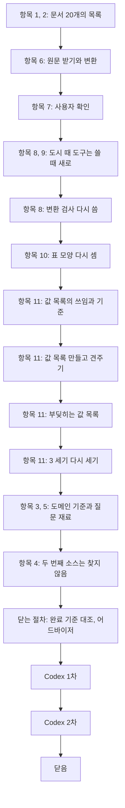

# 2단계 흐름 요약: 희토류 원소 문서 목록·수집·변환

이슈 #7 · 2026-10-22 ~ 2026-10-22

앞 단계에서 한 것: 이슈 #6에서 도메인(코퍼스가 다룰 주제 영역)을 희토류 원소로 정하고, 위키백과 문서 20개와 그 판을 골랐다. 그래서 이 단계: 그 20개를 받아 마크다운 코퍼스로 만들고, 도시 코퍼스로 만들었던 부딪히는 값 목록과 검사를 새 코퍼스에 맞게 새로 만들었다.

정한 것은 세 묶음이다. 첫째, 코퍼스를 만드는 일이다. 문서 목록의 칸, 사용자가 연 두 문서에서 나온 변환 규칙, 도시 때 도구를 다루는 법이 여기 든다. 둘째, 부딪히는 값 목록이다. 같은 대상의 같은 양이 문서마다 다르게 적힌 값(부딪히는 값)을 모든 값에서 찾았고, 그 목록을 빼고도 한쪽 언어 사실이 충분한지 다시 셌다. 셋째, 남은 도메인 기준과 두 번째 소스다.

결과물은 코퍼스 20개(`data/corpus/`), 부딪히는 값 213개(`data/questions/known_conflicts.json`), 그것을 만든 값 목록과 프로그램(`research_notes/stage2_values_rare_earth/`)이다. 3단계 질문 검사가 이 목록으로 답이 갈리는 질문을 떨어뜨린다. 이 글은 그 과정을 다시 볼 때 읽는 글이다. 항목 번호는 이슈 체크리스트의 차례(위에서부터 1~11)다. 규칙의 정확한 문장은 `decisions/stage2.md`에 있다.

| 숫자 | 값 |
|---|---|
| 코퍼스 | 20 (한국어 10, 영어 10. 두 언어 주제 5, 한국어만 5, 영어만 5) |
| 결정 줄 | 12 (2단계 11, 일하는 방식 1) |
| 판단 기록 줄 | 10 (2026-10-22 "희토류 원소 문서 20개를 받았다" 줄 ~ "이슈 #7 Codex 2차 검토" 줄) |
| 커밋 | 51 (이슈 번호가 붙은 것, 이 흐름 요약을 넣기 전까지) |
| 값 목록 | 자리 4,042 (정보 상자 619, 표 2,769, 본문 654) |
| 견주기 | 738 (곳이 둘 이상인 묶음. 같음 452, 다름 286. 다름 가운데 AI가 읽은 199: 부딪힘 125, 부딪힘 아님 74. 읽지 않아도 된 87. Codex 1차 반영 뒤의 수) |
| 부딪히는 값 | 213 (읽지 않아도 된 다름 87, 판정한 부딪힘 125, 손으로 더한 1. Codex 1차 전에는 209) |
| 한쪽 언어 사실 | 한국어 20, 영어 18 (부딪히는 값과 후보 검사가 막는 것을 빼고 셈. 표는 한국어 15, 영어 5. 영어는 17에서 2개를 더 확인해 18. 기준은 언어마다 18, 표 3. 한국어는 Codex 1차 전에 21) |
| 질문 재료 | 언어마다 12와 6 (여러 문서 연결 12, 표·수치·조건 6. 표·수치·조건 가운데 표 칸은 한국어 3, 영어 4) |
| Codex 지적 | 4 (검토 2번. 1차 3: 보통 2, 낮음 1. 2차 1: 낮음. 모두 반영) |

## 흐름

순서가 이렇게 된 이유: 문서를 받아 마크다운으로 바꾼 뒤에야 사용자가 열어 볼 수 있었고, 사용자의 지적으로 변환이 바뀌어 표 모양과 값은 바뀐 마크다운에서 다시 셌다. 부딪히는 값 목록은 모든 값을 견줘야 해서 코퍼스가 굳은 뒤에 만들었다. 3 세기(이슈 #6에서 도메인을 고를 때 AI가 원문과 대조해 한쪽 언어 사실을 센 단계)의 사실이 충분한지는 이 목록이 있어야 다시 셀 수 있었고, 질문 재료도 이 목록에 걸리지 않는 값에서 골랐다.

## 1. 코퍼스 만들기

### 항목 1, 2: 문서 목록의 칸은 주제 하나와 갈래 (사용자 지적)

> 문서마다 다루는 주제 하나(`topic`)와 그 주제를 어느 언어 문서로 넣었는지(`branch`: 두 언어, 한국어만, 영어만)를 적는다.

- **정한 것**: 도시 때의 `city`를 `topic`으로, `city_group`을 `branch`로 바꿨다. 아무 프로그램도 읽지 않던 `kind`는 뺐다. 도시 코퍼스를 옛 변환에 묶던 칸은 지웠다.
- **이유**: 이번 코퍼스는 문서 하나가 주제 하나다. 대상이 모두 원소는 아니어서(중성자 포획 치료, 사마륨-코발트 자석) 이름을 `topic`으로 했다. 사용자의 말: "희토류 대상 하나로 해도 되지 않을까".
- **예**: `wiki-ko-erbium`은 주제 "어븀", 갈래 "한국어만"이다. 영어 어븀 문서는 코퍼스에 없다.

### 항목 6, 7: 사용자가 연 두 문서의 지적을 변환 규칙으로 (사용자 지적)

> 사용자가 한국어 툴륨과 터븀 동위 원소 문서를 위키백과와 나란히 보고 지적한 것을, 그 문서만이 아니라 같은 꼴의 문서 20개 모두에 쓰는 변환 규칙으로 고쳤다.

- **과정**: 원문 20개를 받아 바꾸니, 3 세기에 쓴 것과 같은 판인데도 원소 문서 14개의 HTML이 달랐다. 위키백과가 지금의 틀로 다시 그려 보내기 때문이다. 바뀐 곳은 동위 원소 존재비 퍼센트뿐이라 3 세기 판정은 바뀌지 않았다. 사용자는 툴륨에서 "주기율표를 그냥 나열한것이기 때문에 필요하지 않을것 같음", "1 (pa)의 해당하는 온도가 1117(K)인데 그것을 구별할수가 없다"고 했고, 터븀 동위 원소에서 "표의 마지막 열은 아무것도 들어가있는 값이 없어서 없애도 될 것같아"라고 했다.
- **정한 것**: 주기율표 그림은 지운다. 정보 상자 안의 작은 표(증기 압력, 주요 동위원소)는 한 줄로 늘어놓지 않고 그 자리에 마크다운 표로 옮기고, 앞에 표 이름 줄을 둔다. 데이터 칸이 모두 빈 열은 지운다.
- **이유**: 한 줄로 늘어놓으면 어느 값이 어느 열인지 알 수 없어 질문의 근거가 되지 못한다.
- **한계**: 사용자는 한국어 문서 2개만 열어 봤다. 영어 10개와 나머지 한국어 8개는 같은 규칙과 변환 검사로만 봤다.

### 항목 10: 값 칸 안의 줄바꿈은 ` / `로

> 정보 상자와 표의 값 칸 안의 줄바꿈은 빈칸 대신 ` / `로 바꾼다. 머리글 칸, 통째로 괄호인 조각, 본문의 줄바꿈은 그대로 빈칸이다.

- **처음**: 줄바꿈을 모두 빈칸으로 바꿨다. 표 모양을 다시 세다가 서로 다른 값이 빈칸으로 붙은 것을 찾았다(`wiki-ko-yttrium.md`의 `0.48 0.38D`).
- **걸린 것**: 모든 줄바꿈을 바꾸는 안을 20개에 돌리니 68줄이 바뀌었고, 본문 화학식과 표 머리글이 망가졌다.
- **정한 것**: 값 칸만 바꾸고 나빠지는 꼴을 예외로 뺐다. 다시 돌려 24줄만 바뀌는 것을 확인했다. 사용자는 바뀌는 줄을 파일에서 보고 "그렇게 해줘"라고 했다.
- **예**: `wiki-en-thulium.md`의 `common: +3 +1, +2`가 `common: +3 / +1, +2`가 된다. 흔한 산화 상태 +3과 드문 +1, +2의 경계가 되살아난다.
- **한계**: 통째로 괄호인 조각을 빼는 예외는 이 코퍼스의 39줄로만 확인했다.

### 항목 10: 화학식의 아래 첨자는 평범한 글자로 붙인다 (사용자 지적)

> 화학식 틀 안의 줄바꿈을 지워 `La 2O 3`을 `La2O3`으로 만든다. 아래 첨자 글자(`La₂O₃`)로 바꾸지는 않는다.

- **정한 것**: 영어 란타넘 16줄, 영어 루테튬 1줄이 바뀐다.
- **버린 것**: 원래 표기(`La₂O₃`)로 가져오기. 그러면 4단계 검색에서 글자 꼴 맞추기가 꼭 필요하고, 숫자 세기 프로그램이 그 글자를 읽는지도 확인해야 한다. 평범한 글자로 두면 질문을 평범한 글자로 써도 검색에서 글자가 같다.
- **과정**: 사용자가 화학식 표기를 물어 나왔다. AI가 두 안을 견줘 추천했고 사용자가 "그렇게 하자"고 했다.
- **한계**: 화학식이 아닌 아래 첨자는 뜻이 흐려진다(반감기 `t1/2`).

### 항목 8, 9: 도시 때 도구는 쓸 때 새로 정한다 (사용자 지적)

> 도시 때 만든 기록은 그대로 두고, 도구와 규칙은 쓸 차례에 희토류 원소 기준으로 새로 정한다. 3단계 질문 프로그램과 그 시험은 3단계를 다시 시작하기 전에 고친다.

- **정한 것**: 이 이슈에서는 실제로 쓰는 도구(변환 검사, 부딪히는 값 프로그램)만 새로 맞췄다. 변환 검사는 희토류 원소 기준 12개 항목으로 다시 썼다. 질문 프로그램의 시험은 그때까지 실패한 채로 둔다(92개 가운데 실패 9, 오류 65).
- **이유**: 도시를 기준으로 하다 맞지 않아 도메인을 다시 정했으므로, 도시 규칙을 끌고 가면 다시 돌아오는 비용이 생긴다. 사용자의 말: "왠만하면 도시 것을 가지고 규칙을 정하는 것을 하지 말아줘. 우리가 다시 정한것에 맞게 진행을 할수 있도록 하자", 시험은 "3단계에서 안B로 도시가 아닌 희토류에 맞게 설정하도록".
- **버린 것**: 도시 파일을 시험용으로 남기기. 그러면 시험은 지금 통과하지만, 3단계 규칙을 새로 정할 때 시험을 다시 고쳐야 한다.

## 2. 부딪히는 값 목록

### 항목 11: 사실 목록 대신 모든 값을 견주는 값 목록

> 도시 때의 사실 목록과 `excluded.json`은 만들지 않는다. 문서에 적힌 값을 대상과 양마다 모은 값 목록을 만들어, 같은 문서 안, 같은 언어의 다른 문서, 반대 언어 문서와 모두 견주고, 부딪히는 값 목록을 만든다.

- **이유**: 도시 때 사실 목록이 한 일 가운데 한쪽 언어 사실 세기는 3 세기가 원문 대조로 이미 했다. 부딪히는 값은 아직 없었다. 3 세기는 반대 언어 문서와만 견줬기 때문이다. 사용자는 영어를 읽지 못해, 영어 쪽 부딪힘은 목록에 미리 들어 있어야만 걸러진다.
- **버린 것**: 도시 때처럼 문서마다 한쪽 언어 사실을 뽑아 다시 세는 안. 다시 세도 2단계 기준의 판정은 바뀌지 않고, 뽑아 둔 사실끼리만 견주면 뽑지 않은 값의 부딪힘을 놓친다.
- **과정**: 사용자는 처음에 이 일이 무엇인지 이해하지 못해 여러 번 되물었다. 사용자가 도시 때 직접 겪은 예(경주 면적 후보를 대조하다 값이 달라 버린 일)로 다시 설명한 뒤 "이해했어. 이어서 진행해줘"라고 했다. AI가 두 안을 내고 사용자가 "가로 진행해"라고 했다.
- **예**: 툴륨의 기화열은 한국어 문서에 247 kJ/mol, 영어 문서에 191 kJ/mol로 적혀 있다. 이런 값으로 질문을 만들면 어느 문서를 읽느냐에 따라 정답이 갈린다.

### 항목 11: 수가 같을 때만 같은 값

> 같은 대상·같은 양의 두 값은 수가 같을 때만 같은 값이다. 반올림한 값, "약"을 붙인 값, 덜 자세한 날짜, 범위와 그 안의 값 하나는 다른 값이다.

- **정한 것**: 적는 방식만 다른 것(`9.32`와 `9.320`)과 한 자리에 함께 적은 환산(`1818 K (1545 °C, 2813 °F)`)은 같은 값이다. 다른 자리에 다른 단위로 적은 두 값은 단위를 바꿔 견주고, 바꾼 수가 같지 않으면 다른 값이다. 문서가 조건을 달리 적어 구분되면(상온의 밀도와 액체일 때의 밀도) 다른 양이다.
- **버린 것**: ±1% 안이거나 반올림하면 같아지는 값을 같은 값으로 보는 안(3 세기의 규칙). 이 안이면 정답이 58.5일인지 58.51일인지 갈리는 질문이 남고, 채점 규칙에 숫자 허용 범위를 새로 넣어야 한다.
- **이유**: 정답이 하나로 정해져야 채점자마다 판정이 갈리지 않는다. 사용자의 말: "가로 해줘".
- **예**: ⁹¹Y의 반감기는 한 문서에 `58.5d`, 다른 문서에 `58.51(6) d`로 적혀 있어 부딪히는 값이다.

### 항목 11: 모든 칸과 본문의 숫자를 넣는다

> 정보 상자와 표의 모든 칸(숫자가 없는 칸까지)과 본문의 숫자가 든 자리를 모두 값 목록에 넣는다. 본문의 숫자 없는 문장은 넣지 않는다.

- **정한 것**: 칸과 숫자는 프로그램이 모두 찾아 세고, 하나하나가 값 목록에 들어갔는지 프로그램이 맞춰 본다. 본문 숫자는 서브에이전트가 숫자마다 대상과 양을 적는다.
- **버린 것**: 본문의 숫자 없는 문장도 서브에이전트가 뽑아 넣는 안. 그러면 프로그램이 빠뜨린 것을 셀 수 없다.
- **과정**: 사용자가 처음 설명을 이해하지 못해("무엇을 보라는건지 이해가 안돼"), 숫자가 있는 문장과 없는 문장의 예 하나씩으로 다시 물었다. 사용자의 말: "가로해".
- **한계**: 숫자 없는 문장끼리의 부딪힘(툴륨이 "가장 적게 산출된다"와 "두 번째로 적다")은 찾지 못한다. 그런 사실로 질문을 만들지는 3단계에서 정한다.

### 항목 11: 읽어야 할 묶음 197개는 AI가 원문을 읽고 판정

> 프로그램이 "다르다"고 낸 묶음 가운데 번역, 덧붙인 말, 본문 값이 낀 197개는 AI가 원문 줄을 읽고 부딪힘 121, 부딪힘 아님 76으로 판정했다. Codex 1차 지적으로 하나를 고치고 묶음 셋이 더해져 199개(부딪힘 125, 부딪힘 아님 74)가 됐다.

- **정한 것**: 같은 뜻을 두 언어로 적은 것(은백색과 silvery white)과 문서가 조건을 달리 적어 구분되는 것(해, 나라, 환자 무리, 서로 다른 두 전이)은 부딪힘 아님이다. 그 밖에 수나 목록이 다르면 부딪힘이고, 애매하면 부딪힘에 넣었다.
- **이유**: 목록에 넣은 값으로는 질문을 만들지 않을 뿐이라, 더 넣어도 질문이 틀어지지 않는다. 빠뜨리면 답이 갈리는 질문이 남는다.
- **과정**: 사용자는 값 목록의 칸이나 영어 이름처럼 AI가 보고 쓰는 세부까지 묻는 것을 두고 "결국 너가 보고 진행을 할거라서 그런것 까지는 내가 알필요가 없는데"라고 했다. 그 뒤로 작업 파일의 세부는 AI가 정했다.
- **예**: 핵 스핀을 한국어 표는 `(1/2-)`, 영어 표는 `1/2−`로 적었다. 괄호는 잠정 배정이라는 뜻이라 적힌 값이 달라 부딪힘에 넣었다.

### 항목 11: 3 세기 사실은 검사가 막는 것까지 빼고 센다

> 부딪히는 값을 빼고 세니 영어 한쪽 언어 사실이 17개로 기준 18개에 하나 모자랐다. 기준을 느슨하게 바꾸지 않고, 3 세기의 차례를 이어 영어 사실을 원문과 대조해 2개를 더 확인했다. 영어는 18개가 됐다.

- **처음**: 사실의 값 자체가 부딪히는 것만 빼는 셈과, 3단계 후보 검사가 막는 것까지 빼는 셈을 둘 다 세기로 했다(결과를 보기 전).
- **걸린 것**: 한국어는 두 셈 모두 21개였다. 영어는 앞의 셈으로 23개, 뒤의 셈으로 17개였다. 후보 검사는 부딪히는 값이 있는 줄을 통째로 막고, 부딪히는 값과 같은 숫자가 줄에 있어도 막는다. 예를 들어 핀란드 원자로 표 줄의 생존 기간 21.9개월은 부딪히지 않는데, 같은 줄의 환자 수 50이 부딪히는 값(붕소 농도 20–50)의 50과 같아 막혔다.
- **정한 것**: 뒤의 셈으로 보고, 3 세기 차례의 21번째부터 빈틈없이 확인해 2개를 더했다. 하나는 오늘 문서에서 위치를 찾지 못해 세지 않았고, 다른 하나로 18개가 됐다.
- **버린 것**: 앞의 셈(23개)으로 충족이라 적기. 엄격한 셈이 모자란 것을 본 뒤 느슨한 셈을 고르면 결과를 보고 기준을 바꾸는 것이 된다.
- **과정**: 사용자가 "나로 해서 … 안넘으면 어떻게 되는건데?"라고 물었고, 남은 후보가 84개라는 설명을 듣고 "추천대로 진행해"라고 했다. AI는 처음에 이 셈을 "가장 엄격한 셈"이라고 말했는데, 언급이 모두 막히지 않아야 하는 셈이 더 엄격하다(영어 17개). 이 말을 바로잡았다.
- **한계**: 영어는 18개로 여유가 없다. Codex 1차 지적을 반영한 뒤 한국어는 21개에서 20개가 됐다(기준은 그대로 넘는다).

### 항목 11: 진행 안내 끝의 목록은 3단계에 바꾼다 (어드바이저 지적)

> 3단계 검사 프로그램이 읽는 목록 파일은 이번에 바꿨다. 사람이 읽는 진행 안내 끝의 같은 목록은 3단계에서 진행 안내를 고칠 때 바꾼다.

- **과정**: AI가 이 일을 문서 맞추기로 보고 이슈의 완료 기준을 먼저 고쳤다. 어드바이저가 완료 기준을 바꾸는 일은 사용자에게 물어야 한다고 짚어, 알리고 물었다. 사용자의 말: "가로 진행해".
- **버린 것**: 지금 붙여 넣기. 그러면 3단계 전까지 진행 안내에 도시 기준 설명과 희토류 원소 목록이 섞인다.

## 3. 남은 도메인 기준과 소스

### 항목 3, 5: 질문 재료는 프로그램이 내고 AI가 대조

> 한쪽 언어 주제 문서의 값 가운데 반대 언어에 없고 부딪히지 않는 것으로 프로그램이 재료 후보를 차례대로 냈고, AI가 원문과 대조해 언어마다 여러 문서 연결 12개와 표·수치·조건 6개를 받았다.

- **정한 것**: 여러 문서 연결 재료는 두 문서의 같은 양을 견주는 쌍이다. 답이 하나로 정해져야 해서 같은 값과 어림 값은 뺐다. 표·수치·조건은 표 칸이거나, 같은 문서에 조건이 다른 값이 둘 이상인 것만 넣었다.
- **예**: "어븀과 사마륨 중 녹는점이 더 높은 것은?"은 어븀 문서의 1770 K와 사마륨 문서의 1345 K를 합쳐야 답이 나온다.
- **한계**: 재료가 원소 정보 상자의 견주기에 몰려 있다(한국어 12개 가운데 어븀·사마륨 10, 영어 12개 가운데 유로퓸·란타넘 9). 집계나 여러 단계를 거치는 꼴은 찾지 않았다. 재료는 만들 수 있음을 보인 것이고, 3단계 질문 후보는 웹 AI가 낸다.

### 항목 4: 두 번째 소스는 찾지 않는다 (사용자 지적)

> 이슈 #6에서 "한 번 찾아보고 없으면 위키백과만 쓴다"고 정했으나, 찾지 않고 위키백과만 쓰기로 바꿨다.

- **처음**: AI는 과제가 지정한 공공데이터포털과 구텐베르크만 찾는 안과 그 밖까지 찾는 안을 냈다.
- **걸린 것**: 사용자의 말: "그냥 찾지 말고 진행해줘. 이미 있는것으로 충분하지 않을까 싶어. 만약 거기서 찾으면 또 그것을 가져와서 가공하고 또 세고하는데 시간이 많이 걸리니까".
- **정한 것**: 찾지 않는다. 과제는 위키백과 하나로 채운다.
- **버린 것**: 찾아서 더하기. 그러면 받기·변환 코드, 값 목록, 부딪히는 값 목록, 다시 세기를 새 문서까지 다시 해야 해 10-25 일정에 맞지 않는다.
- **한계**: 여러 출처의 문서를 한 코퍼스에서 다루는 모습은 보이지 못한다. 리포트의 한계에 적는다.

## 세부로 정한 것

- 항목 3: "언어별 최소 문서 수"는 숫자로 정한 곳이 없어, 과제의 "합계 20~30개"와 "여러 문서 연결을 위해 언어마다 2개 이상"으로 읽었다. 한국어 10, 영어 10으로 어느 쪽으로 읽어도 채운다.
- 항목 8: 3단계 후보 검사의 오류 문구가 가리키는 목록 만드는 프로그램을 새 것으로 바꿨다.
- 항목 10: 영어 동위 원소 묶음 제목 끝의 `v, e`(틀 보기·편집 링크)와 정보 상자 맨 아래 안내 줄은 지운다.
- 항목 11: 견주기 결과를 읽다가 동위 원소 존재비가 두 열쇠로 갈라져 같은 값끼리 견주지 못한 것을 찾아 합쳤다. 부딪힘 5개를 놓치고 있었다(예: ¹⁶⁴Dy 존재비 28.18%, 28.3%, 28%).
- 항목 11: 숫자를 낱말로 적어 값 목록에 없는 부딪힘 1개(이터븀 방사성 동위 원소: 한국어 27개, 영어 Thirty-two)를 손으로 더했다.
- 항목 11: 한 자리에 함께 적은 환산과 다른 자리의 값이 같은 묶음 5개(본문 `920 °C`와 정보 상자 `1193 K (920 °C, 1688 °F)` 등)를 같은 값으로 판정했다. 견주기 프로그램이 함께 적은 환산을 비교에 쓰지 않아 다름으로 냈다.
- 항목 11: ¹⁴⁹Sm 반감기(표 `>2×10¹⁵ y`, 본문 `2×10¹⁵년 이상`)를 "같은 하한"으로 본 판정을 부등호가 다른 값으로 고쳤다. 같은 까닭으로 이터븀 나머지 방사성 동위 원소의 반감기(한국어 "넘지 않음·이하", 영어 "less than")도 두 언어의 대상 이름을 맞춰 견줬다 (Codex 지적)
- 항목 11: 값 목록이 연대를 연대로 읽지 못하던 것(영어 `1990s`는 1990초로, 한국어 `1950년대`는 단위 없는 1950으로)을 연대와 초·중·후반으로 읽게 고쳤다. 미국의 붕소 중성자 포획 치료 임상 재개("1990년대까지"와 "1990년대 중반")가 부딪히는 값에 들어왔다 (Codex 지적)
- 닫는 절차: 질문 프로그램 시험 항목에 미룬 까닭과 지금 시험 수를 적었고, 미정 목록 세 줄의 다룰 단계를 남은 단계로 고쳤다 (완료 기준 대조 중 발견)
- 닫는 절차: 재료 목록의 머리말이 원문 확인을 "사람이 한다"고 적은 것을 AI로 바로잡았고, 끝난 미정 목록 두 줄을 지웠고, 같음 표본 30개의 목록을 저장했다 (어드바이저 지적)

## 검토에서 있었던 일

- **어드바이저(작업 중)**: 3 세기 다시 세기 뒤 AI가 사용자에게 "가장 엄격하게 세어도 채운다"고 한 말이 틀렸다고 짚었다(언급이 모두 막히지 않아야 하는 셈이 더 엄격하고 영어 17개). 사용자에게 바로잡아 알리고 결정의 이유 칸을 고쳤다. 진행 안내 끝 목록의 완료 기준을 AI가 묻지 않고 고친 것도 짚어, 알리고 물었다.
- **닫는 절차의 완료 기준 대조**: 둘을 찾았다. 질문 프로그램 시험 항목의 완료 기준("고쳐 시험이 통과한다")이 3단계 전으로 미룬 결정과 어긋나, 완료 기준은 그대로 두고 그 항목에 미룬 까닭과 지금 시험 수를 적었다. 미정 목록 세 줄의 다룰 단계에 끝난 2단계가 남아 있어 남은 단계로 고쳤다.
- **닫는 절차의 어드바이저 점검**: 셋을 찾았다. 재료 목록 머리말의 "원문 확인은 사람이 한다", 끝난 미정 목록 두 줄을 지우지 않고 남긴 것, 숫자만 적고 목록을 저장하지 않은 표본 셋이다. 고치고 같음 표본은 다시 뽑아 저장했다.
- **Codex 1차**: 지적 3개(보통 2, 낮음 1)를 사용자가 모두 반영하기로 했다("가로 진행하고 다음 작업들도 이어서 자동으로 진행해줘"). ¹⁴⁹Sm 반감기의 부등호 판정, 연대를 연대로 읽지 못한 고장, 표 모양 보고서의 낡은 설명이다. 반영한 뒤 부딪히는 값은 209개에서 213개, 한국어 한쪽 언어 사실은 21개에서 20개가 됐다. Codex는 "부딪힘 아님" 76개를 모두, 부딪힘은 표본 33개를 원문과 대조했다.
- **Codex 2차**: 1차 지적 셋을 모두 "해소됨"으로 가렸다. 새 지적 하나(낮음)는 기록의 문장이었다. 1차 지적을 적은 판단 기록 줄이 연대 21곳이 "모두 초로" 읽혔다고 했으나, 영어 18곳은 초로, 한국어 3곳은 단위 없는 수로 읽혔다. 값과 판정은 그대로라 기록의 문장만 바로잡았다. Codex는 판정·부딪히는 값·다시 센 수·질문 재료가 저장된 파일과 맞는 것을 다시 계산해 확인했다.

## 계획과 달라진 것

- 이슈를 열 때는 도시 때처럼 사실 목록, `excluded.json`, 알려진 부딪히는 값 목록을 다시 만들 계획이었다. 사실 목록과 `excluded.json`은 만들지 않고 값 목록으로 부딪히는 값만 찾았다.
- 3단계 질문 프로그램의 시험을 이 이슈에서 고칠 계획이었다. 3단계를 다시 시작하기 전으로 미뤘다.
- 진행 안내 끝의 목록은 3단계로 미뤘다.
- 두 번째 소스는 찾지 않았다.

## 뒤 단계가 기대는 것

| 단계 | 이 이슈에서 가져다 쓰는 것 |
|---|---|
| 3 질문 | 부딪히는 값 목록(`data/questions/known_conflicts.json`, `research_notes/stage2_values_rare_earth/known_conflicts.md`), 질문 재료와 몰림(`materials_check.md`), 3 세기 사실을 다시 센 결과(`recheck_step3.json`), 3단계 전에 고칠 질문 프로그램과 시험, 진행 안내 끝의 목록, 숫자 없는 사실로 질문을 만들지 |
| 4 설계 | 표 모양별 처리(머리글 두 줄, 가로로 놓인 증기 압력 표 등. `research_notes/stage2_table_shapes_rare_earth/`), 검색에서 글자 꼴을 맞출지(`¹³⁹La`와 `139La`) |
| 5 지식 베이스 | 코퍼스 20개와 다시 만드는 명령(`src/corpus/build.py --verify`) |
| 8 리포트 | 소스가 위키백과 하나라는 한계, 숫자 없는 문장을 견주지 않았다는 한계 |

## 남은 것

- 판정 199개는 AI가 한 번 읽었고, Codex가 "부딪힘 아님" 전부와 부딪힘 표본을 다시 대조했다. 사용자는 영어를 읽지 못해 영어 쪽 판정을 따로 보지 않았다.
- 본문 값 30개와 자동으로 뺀 숫자 40개의 표본은 목록을 저장하지 않았다.
- 영어 한쪽 언어 사실은 18개로 여유가 없다. 3단계 후보 검사가 흔한 두 자리 수(20, 50)로 관계없는 줄까지 막아 줄 수 있다. 3단계 전에 검사를 고칠 때 본다.

## 다시 볼 곳

| 내용 | 상태 | 쓰이는 곳 |
|---|---|---|
| 부딪히는 값 목록을 왜 지금 만드는지 | 사용자가 여러 번 되물었고, 경주 면적 예로 설명한 뒤 이해했다 | 3단계 질문 검사 |
| 3 세기 사실을 세는 두 셈과 영어 18개 | 사용자가 18개를 못 채우면 어떻게 되는지 물어 설명했다 | 2단계 기준, 3단계 질문 |
| 값 목록에 넣는 값(숫자 없는 문장은 넣지 않음) | 사용자가 처음 설명을 이해하지 못해("무엇을 보라는건지 이해가 안돼"), 숫자가 있는 문장과 없는 문장의 예 하나씩으로 다시 물었다 | 3단계 질문(숫자 없는 사실로 질문을 만들지), 8단계 리포트의 한계 |
| 화학식 표기 | 사용자가 물어 두 안을 견줘 설명했다. 평범한 글자로 붙인다 | 4단계 검색 |
| 두 번째 소스를 찾지 않는 것 | 사용자가 찾지 않아도 되는지 AI의 생각을 물었고, AI가 동의했다 | 8단계 리포트의 한계 |
| 2단계 다음 차례 | 사용자가 물어 설명했다. 이슈 #7을 닫으면 2단계가 끝나고 4단계로 간다. 시작할 때 개발용 질문을 최소판과 나란히 만드는 방법을 먼저 사용자와 정한다(`DECISIONS.md` 미정 목록) | 4단계 시작 |

## 원본

- 결정: `decisions/stage2.md` 2026-10-22 "희토류 원소 코퍼스의 문서 목록" 줄부터 끝까지, `decisions/common.md` 2026-10-22 "도시 때 만든 것은 기록과 도구·규칙으로 나눠 다룬다" 줄
- 판단: `decisions/judgments.md` 2026-10-22 "희토류 원소 문서 20개를 받았다" 줄부터 끝까지
- 코드와 결과: `src/corpus/`, `research_notes/stage2_table_shapes_rare_earth/`, `research_notes/stage2_values_rare_earth/`
- 검토: `CODEX_REVIEW.md`(이슈를 닫을 때 커밋한 뒤 지운다)
- 이슈: #7
