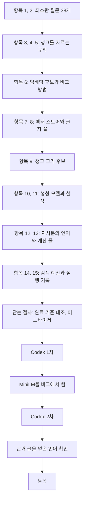

# 4단계 흐름 요약: 최소판 설계

이슈 #8 · 2026-10-22 ~ 2026-10-23

앞 단계에서 한 것: 이슈 #7에서 희토류 원소 위키백과 문서 20개를 받아 마크다운 코퍼스로 만들고, 부딪히는 값 목록을 새로 만들었다. 그래서 이 단계: 그 코퍼스로 최소판(검색을 한 번 하고 가져온 청크로 답하는 RAG)을 만들 수 있게, 최소판에 필요한 설계만 먼저 정했다.

정한 것은 네 묶음이다. 첫째, 최소판을 견줄 질문 38개다. 둘째, 문서를 청크(검색 결과로 가져오는 글 조각)로 자르는 규칙과 크기 후보다. 셋째, 임베딩 모델(글을 숫자 묶음인 벡터로 바꾸는 모델)과 벡터 검색, 그리고 그 둘을 견주는 방법과 고르는 기준이다. 넷째, 답을 쓰는 생성 모델과 그 설정, 지시문(시스템 프롬프트)이다. 돌려 봐야 정해지는 값은 결과를 보기 전에 후보, 재는 것, 고르는 기준을 정했다. 워크플로우의 기능(재검색, 판정 등)과 BM25, 판정 방식, API 형식은 그 기능을 붙일 때 정하기로 하고 이 이슈에서 다루지 않았다(`decisions/common.md` 2026-10-20).

결과물은 결정 기록(`decisions/stage4.md`), 질문 파일(`data/minimal/questions.json`)과 그것을 만드는 프로그램, 짧은 시험 세 가지의 프로그램과 결과(`research_notes/stage4_*`), 임베딩 조사 메모(`research_notes/한영 교차 검색 임베딩 후보/`)다. 5단계가 이 결정대로 청크와 인덱스를 만들고 검색 비교를 돌린다. 이 글은 그 과정을 다시 볼 때 읽는 글이다. 항목 번호는 이슈 체크리스트의 차례(1~15)다. 규칙의 정확한 문장은 `decisions/stage4.md`에 있다.

| 숫자 | 값 |
|---|---|
| 결정 줄 | 30 (`decisions/stage4.md`, 2026-10-22 ~ 2026-10-23) |
| 판단 기록 줄 | 10 (`decisions/judgments.md`의 이 이슈 줄) |
| 커밋 | 43 (이슈 번호가 붙은 것, 이 흐름 요약을 넣기 전까지) |
| 최소판 질문 | 38 (한국어 19, 같은 질문의 영어 번역 19. 근거 문서 갈래: 한국어만 8, 영어만 8, 두 언어 3) |
| 검색 비교 조합 | 8 (임베딩 모델 2 × 청크 크기 2 × 제목 붙임 여부 2) |
| 검색 예산 | 1,024토큰 (가장 큰 크기 256 × 최소 k 4. 크기 256은 청크 4개, 128은 8개) |
| 생성 설정 | qwen3:8b, 생각 모드 끔, temperature 0.7, 질문마다 5번 (두 시스템 합쳐 380번) |
| 답 언어 확인 | 5번 (첫 한국어 지시문 19/38, A 영어 지시문 38/38, B 22/38, C 38/38, 근거 글을 넣은 A 38/38) |
| Codex 지적 | 9 (검토 2번. 1차 7: 심각 2, 보통 3, 낮음 2. 2차 2: 보통 1, 낮음 1. 모두 반영) |

## 흐름

순서가 이렇게 된 이유: 무엇을 재는지가 먼저 있어야 해서 질문부터 정했다. 청크는 자르는 규칙만 먼저 정하고, 크기는 뒤로 미뤘다. 크기 후보는 임베딩 모델이 한 번에 읽는 길이를 알아야 정할 수 있어서 임베딩 다음에 두었다. 검색 예산(생성 모델에 근거로 넣는 글의 양)은 생성 모델이 받는 길이를 확인한 뒤에 정했다. 처음 체크리스트는 주제별(청크, 임베딩, 생성 모델)로 묶여 있었는데, 실제 순서가 주제를 오가 사용자가 따라가기 어려웠다. 그래서 중간에 일하는 순서대로 다시 짜고 항목마다 세부 칸을 달았다.

## 1. 최소판에 쓸 질문

### 항목 1: 도메인 고르기에서 쓴 질문 19개를 다시 쓴다

> 개발용 질문을 기다리지 않고, 이미 원문과 확인한 질문 19개(정식 실험 9, 4 모델 시험 10)로 최소판의 값을 고른다.

- **정한 것**: 정식 실험 질문 10개 가운데 re-03(이터븀)을 뺀 9개와 4 모델 시험 질문 10개. 답은 마지막 숫자가 정답의 ±1% 안이면 맞음, 검색은 근거 줄이 든 청크를 가져왔는지로 센다.
- **버린 것**: 확인 목록에서 질문을 새로 만드는 안. 개발용 질문을 만드는 일과 같아서, 따로 하거나 최소판 뒤에 쓰기로 했다.
- **이유**: 정식 실험 쪽은 정보 상자 한 줄이라 찾기 쉬운 모양이고, 모델 시험 쪽은 표의 행과 영어 본문이라 청크와 표 처리의 차이가 드러난다. 둘을 합치면 한쪽 모양에 치우치지 않는다. 사용자의 말: "두묶음 합친 방향으로 가자".
- **re-03을 뺀 까닭**: 코퍼스에 이터븀 밀도가 6.90, 6.973, 6.967로 셋 있어, 문서대로 답해도 1% 넘게 틀림이 될 수 있다.

### 항목 1: 영어로 옮긴 19개를 더해 38개로 (사용자 지적)

> 같은 19개를 영어로 옮겨 더하고, 질문마다 정답이 어느 문서에 있는지 적어 여섯 묶음으로 나눠 본다.

- **처음**: 질문 19개가 모두 한국어였다.
- **걸린 것**: 사용자가 "검색 비교용 질문이 어떻게 보면 한-영을 같이 보자는 의미였던거야?"라고 물었다. 한국어만으로 임베딩 모델과 청크 크기를 고르면 한국어에 맞춘 값이 될 수 있다. 사용자의 말: "하나에만 쏠리면 제대로 정할수 없을것 같아".
- **정한 것**: 영어 질문은 새 사실이 아니라 같은 질문의 번역이다. 그래야 결과 차이의 원인이 언어 하나로 좁혀진다. 결과는 질문 언어(한국어, 영어) × 근거 문서 갈래(한국어만, 영어만, 두 언어)의 여섯 묶음으로 본다.
- **예**: "영어 질문인데 근거가 한국어 문서에만 있는" 묶음이 8개다.
- **과정**: 사용자가 DeepL로 영어 질문을 되옮겨 확인했고, AI가 애매하다고 남긴 여섯 개를 한 번 더 봤다.

### 항목 1: 최종 평가용 질문과의 겹침은 빼지 않는다 (사용자 지적)

> 최소판 질문의 사실이 최종 평가용에도 쓰일 수 있지만 빼지 않고, 7단계에서 겹침을 표시해 점수를 두 가지로 낸다.

- **처음**: AI는 최소판 사실을 최종 평가용에서 빼라고 질문 작업 세션에 알리는 안을 추천했다.
- **걸린 것**: 빼면 영어 표 사실 재료가 거의 바닥난다(확정된 영어 표 사실 7개 가운데 5개가 최소판 질문). 사용자의 말: "질문 세션에서는 지금 우리가 만든것과 상관없이 진행하면 되는거 아니야?"
- **정한 것**: 질문 작업 세션에는 알리지 않는다. 7단계에서 겹친 질문을 표시하고, 모든 질문의 점수와 겹친 것을 뺀 점수를 함께 낸다.

## 2. 청크

### 항목 3: 문서 구조를 따라 자른다

> 정보 상자는 묶음마다, 글은 절 안의 문단마다, 표는 따로 다루고, 청크마다 문서와 원문 줄 범위를 저장한다.

- **정한 것**: 작은 단위는 같은 절 안에서 크기 한도까지 합치고, 넘는 단위는 문장(표는 행) 경계에서 나눈다. 절을 넘어 합치지 않는다. 크기는 임베딩 모델의 토큰으로 센다.
- **이유**: 사용자도 일반 글과 표를 따로 다루려 했다. 길이로만 자르면 표 행이나 정보 상자 묶음이 중간에서 잘린다.
- **예**: 정보 상자의 "물리적 성질" 묶음은 한 청크다.

### 항목 3: 정보 상자 묶음은 합치지 않는다 (사용자 지적)

> 정보 상자는 묶음 하나가 한 청크이고, 이웃 묶음과 합치지 않는다. 크면 줄 경계에서 나누고 조각마다 묶음 이름을 다시 붙인다.

- **처음**: AI는 작은 묶음을 이웃 묶음과 합치는 안을 추천했다.
- **걸린 것**: 사용자의 말: "묶음을 합칠 필요까지 있어야 하나", "다른 청크에 들어가는데 이때 어떤 카테고리인지 알수가 없으면 안되잖아".
- **정한 것**: 합치지 않는다. 나뉜 조각에는 묶음 이름을 붙인다. 합치는 이점이 확실하지 않고 벡터가 흐려질 수 있다.

### 항목 4: 표는 한 단위, 크면 행 경계에서 나누고 머리글을 붙인다 (사용자 지적)

> 표 하나를 한 단위로 두고, 크면 행 경계에서 나누며 조각마다 머리글 줄 전부와 표 제목을 붙인다. 첫 칸이 같은 행은 한 조각에 둔다.

- **정한 것**: 표 모양 대부분이 이 규칙으로 풀린다(머리글 두 줄, 줄마다 열의 뜻이 바뀌는 표, 같은 대상이 여러 줄 등).
- **예외 1**: 중성자 포획 치료 문서의 Table 1(54~68줄)은 붕소 전달 물질 이름을 두 열로 늘어놓은 것이라, 청크에서는 표 제목 아래 목록으로 쓴다. 사용자의 말: "그냥 리스트 형태로 하면 안돼?"
- **예외 2**: 가속기 설치 현황 표(187~202줄)는 첫 열에 네 가지가 붙어 있어, 원본 HTML의 `
` 경계대로 네 열로 나눠 넣는다. 사용자의 말: "데이터를 가공해서 사용할수 있으면 우리가 가공해서 쓰면 될것 같은데".
- **버린 것**: AI는 예외 1에 표 제목만 붙이는 안, 예외 2에 한계로 적고 넘어가는 안을 냈다. 사용자의 안이 더 낫다고 보고 따랐다.
- **한계**: 예외는 청크에 넣는 글만 바꾸고 코퍼스 파일은 고치지 않는다. 다른 작업 폴더에서 같은 코퍼스로 질문을 만들고 있어 근거 줄이 흔들리면 안 된다.

### 항목 5: 청크 앞 제목은 붙일지 재 보고 정한다 (사용자 지적)

> 붙이는 꼴(정보 상자 "제목 > 묶음 이름", 본문 "제목 > 절 > 소절")만 정하고, 붙일지는 검색 비교에서 붙임과 붙이지 않음을 함께 돌려 정한다.

- **처음**: AI는 제목과 절 경로를 붙이는 안을 추천했다.
- **걸린 것**: 사용자가 "이렇게 하면 잘 구분할수 있을지 모르겠네"라며 리서치를 원했다. 리서치(`decisions/references.md` S11)에서 근거가 약하고 붙여서 나빠지는 경우도 있었다(같은 문서의 청크끼리 앞부분이 같아짐).
- **정한 것**: 비용은 같은 청크를 한 번 더 임베딩하는 것뿐이라 둘 다 잰다. 사용자의 말: "두 번째로 하자. 크기 비교에서 같이 돌려보고 정해".

### 항목 9: 크기 후보는 128과 256, 긴 문단은 문장 하나를 겹친다 (사용자 지적)

> 크기 후보는 128과 256토큰이고, 한도보다 긴 문단을 문장 경계에서 자를 때 앞 조각의 마지막 문장 하나를 다음 조각 앞에 겹친다.

- **재 본 값**: 문단 505개의 중앙값 119토큰, 128 초과 46%, 256 초과 11%, 512 초과 2개. 표 행 중앙값 45토큰.
- **버린 것**: 512를 넣는 안. 넣으면 검색 예산이 2,048토큰이 되어 크기 128에서 청크 16개를 넘긴다. 빼면 1,024토큰(청크 8개)이다. 사용자의 말: "512를 하면 … 청크를 나눠서 특정 부분에 대답하려는 부분이 잘 안될것 같기도해".
- **겹침**: 사용자가 "문단의 경계 문제는 청크 오버랩으로 해결하는 방향으로 가자"고 했다. 겹치는 양은 토큰 수가 아니라 문장 하나다. 토큰 수로 정하면 문장 중간에서 시작될 수 있어서다. 겹친 문장까지 한도 안에 들 때만 넣는다.
- **한계**: 문단을 거의 통째로 두는 것(512)이 나은지는 재지 못한다.

### 닫는 절차: 가장 작은 단위는 자르지 않고 한도를 넘긴다 (Codex 지적)

> 표 머리글 + 행 하나, 문장 하나, 정보 상자 줄 하나는 더 쪼개지 않는다. 그 자체로 크기보다 크면 한도를 넘긴 채 둔다.

- **처음**: 크기 한도와 "표는 머리글을 붙이고 첫 칸이 같은 행은 함께"라는 규칙을 둘 다 지킨다고 여겼다.
- **걸린 것**: Codex 1차가 짚었다. 한국어 터븀 동위 원소 표는 머리글만 166토큰이라 크기 128에 머리글 + 행 하나도 들지 않는다. ¹⁴⁴ᵐ¹Tb 세 행과 머리글은 334토큰이라 256도 넘는다.
- **정한 것**: 행이나 문장 안을 자르면 뜻이 깨지므로 단위를 지킨다. 첫 칸이 같은 행 묶기와 문장 겹침은 한도 안에 들 때만 한다. 넘친 청크 수를 기록한다.
- **예**: 크기 128의 터븀 표 조각은 머리글 + 행 하나로 약 221토큰이다. gte와 bge-m3는 8,192토큰까지 읽어 끝까지 벡터로 만든다.
- **한계**: 터븀 표는 크기 256에서도 행이 하나만 들어, 128과 256의 조각이 같다. 터븀 질문 3개(q10~q12)에서는 크기 차이가 드러나지 않는다.

## 3. 임베딩과 검색

### 항목 6: 임베딩 후보는 과제 권장 모델에서 시작한다 (사용자 지적)

> 후보는 과제 권장 두 모델(paraphrase-multilingual-MiniLM-L12-v2, gte-multilingual-base)과, 두 모델에 견줄 기준 모델 bge-m3다.

- **처음**: AI는 과제 문서를 보지 않고 예전 조사 보고서의 점수표만으로 bge-m3, multilingual-e5-large, Qwen3-Embedding-0.6B를 냈다.
- **걸린 것**: 사용자의 말: "먼저 사전과제에 있는것을 위졸 후보를 해야하는거 아니야?" 과제 문서 "4. 권장 무료 모델 가이드"가 두 모델을 권장하고, 모델 선택 이유와 한계를 리포트에 쓰라고 한다.
- **첫 번째 변경**: 권장 두 모델을 바탕에 두고 세 번째 모델을 하나 더 넣기로 했다.
- **두 번째 변경**: 사용자가 예전 보고서가 코퍼스를 정하기 전의 일반 조사라며 다시 조사하자고 했다("지금 우리가 코퍼스가 정해진 상태에서 다시 조사하는건?"). 조사 네 갈래(`decisions/references.md` S12) 뒤에도 추천은 bge-m3였고, 근거가 위키백과 한국어 검색(Mr.TyDi 27개 중 2등)과 언어를 섞은 인덱스 실험으로 바뀌었다.
- **버린 것**: EmbeddingGemma-300m(한·영 교차 점수는 더 높으나 한국어 전체가 낮고 이용약관 동의 필요), KURE-v1(bge-m3보다 0.0107 높을 뿐이고 위키백과 과제에서 낮음).
- **한계**: 사용자는 이 조사가 과했다고 보았다("임베딩 모델관련해서 심층리서치는 과했던것 같아").

### 항목 6: 모델, 크기, 제목 붙임을 함께 견준다 (사용자 지적)

> 모델 × 크기 × 제목 붙임 여부의 조합마다 인덱스를 만들어 질문 38개로 검색하고 조합 하나를 고른다. 이 비교가 크기와 제목 붙임도 함께 정한다.

- **이유**: 모델 성적이 청크 크기에 따라 달라진다. 크기 하나를 고정하고 모델을 먼저 고르면 고정한 크기가 결과를 좌우한다.
- **예**: 크기 512로 고정하면 MiniLM은 앞 128토큰만 읽어 지는데, 그것은 모델이 나빠서가 아니라 글이 잘려서다.
- **겹침을 조합에 넣지 않은 것**: 사용자가 "그런데 이때 청크오버랩은 어떻게하는데?"라고 물었다. 겹침이 필요한 곳은 한도보다 긴 문단뿐이라 조합에 넣지 않았다.

### 닫는 절차: MiniLM은 재기 전에 뺀다 (사용자 지적)

> 과제 권장 MiniLM은 한 번에 128토큰까지만 읽는데 우리 표의 머리글만 166토큰이라, 비교에서 재기 전에 빼고 그 이유를 리포트에 적는다.

- **처음**: MiniLM은 128토큰 이하 크기에서만 재기로 했다(사용자: "MiniLM은 어쩌피 128 초과는 읽지 못하는데 하는 이유가 뭐야?").
- **걸린 것**: Codex 1차로 표 머리글이 128을 넘는다는 것이 드러났다. AI는 재기만 하고 고를 후보에서 빼는 안을 냈다. 그대로 두면 비김 순서의 "과제 권장 모델 먼저"로 표를 못 읽는 MiniLM이 뽑힐 수 있었다.
- **정한 것**: 사용자의 말: "어쩌피 뺄거면 나는 왜 재냐는거야". 재 보지 않아도 사실(166 > 128)로 알 수 있어 뺐다. 비교 조합은 8개가 됐다.
- **한계**: 이 결정은 Codex 2차가 도는 동안 정해 Codex가 보지 않았다. 따라 바뀌는 곳은 AI가 대조했다.

### 항목 6, 14: 가져오는 글의 양을 같게 둔다 (사용자 지적)

> k(가져오는 청크 수)는 크기마다 같게 두지 않고, 검색 예산 1,024토큰을 크기로 나눈다: 256은 4개, 128은 8개.

- **이유**: k를 똑같이 두면 큰 청크가 글을 많이 봐서 이긴다. 그러면 잘 잘라서 이긴 것인지 가를 수 없다.
- **과정**: 사용자가 "128에 대해서도 청크8개가 맞는지 모르겠어. 솔직히 청크가 너무 많은것 같아"라고 했다. AI가 128 × 8과 256 × 4는 글의 양이 같다고 설명했고 유지했다.
- **최소 k 4**: 여러 문서 연결 질문에서 두 문서에 하나씩 정답이 들어오고도 둘이 빗나갈 자리가 남는다. 사용자가 "만약 여러 문서를 기반으로 대답을 해야되는 상황이 생기면?"이라고 물어 넣었다.
- **Codex 지적으로 낮춤**: 청크가 크기보다 작거나 넘칠 수 있어 실제 양은 다르다. "같은 양"이 아니라 "같은 최대 예산"으로 적고, 실제로 가져온 토큰 수를 실행 기록에 남긴다.
- **버린 것**: 조합을 고른 뒤 k를 줄이는 규칙. 사용자의 말: "그렇게 치면 우리가 지금 정한 규칙이 맞는 방식이여야 하느건데 그것도 검증이 된게 아니잖아". 128에서 8개가 과한지는 개발용 질문으로 다시 확정할 때 본다.

### 항목 6: 고르는 기준은 2개 이하 차이를 비김으로 본다

> ✔ 수가 가장 많은 조합을 고르되, 2개 이하 차이는 비김이다. 비기면 언어가 엇갈리는 질문 16개의 ✔, 과제 권장 모델, 제목 안 붙임, 작은 크기, 모델 순서(gte, bge-m3)로 고른다.

- **이유**: 질문이 38개뿐이라 1~2개 차이는 정답 청크가 k등 안이냐 바로 밖이냐로 갈린 우연일 수 있다.
- **과정**: 사용자는 1번(언어가 엇갈리는 질문)은 이해했으나 나머지 순서가 맞는 방향인지 확신하지 못했다. AI가 칸마다 까닭을 설명한 뒤 정했다. 결과는 모든 조합의 표를 다 남기고, 순서는 고를 때만 쓴다.
- **한계**: 2개라는 값과 순서는 검증된 것이 아니다. 결과를 보고 고르는 것을 막을 뿐이고, 맞는지는 개발용 질문으로 다시 확정할 때 본다.

### 닫는 절차: ✔는 정답 숫자가 청크에 있어야 센다 (Codex 지적)

> 청크의 줄 범위에 근거 줄이 들고, 청크 글에 그 줄의 정답 숫자(예: "17.7")가 있어야 ✔다.

- **처음**: 줄 범위에 근거 줄이 들면 ✔로 셌다.
- **걸린 것**: Codex 1차가 짚었다. q19의 근거 159줄은 한 줄짜리 478토큰 문단이라, 문장 경계에서 나누면 같은 줄 번호의 조각이 여럿 생긴다. 정답 숫자가 없는 앞 조각도 ✔가 된다.
- **정한 것**: 질문 파일의 근거마다 정답 숫자를 적은 글자(`value_text`)를 더하고 시험도 더했다.

### 항목 7: 벡터 스토어는 PostgreSQL + pgvector (사용자 지적)

> 과제 권장(FAISS, Chroma) 대신 PostgreSQL + pgvector를 쓰고, 비교에서는 인덱스 없이 모든 청크와 거리를 재는 정확한 검색을 한다.

- **처음**: AI는 비교의 공정함과 일정을 들어 FAISS를 추천했다.
- **걸린 것**: 사용자의 말: "지금 과제의 목적이 물론 제출도 있지만 내가 이것을 통해서 공부를 하려는 목적이야", "DB는 설정만 하면은 되지 않나 싶은데. 이후에 잘 바꾸지도 않잖아".
- **정한 것**: 정확한 검색끼리는 저장소에 따라 찾는 청크가 같아 비교로 잃는 것이 없다. AI가 설명 문서를 만들어 사용자가 읽었다. 거리는 코사인(`<=>`), 같은 거리는 청크 ID 순서다(Codex 지적).
- **버린 것**: 사용자가 DB를 MCP로만 다루는 안을 꺼냈다가 거두었다(지금 상황과 관계없음).

### 항목 8: 글자 꼴은 따로 맞추지 않는다

> 세 후보 모델의 토크나이저가 이미 `¹⁴⁷Nd`와 `147Nd`를 같은 토큰으로 바꿔, 임베딩 검색에서는 꼴을 따로 맞추지 않는다.

- **과정**: 여섯 쌍(위 첨자, 아래 첨자, 전각 글자)을 세 모델의 토크나이저에 넣어 모두 같은 토큰이 나오는 것을 봤다.
- **남은 것**: BM25는 자기 방식으로 낱말을 나누므로 붙일 때 다시 본다. `Nd-147`이나 `네오디뮴-147`처럼 표기 자체가 다른 것은 이것으로 풀리지 않는다.

## 4. 생성 모델과 지시문

### 항목 10: 생성 qwen3:8b, 판정 gemma3:4b, 선별하지 않는다 (사용자 지적)

> 후보 3개를 짧게 선별하지 않고, 도메인 고르기 실험과 같은 짝(생성 qwen3:8b, 판정 gemma3:4b)을 쓴다.

- **처음**: AI는 과제 권장 3개(Qwen3-8B, Gemma 3-4B, Phi-4-mini)를 후보로 두고 짧게 선별하는 안을 추천했다.
- **걸린 것**: 사용자의 말: "이전에 우리가 워크플로우1단계에서 설계한 대로 진행해줘".
- **정한 것**: 도구 호출(검색 도구 부르기)은 생성 모델인 qwen3:8b가 한다. gemma3:4b는 Ollama에서 도구 호출이 안 되지만 판정만 하므로 상관없다. 플로우 PDF의 1단계와 2단계 모두 같은 짝을 쓴다.
- **한계**: 과제 권장 Phi-4-mini와는 견주지 않았다. STEPPER 4·6단계의 "후보 3개 선별"을 바꿨다.

### 항목 11: temperature 0.7로 질문마다 5번 (사용자 지적)

> 생각 모드를 끄고 모델 카드가 권하는 값(temperature 0.7, top_p 0.8, top_k 20)으로, 질문마다 씨앗을 바꿔 5번 돌린다.

- **과정**: 사용자가 "일관되게 답이 나오도록 하는게 맞을것 같기도 하면서, 이후에 judgement를 붙히면 그것을 바로 잡을수있도록도 하지 않을까"라고 했다. AI는 temperature가 판정이 답을 고칠 수 있느냐와는 따로라고 설명했다.
- **이유**: 한 번씩만 돌리면 맞은 것이 우연인지 가를 수 없다. 5번 돌리면 질문마다 흔들림(예: 5번 중 2번)을 보고, 판정을 붙인 뒤 흔들리던 답이 바로잡히는지 견줄 수 있다.
- **버린 것**: temperature 0으로 한 번. 10번(도메인 고르기 때의 횟수)은 시간이 두 배다.
- **다시 돌려 같은 글인지**: 확인하지 않는다. 몸풀기 호출 한 번, 질문 순서 고정, 하나씩 보내기로 조건만 고정한다.

### 항목 12: 지시문은 영어 하나 (확인 결과로 바뀜)

> 답을 질문 언어로 하게 하려고, 지시문을 영어 하나로 쓰고 "질문과 같은 언어로 답하라"를 넣는다.

- **처음**: 도메인 고르기 때의 한국어 지시문에 "질문과 같은 언어로 답하라"를 한 줄 더했다.
- **걸린 것**: 38개를 돌려 보니 영어 질문 19개가 모두 한국어로 답했다(19/38).
- **정한 것**: 후보 셋을 A, B, C 순서로 정하고 처음 통과한 것을 쓰기로 했다. A(영어 지시문 하나) 38/38, B(한국어 지시문 + 질문 끝 "Answer in English.") 22/38, C(질문 언어마다 지시문 바꿔 끼우기) 38/38. A를 쓴다. 지시문의 언어가 답의 언어를 크게 끈다.
- **사용자의 판단**: C는 질문 언어를 감지해야 하는데 사용자가 "안2도 완벽한건 아니것 같아서 그래"라고 했다. 영어 지시문을 DeepL로 확인하는 일은 "이미 다 잘된거면" 필요 없다며 건너뛰었다.
- **닫는 절차에서 더한 것**: 어드바이저가 청크를 넣는 부분의 언어가 정해지지 않았다고 짚었다. 그 부분도 영어로 정하고, 다른 언어의 근거 줄을 넣어 돌려 38/38을 확인했다.

### 항목 13: 계산 실수는 지시문 한 줄까지만 (사용자 지적)

> 최소판에서는 지시문에 "식을 쓰고, 단위 바꾸는 단계를 따로 적고, 다시 확인하라"는 한 줄만 넣는다. 판정이나 생각 모드는 최소판 다음에 기능으로 정한다.

- **처음**: AI는 지시문도 그대로 두는 안을 추천했다.
- **걸린 것**: 사용자의 말: "생각 모드는 아닌것 같고, 시스템 프롬프트를 넣는 수준까지만 하자".
- **정한 것**: 이 줄은 Baseline과 최소판에 똑같이 들어가는 출발점이라 전과 후를 견주지 않는다. 판정이나 생각 모드를 붙일 때 이 출발점과 견준다.

## 세부로 정한 것

- 항목 2: 질문 파일 `data/minimal/questions.json`. 질문마다 근거 문서, 근거 줄, 갈래, 한쪽 언어라는 근거를 적는다. 영어 문법 하나("a erbium")를 고쳤다.
- 항목 7: PostgreSQL 16과 Docker는 이 컴퓨터에 있고 pgvector는 없다. 설치는 5단계.
- 항목 6: bge-m3는 받아 둔 줄 알았으나 설정 파일만 있었다. 5단계에서 받는다.
- 항목 14: Ollama가 qwen3:8b에 잡은 길이 32,768토큰을 프로그램에 직접 적는다. 한 번에 넣는 양은 약 3,300토큰이라 넉넉하다.
- 항목 15: 실행 기록은 답 하나(질문 × 시스템 × 씨앗)마다 한 줄이고, 실행, 검색, 생성, 채점, 시간 칸을 둔다. 검색 ✔와 답의 맞음이 한 줄에 있어 "검색은 맞았는데 답이 틀린 질문"을 바로 센다.
- 닫는 절차: 답 언어 확인의 시간 중앙값을 바로 셌다(예: A 5.615초). KURE 비교 수치를 0.0107로 고쳤다. (Codex 지적)

## 검토에서 있었던 일

- 어드바이저 점검(닫기 전): STEPPER 완료 기준 칸에 "후보 3개 선별"이 남은 것, 영어 지시문 줄이 앞 줄을 바꾼다는 표시가 없는 것, 표의 칸 수, 청크 없이 돈 언어 확인. 넷 다 고쳤다.
- Codex 1차: 지적 7개(심각 2, 보통 3, 낮음 2). 심각 둘이 청크 단위와 ✔ 정의를 바꿨다. 틀린 지적은 없었다.
- Codex 2차: 1차 지적 6개 해소, 1개 절반. 새 지적 2개(같은 거리의 순서, 조사 메모에 남은 단정). 모두 고쳤다.
- 어드바이저 점검(2차 뒤): 청크를 넣는 부분의 언어가 정해지지 않았다. 영어로 정하고 확인했다.

## 계획과 달라진 것

- 체크리스트를 주제별에서 일하는 순서로 다시 짜고, 항목마다 세부 칸을 달았다. 사용자의 말: "순서대로 가는것도 아닌것 같고 중간에 막 다음으로 넘어가는것 같기도 하고".
- STEPPER 4단계 ④와 6단계 ②의 "후보 3개 선별"을 하지 않는다.
- 청크 크기의 "재는 것과 고르는 기준"은 9번이 아니라 6번의 검색 비교가 함께 정한다.

## 뒤 단계가 기대는 것

- 5단계: 이 규칙대로 청크를 만들고(가장 작은 단위는 자르지 않음, 넘친 수 기록), pgvector에 조합 8개의 인덱스를 만들어 질문 38개로 검색 비교를 돌린다. ✔는 `value_text`로 센다.
- 6단계: 고른 조합과 영어 지시문으로 Baseline과 최소판을 질문마다 5번 돌려 첫 비교를 낸다. 실행 기록의 "답의 언어" 칸으로 실제 청크에서도 질문 언어로 답하는지 본다.
- 7단계 전: 최소판에서 고른 값을 개발용 질문으로 다시 확정한다. 128에서 청크 8개가 과한지도 이때 본다.

## 다시 볼 곳

| 내용 | 상태 | 쓰이는 곳 |
|---|---|---|
| "조합"의 뜻(모델 하나, 크기 하나, 제목 붙임 여부 하나의 묶음)과 비김 | 사용자가 물어 다시 설명함 | 5단계 검색 비교 |
| 비김 순서 2~4번이 맞는 방향인지 | 사용자가 확신하지 못한 채 정함 | 5단계 검색 비교, 개발용 질문으로 다시 확정 |
| 크기 128에서 한도를 넘긴 청크가 어떻게 쓰이는지 | 사용자가 물어 설명함 | 5단계 청크 만들기 |
| top_p, top_k의 뜻 | 사용자가 물어 설명함 | 6단계 생성 설정 |
| pgvector가 하는 일 | 설명 문서를 읽고 물음 | 5단계 설치와 인덱스 |
| 토크나이저가 글자 꼴을 맞추는 것 | 사용자가 물어 설명함 | BM25를 붙일 때 |

## 원본

- 결정: `decisions/stage4.md`(30줄), `decisions/references.md` S11·S12
- 판단 기록: `decisions/judgments.md`의 2026-10-22·23 이 이슈 줄
- 질문: `data/minimal/questions.json`, `src/minimal/`
- 시험: `research_notes/stage4_tokenizer_norm/`, `research_notes/stage4_chunk_lengths/`, `research_notes/stage4_answer_language/`
- 조사: `research_notes/한영 교차 검색 임베딩 후보/`
- 이슈: #8 체크리스트와 마무리 댓글
