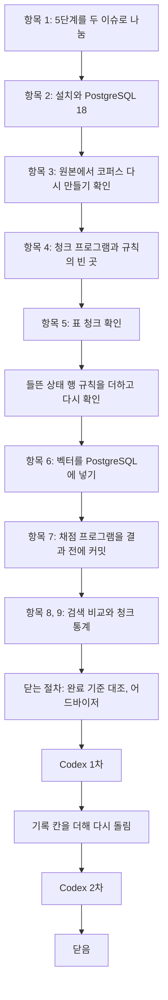

# 5단계 흐름 요약: 최소판 지식 베이스

이슈 #10 · 2026-10-23 ~ 2026-10-23

앞 단계에서 한 것: 이슈 #8에서 최소판(검색을 한 번 하고 가져온 청크로 답하는 RAG)의 설계를 정했다. 질문 38개, 청크 규칙, 검색 비교 방법과 고르는 기준이 그 설계다. 그래서 이 단계: 그 설계대로 청크와 벡터 인덱스를 실제로 만들고, 질문 38개로 검색 방식 8가지를 견줘 하나를 골랐다.

이 이슈는 5단계의 앞 절반이다. 개발용 질문이 아직 만들어지는 중이라, 개발용 질문이 있어야 하는 일은 두 번째 5단계 이슈로 보냈다. 그 일은 BM25, 근거를 청크에 잇기, 값 다시 확정, 나머지 EDA다. 이번에 한 일은 넷이다: 문서를 청크로 자르는 프로그램, 벡터를 PostgreSQL(pgvector)에 넣는 프로그램, 표 청크가 값과 머리글을 맞게 짝지었는지 전부 확인하기, 검색 비교와 조합 고르기.

만드는 중에 4단계 규칙의 빈 곳 셋을 메웠고, 표 청크 확인에서 찾은 한계 하나는 규칙을 고쳐 없앴다.

결과물은 프로그램(`src/minimal/`의 `chunk.py`, `index.py`, `search.py`, `compare_retrieval.py`와 시험), 청크 묶음 4개(`data/minimal/chunks/`), 검색 비교 결과(`data/minimal/retrieval/`), 표 청크 확인(`research_notes/stage5_table_chunks/`), 결정 기록(`decisions/stage5.md`)이다. 6단계가 여기서 고른 검색 방식으로 Baseline과 최소판을 돌린다. 항목 번호는 이슈 체크리스트의 차례(1~9)다.

| 숫자 | 값 |
|---|---|
| 결정 줄 | 11 (5단계 결정 파일 8, 4단계 결정 파일에 더한 3) |
| 판단 기록 줄 | 8 (판단 기록 파일의 이 이슈 줄) |
| 커밋 | 33 (이슈 번호가 붙은 것, 이 흐름 요약을 넣기 전까지) |
| 청크 묶음 | 4 (크기 128·256 × 제목 붙임 여부. 청크 수 1,285, 1,383, 625, 646) |
| 검색 비교 조합 | 8 (청크 묶음 4 × 임베딩 모델 2. 질문 38개씩, 결과 304줄) |
| 고른 조합 | 크기 128 + 제목 붙임 + bge-m3, 청크 8개. 질문 38개 중 31개 ✔ |
| 표 청크 확인 | 1,243개 모두 맞음(들뜬 상태 행 규칙을 더한 뒤). 일부러 망가뜨린 14가지를 모두 잡음 |
| 시험 | 99개 (청크, 저장과 검색, 채점과 고르기, 질문 파일) |
| Codex 지적 | 2 (1차: 보통 1, 낮음 1. 2차: 새 지적 없음. 모두 반영) |

## 흐름

차례는 체크리스트대로 갔다. 청크를 먼저 만들고 표 청크를 확인했다. 표 청크에서 고칠 것이 나오면 벡터를 다시 넣어야 하기 때문이다. 실제로 들뜬 상태 행 규칙이 이 자리에서 더해졌다. 채점 프로그램은 질문 38개를 돌리기 전에 시험과 함께 커밋했다. 결과를 본 뒤 기준을 바꾸지 않으려는 것이다(CLAUDE.md 3번).

## 1. 범위와 저장소

### 항목 1: 5단계를 이슈 두 개로 나눈다 (사용자 지적)

> 이번 이슈는 최소판 몫과 청크 통계만 하고, 개발용 질문이 필요한 일과 BM25, 나머지 EDA는 두 번째 이슈로 보낸다.

- **처음**: AI가 안 셋을 냈다. 안 A: 최소판 몫만 하고 나머지는 두 번째 이슈. AI가 추천했다. 안 B: 안 A에 EDA 전부를 더한다. 안 C: 한 이슈에 다 넣고 이슈 #9가 닫힐 때까지 열어 둔다. 이때 AI는 "EDA는 조합을 고르는 데 영향이 없다"고 설명했다.
- **걸린 것**: 사용자가 물었다. "그런데 이미 우리가 정한 청크사이즈에 대해서 그 결과를 EDA랑 같이 봐야 되는거 아니야?" 고르는 데는 영향이 없지만, 고른 결과를 설명하는 데는 청크가 잘린 모양(청크 수, 길이, 한도를 넘긴 청크)이 필요했다.
- **정한 것**: 안 A에 청크 통계를 더한다. 사용자: "안 A에 청크 통계 더해서 진행해. 그리고 나머지 부분은 어디에서 해야될지 기록도 미리 해주고."
- **버린 것**: 안 B를 골랐으면 문서 수와 언어별 그림까지 만드느라 6단계 첫 비교가 10-25 전에 끝나지 못할 위험이 컸다. 안 C를 골랐으면 이 이슈를 연 채 6단계를 시작해야 했다.
- **예**: 미정 목록에 "두 번째 5단계 이슈에서 할 일" 줄을 더했다.

### 항목 2: 벡터 저장소는 PostgreSQL 18과 pgvector다 (사용자 지적)

> Homebrew의 pgvector가 PostgreSQL 17·18용만 있어서, 이 컴퓨터의 16 대신 18을 새로 깔았다.

- **과정**: 4단계에서 "설치 전에 AI가 설명 문서를 만들고 사용자가 읽는다"고 정했다. 그래서 `research_notes/stage5_pgvector/pgvector_설명.md`를 먼저 썼다. 문서를 쓰기 전에 사용자가 먼저 물었다. "버전을 올려야하는거 아니야?" 이 물음대로 18로 올리는 안이 추천안이 되었다.
- **버린 것**: 16에 직접 컴파일해 붙이는 안: 16이나 pgvector를 올릴 때마다 다시 컴파일해야 했다. Docker 안: 쓸 때마다 Docker를 켜야 했다.
- **이유**: 정확한 검색(모든 청크와 거리를 잼)은 판과 설치 방법이 달라도 같은 청크를 같은 순서로 낸다. 그래서 실험 결론은 바뀌지 않고, 손이 가장 적게 가는 안을 골랐다.
- **과정**: 사용자가 실제 서비스는 어떻게 하는지 물었다("실제 서비스는 보통 C형태로 진행이돼?"). 답은 둘이었다. 운영에서는 AWS RDS 같은 관리형 DB가 흔하고, Docker는 개발자 컴퓨터에서 흔하다. 관리형 DB도 PostgreSQL의 다른 종류가 아니라 같은 PostgreSQL을 대신 운영해 주는 서비스다.
- **예**: 데이터베이스 `multilingual_rag`, 서버는 `brew services run postgresql@18`로 켠다(로그인 때 저절로 켜지지 않음).

## 2. 청크와 표

### 항목 4: 검색 ✔는 청크에 실제로 든 원문 줄 목록으로 본다 (어드바이저 지적)

> 청크마다 원문 첫 줄·끝 줄과 함께 실제로 든 원문 줄 번호 목록을 남기고, ✔는 이 목록으로 본다.

- **처음**: 4단계 규칙은 "청크의 원문 줄 범위(첫 줄~끝 줄)에 근거 줄이 들고, 청크 글에 정답 값이 있으면 ✔"였다.
- **걸린 것**: 나뉜 표 조각은 원문에서 이어진 줄이 아니다. 예: 터븀 표 128 조각이 머리글 9~11줄과 행 40줄이면 범위는 9~40이다. 조각에 없는 12~39줄도 범위에 든다. 그 사이 줄이 근거인 질문에서, 같은 숫자가 머리글이나 다른 행에 있으면 틀린 ✔가 된다.
- **정한 것**: 줄 목록으로 본다. 첫 줄·끝 줄은 생성 지시문의 "lines 첫 줄-끝 줄" 표시에 그대로 쓴다.
- **과정**: AI가 이것을 안으로 물었다. 사용자의 답: "우리가 이미 정한게 안1인데 그것의 문제점을 찾아서 고친다는거 아니야? 이런거면 그냥 너가 알아서 진행해도 되잖아." 이후로 이미 정한 규칙의 빈 곳을 결과 전에 메우는 수정은 AI가 고치고 알린다.

### 항목 4: 정보 상자의 "증기 압력" 줄은 그 아래 표와 같은 청크에 둔다 (어드바이저 지적)

> 표 바로 위의 항목 줄(`  - 증기 압력`)은 그 표의 이름으로 보고, 표가 나뉘어도 조각마다 붙인다.

- **걸린 것**: 크기 128에서 "물리적 성질" 묶음이 나뉘면, "증기 압력" 줄과 그 아래 2행 표가 다른 조각으로 갈릴 수 있었다. 그러면 `압력 (Pa) | 1 | 10 …` 표만 남아 무엇의 값인지 알 수 없다.
- **정한 것**: 표 제목 줄처럼 표와 함께 둔다. 원소 문서 14개의 증기 압력 표가 대상이다.
- **이유**: 값이 무엇의 값인지를 함께 두려고 구조를 따라 자른다는 4단계의 뜻을 따른 것이다.

### 항목 4: 두 임베딩 모델이 같은 청크 묶음 4개를 함께 쓴다

> 두 모델의 토크나이저가 코퍼스 2,011줄 모두에서 같은 토큰을 내서, 청크를 모델마다 따로 만들지 않는다.

- **정한 것**: 조합 8개는 청크 묶음 4개 × 모델 2개다.
- **이유**: 4단계는 "크기는 임베딩 모델의 토큰으로 센다"고 정했다. 두 모델이 같은 토큰을 내므로 이 규칙을 지키면서 청크가 같아진다.
- **결과**: 모델의 차이를 같은 청크 위에서 견주게 되었다.

### 항목 5: 표 청크는 프로그램 두 층과 읽기로 확인한다

> 값과 머리글의 짝이 깨질 수 있는 두 곳(원문 HTML을 마크다운으로 옮길 때, 마크다운을 청크로 나눌 때)을 모두 프로그램으로 보고, 위치만으로 뜻이 드러나지 않는 행 모양은 AI가 읽었다.

- **정한 것**: 변환 층: 표 37개를 원문 HTML과 칸마다 견준다. 원문 격자는 변환 코드를 부르지 않고 따로 편다. 청크 층: 표가 든 청크 전부를 본다. 머리글, 행 순서, 칸 수, 빠짐·겹침을 확인한다. 검사가 틀림을 잡는지는 일부러 망가뜨린 청크와 표를 넣어 확인한다.
- **이유**: 1,500개쯤의 청크를 눈으로 하나씩 보면 놓치는 것을 셀 수 없다. 사람이 판단할 수 있는 것은 프로그램으로 바꾼다는 규칙을 따랐다.
- **결과**: 첫 확인에서 틀린 표 청크는 0개였다. 가속기 표의 예외 2에서 세 조각뿐인 행들은 원문을 읽어 확인했다. 빠진 것이 제품 이름이었다. 처음 돌렸을 때는 가속기 표 청크에서 틀림이 났다. 원인은 확인 프로그램 쪽에 있었다. 예외 2의 기대값을 만드는 확인 프로그램이 원문 칸의 첫 조각(`
` 밖의 제조사 이름)을 읽지 못했다. 이것을 고친 뒤 0개가 나왔다.
- **예**: 망가뜨린 경우는 둘째 머리글 줄 빠짐, 칸 자리 바뀜, 행 빠짐·겹침, 다른 표의 머리글 등이다. 이 모두를 "틀림"으로 잡았다.

### 항목 5: 들뜬 상태 행의 값에 이름을 붙인다 (사용자 지적)

> 들뜬 에너지가 Z·N·질량 세 열에 걸친 행은, 청크 글에서 첫 칸에 "들뜬 에너지 621.4(11) keV"처럼 이름을 붙이고, 그 표에서는 둘째 머리글 줄을 빼기로 했다.

- **처음**: 4단계 규칙은 "머리글 줄을 모두 붙인다"였다. 첫 확인은 이것을 "맞음(조건 있음)"으로 판정하고 한계로 남겼다. 621.4 keV를 첫째 머리글 줄로 읽으면 "Z(p)"의 값이 되고, 둘째 줄("들뜬 에너지")로 읽어야 맞는다.
- **걸린 것**: 사용자가 물었다. "그러면 이것에 대해서 지금 미리 수정할수는 없을까? … 줄바굼같은게 들어갔을때 … 그런것들도 우리가 정하고 수정하고 갔잖아."
- **정한 것**: 사용자: "그래도 지금 근본적으로 고치는게 맞다고 생각해. 어쩌피 이후에 가서도 이러한 문제가 계속 발생을 할것인데." 값에 이름을 붙인다. 이름을 붙이면 둘째 머리글 줄은 할 일이 없다. 남겨 두면 보통 행의 Z를 "들뜬 에너지"로 읽는 반대 방향 혼동이 생긴다. 그래서 둘째 머리글 줄을 뺀다. 이것은 AI가 고치는 방식 안에서 정하고 알렸다.
- **버린 것**: 6단계에서 q10·q11 결과를 보고 정하는 안. 그 안이었으면 틀린 것이 확인된 뒤 청크·임베딩·검색 비교를 다시 돌려야 했고, 결과를 본 뒤 규칙을 바꾸는 것이 되었다.
- **결과**: 동위 원소 표 4개, 행 144개가 바뀌었다. 청크 프로그램(마크다운 글자로 찾음)과 확인 프로그램(원문 HTML의 합친 칸으로 찾음)의 결과가 같았다. 크기 256에서 한도를 넘긴 청크가 7·32개에서 0개가 되었다. 표 청크 1,243개 모두 맞음이고, 망가뜨린 14가지를 모두 잡았다.
- **예**: `| ¹⁴²ᵐ²Tb | 621.4(11) keV | 621.4(11) keV | 621.4(11) keV | 15(4) µs | …`가 `| ¹⁴²ᵐ²Tb | 들뜬 에너지 621.4(11) keV |  |  | 15(4) µs | …`로 바뀌었다.

## 3. 검색 비교

### 항목 7: 채점 프로그램을 결과보다 먼저 커밋한다

> ✔ 판정, 비김(2개 이하 차이), 고르는 순서 다섯 칸을 손으로 만든 예로 시험하고 커밋한 뒤에 질문 38개를 돌렸다.

- **정한 것**: 구현을 맡긴 서브에이전트에게 실제 비교를 돌리지 말라고 했다. AI가 ✔ 판정과 고르기 코드를 읽어 확인했다. 그다음 시험과 함께 커밋하고(`b79e175`) 비교를 돌렸다.
- **이유**: 결과를 본 뒤 기준을 바꾸지 않는다는 규칙을 커밋으로 남기려는 것이다.
- **예**: 고르는 순서는 다섯 칸이다: 1칸 다른 언어 질문 16개의 ✔, 2칸 과제 권장 모델(gte), 3칸 제목 없음, 4칸 작은 크기, 5칸 모델 순서.

### 항목 8: 고른 조합은 크기 128 + 제목 붙임 + bge-m3다

> 가장 많은 32와 2개 이하 차이인 세 조합이 비겼고, 다른 언어 질문에서 bge-m3 둘이 남아, 작은 크기인 128이 골라졌다.

- **과정**: 비긴 셋: 256 제목 bge-m3 32, 128 제목 bge-m3 31, 128 제목 gte 30. 1칸(다른 언어 16개): 11, 11, 8이라 bge-m3 둘이 남았다. 2·3칸: 남은 둘이 같았다. 4칸: 작은 크기인 128을 골랐다.
- **결과에서 읽은 것**: 제목을 붙이면 네 쌍 모두 ✔가 늘었다(bge-m3 128은 21에서 31로). 정보 상자 밀도 줄이 근거인 질문 8개는 제목을 붙인 조합에서만 맞았다. 정보 상자 청크에는 원소 이름이 없고 붙인 제목에만 있기 때문이다. 모든 조합이 놓친 질문은 q03-en과 q09-en 둘이다. 영어 질문인데 근거가 한국어 문서에만 있다. 이름이 비슷한 원소(Ytterbium)의 영어 문서를 가져왔다.
- **한계**: 질문이 38개라 1~2개 차이는 우연일 수 있다. 그래서 2개까지를 비김으로 정해 두었다.
- **예**: 비교를 한 번 더 돌려 결과 파일이 바이트까지 같았다. 요약은 결과 파일만으로 다시 만들어 같았다.

### 항목 8, 9: 표 질문에서 고른 조합이 약한 까닭을 모델 차이로 고쳐 적는다 (어드바이저 지적)

> 같은 청크에서 gte는 정답 행을 1등에 놓고 bge-m3는 놓쳤으니, 청크 모양만이 아니라 모델 차이로 읽었다.

- **처음**: 터븀·네오디뮴 표 질문 10개에서 고른 조합은 5개, gte의 128 조합들은 9개였다. AI는 처음에 "128 표 조각은 머리글이 거의 전부라 거리가 몰려 정답 행을 못 찾는다"(청크 모양 탓)로 적었다. 근거로 든 것은 q11-ko에서 상위 8개의 거리가 0.2905~0.2992로 몰린 것이다.
- **걸린 것**: 어드바이저가 짚었다. 같은 청크에서 gte가 9/10이면 청크 모양만으로는 설명되지 않는다.
- **정한 것**: 다시 쟀다. gte도 거리가 좁게 몰렸지만(0.2174~0.2313) 정답 행을 1등에 놓았다. 영어 질문과 한국어 네오디뮴 표(q13-en, q14-en)에서 bge-m3는 상위 8개가 모두 영어 문서였다. 그래서 "행을 가려내는 데서 bge-m3가 약했다"(추론)로 고쳐 적었다.
- **이유**: 모양 탓으로 남겼으면 7단계 전 재확정에서 청크를 고치는 쪽으로 잘못 갈 수 있었다.
- **한계**: 표 질문 수는 고르는 기준에 들지 않는다. 그래서 고른 조합은 그대로 두었다. 이 차이는 7단계 전 개발용 질문으로 다시 확정할 때 본다.

## 세부로 정한 것

- 항목 2: sentence-transformers 5.x, transformers 4.x로 판을 묶었다. 최신 판에서는 gte가 함께 받아 오는 자체 코드가 transformers 5에서 사라진 함수를 불러 돌지 않았다.
- 항목 4: 문장 경계는 `. ! ?` 뒤 공백, 다음 글자가 영어 소문자가 아니면 끝이다. 소수점, 약어, 괄호 안 마침표는 자르지 않는다.
- 항목 4: 정보 상자 구간은 3줄부터 목록·표·빈 줄이 이어지는 곳까지다. 문서 20개의 끝 줄을 파일과 대조했다.
- 항목 6: 표 둘(`chunks`, `chunk_embeddings`)로 저장한다. 임베딩은 CPU, 배치 16으로 고정했다. 한 묶음 625개를 다시 임베딩해 비트까지 같았다.
- 항목 6: 같은 거리의 청크 ID 순서는 바이트 순서(`COLLATE "C"`)로 비교한다. DB 기본 정렬로는 `tie#a`가 `tie#B`보다 앞에 와 결과가 DB 설정에 따라 달라진다.
- 닫는 절차: 가속기 표에서 제품 이름이 없는 행은 3행이 아니라 4행(193·194·196·201줄)이다. 기록의 수만 틀렸다 (Codex 지적).
- 닫는 절차: 검색 비교 결과 줄에 검색 쿼리, 문서 언어, 원문 줄 범위, 검색 시간을 더했다. 4단계 실행 기록 줄이 정한 칸이다. 다시 돌린 결과는 판정 칸 304줄 모두 첫 실행과 같았다 (Codex 지적).

## 검토에서 있었던 일

- 어드바이저 점검은 네 번 했다.
  - 이슈 본문을 쓰기 전: 아래를 짚었다.
    - 미정 목록의 "다룰 단계" 칸을 전부 볼 것.
    - 원본에서 코퍼스를 다시 만들어 근거 줄을 확인할 것(항목 3).
    - 청크의 원문 위치를 어떻게 남길지(항목 4의 줄 목록).
  - 청크 프로그램을 맡기기 전: 지시서의 시험이 규칙과 부딪히는 곳과 표 이름 줄을 짚었다.
  - 표 청크 확인 뒤: 1,529와 1,536 두 개수가 어떻게 맞아떨어지는지와, 망가뜨리기 확인을 저장소에 남기라는 것을 짚었다.
  - 검색 비교 뒤: 표 질문의 원인 해석, 다시 돌리기, 4단계 인계의 전제를 짚었다.
- Codex 1차는 두 가지를 지적했다.
  - 보통: 검색 비교 기록의 빠진 칸. 4단계 실행 기록 줄의 ㉥을 구현 지시서에 옮기지 않았다.
  - 낮음: 표 행 수.
  - 둘 다 동의하고 반영했다(사용자: "진행해").
- Codex 2차는 둘 다 "해소됨"이고 새 지적은 없었다.
- Codex는 샌드박스 권한 때문에 DB에 붙지 못했다. DB 쪽은 이 세션에서 직접 돌린 시험과 확인으로 봤다.
- Codex를 미룰지를 AI가 안으로 물었다. 사용자가 짚었다: "왜 미루는 이야기가 나오는거야? 원래는 안그러잖아." 원래 절차대로 돌렸다.

## 계획과 달라진 것

- 들뜬 상태 행 규칙은 체크리스트에 없던 일이다. 표 청크 확인에서 찾은 한계를 사용자가 지금 고치기로 해서 더해졌다.
- 4단계 인계는 "터븀 표는 128과 256의 조각이 같아 크기 차이가 드러나지 않는다"고 적었다. 들뜬 상태 행 규칙 뒤로 256 조각에 행이 여럿 들어 이 전제는 맞지 않게 되었다. q12-ko는 bge-m3 256에서 맞고 128에서 놓쳤다.
- 들뜬 상태 행 수정은 1~2시간으로 어림했는데 훨씬 짧게 끝났다. 바꿀 곳이 함수 하나였고 확인 도구가 이미 있었다.

## 뒤 단계가 기대는 것

| 내용 | 어디 | 쓰는 곳 |
|---|---|---|
| 고른 검색: 묶음 `size128_title`, 모델 `bge-m3`, k = 8 | `decisions/stage5.md`, PostgreSQL `multilingual_rag` | 6단계 항목 1(Baseline과 최소판) |
| 검색 함수(거리 오름차순, 같은 거리는 청크 ID 바이트 순서) | `src/minimal/search.py` | 6단계 최소판, 6단계 ③ 검색 도구 |
| 청크 묶음을 다시 만들면 표 청크 확인을 다시 돌린다 | `research_notes/stage5_table_chunks/check.py` | 청크 규칙을 바꿀 때 |
| 원본에서 인덱스까지 명령 셋 | `build.py`, `chunk.py`, `index.py` | 두 번째 5단계 이슈, 리포트 |

## 남은 것

- 두 번째 5단계 이슈(이슈 #9가 닫힌 뒤): BM25 인덱스, 개발용 질문의 근거를 청크에 잇기, 개발용 질문으로 값 다시 확정, 문서 수와 언어별 특성 같은 나머지 EDA.
- 7단계 전 재확정에서 볼 것: 크기 128에서 청크 8개가 과한지, 표 질문에서 gte가 앞선 것이 이어지는지(미정 목록).
- 6단계에서 볼 것: 표 질문(q10~q14)이 검색에서 놓친 것이 오답으로 이어지는지.

## 다시 볼 곳

| 내용 | 상태 | 쓰이는 곳 |
|---|---|---|
| EDA의 뜻과, 청크 통계를 검색 결과와 같이 보는 까닭 | 사용자가 물어 설명함 | 항목 1, 항목 9 |
| 청크를 나누고, 벡터로 바꾸고, DB에 넣고, 질문도 벡터로 바꿔 찾는 흐름 | 사용자가 물어 설명함 | 항목 4, 6, 8 |
| 임베딩 인덱스, 벡터 검색, 벡터 스토어, DB의 차이 | 사용자가 물어 설명함 | 항목 2, 6 |
| 관리형 DB(AWS RDS 등)와 로컬 PostgreSQL | 사용자가 물어 설명함 | 항목 2 |
| 들뜬 상태 행이 왜 틀린 짝이 되는지 | 사용자가 처음에 이해하지 못해 예로 다시 설명함 | 항목 5 |
| DB 안을 직접 보는 법(psql, `\d`, SELECT) | 사용자가 따라 해 봄 | 항목 6 |
| Codex 검토를 미루는 안을 낸 것 | 사용자가 짚어 원래 절차대로 함 | 닫는 절차 |

## 원본

- 결정: `decisions/stage5.md`(8줄), `decisions/stage4.md`의 2026-10-23 마지막 세 줄(원문 줄 목록, 표 이름 줄, 들뜬 상태 행)
- 판단: `decisions/judgments.md`의 2026-10-23 이슈 #10 줄들
- 검색 비교: `data/minimal/retrieval/summary.md`, `reading.md`, `results.jsonl`
- 표 청크 확인: `research_notes/stage5_table_chunks/reading.md`, `output.txt`, `mutate_output.txt`
- 저장소 설명: `research_notes/stage5_pgvector/pgvector_설명.md`
- 이슈: #10
