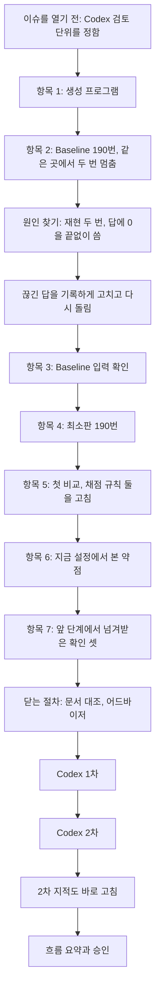

# 6단계 흐름 요약: Baseline과 최소판

이슈 #12 · 2026-10-24 ~ 2026-10-24

앞 단계에서 한 것: 이슈 #10에서 청크와 벡터 인덱스를 만들고, 질문 38개로 검색 방식 8가지를 견줘 크기 128 + 제목 붙임 + bge-m3, 청크 8개를 골랐다. 그래서 이 단계: 그 검색으로 답을 쓰는 최소판과, 문서 없이 답하는 Baseline을 같은 모델·설정으로 380번 돌려 첫 비교를 했다.

이 이슈는 6단계 큰 이슈 #11의 첫 서브이슈다. 최소판은 질문 글로 검색을 한 번 하고 가져온 청크 8개를 모델(qwen3:8b)에게 주어 답하게 하는 가장 단순한 RAG다. Baseline은 같은 모델이 문서 없이 답한다. 두 시스템의 차이를 "문서를 넣었느냐" 하나로 두고, 질문 38개를 씨앗 1~5로 다섯 번씩 물었다. 이 이슈로 최소판이 완성되고, 다음 서브이슈부터 기능을 하나씩 붙인다.

돌리는 도중에 Baseline이 같은 곳에서 두 번 멈췄다. 모델이 답에 0을 끝없이 써서 Ollama가 끊은 것이었고, 원인부터 찾은 뒤 끊긴 답을 그 답으로 기록하게 고쳤다. 결과를 읽으면서 채점 규칙의 빈 곳 둘(오차 표기, 단위)을 찾아 고쳤다. 결과는 Baseline 37/190, 최소판 144/190이다.

결과물은 프로그램(`src/minimal/generate.py`, `scoring.py`, `compare_generation.py`와 시험), 실행 기록(`data/minimal/generation/`의 `runs_baseline.jsonl`, `runs_minimal.jsonl`, 요약 `summary.md`, 멈춘 실행 셋), 멈춘 사례의 재현 자료(`research_notes/stage6_repeat_abort/`), 결정 기록(`decisions/stage6.md`)이다. 항목 번호는 이슈 체크리스트의 차례(1~7)다.

| 숫자 | 값 |
|---|---|
| 결정 줄 | 10 (6단계 결정 파일 8, 일하는 방식 파일 2) |
| 판단 기록 줄 | 10 (판단 기록 파일의 2026-10-24 줄) |
| 커밋 | 33 (이슈 번호가 붙은 것, 이 흐름 요약을 고치기 전까지) |
| 실행 | 380번 (질문 38 × 씨앗 5 × 시스템 2). 그 전에 멈춘 실행 셋(158줄, 1줄, 158줄)은 점수에 쓰지 않고 남김 |
| 맞은 답 | Baseline 37/190, 최소판 144/190 (오차 표기 규칙을 고치기 전 138/190) |
| 같은 질문·씨앗 짝 190개 | 최소판만 맞음 121, Baseline만 맞음 14, 둘 다 맞음 23, 둘 다 틀림 32 |
| 최소판의 검색과 답 | 근거 청크를 가져온 155개 중 144개 맞음, 놓친 35개는 모두 틀림(거절 27) |
| 되풀이로 끊긴 답 | Baseline 1, 최소판 0 |
| 시험 | 193개 (생성, 채점, 비교 프로그램과 앞 단계의 것) |
| Codex 지적 | 1차 3(보통 2, 낮음 1, 모두 반영). 2차: 2개 해소, 1개 절반, 새 1개. 남은 둘(낮음)도 사용자의 결정으로 바로 고침 |
| 미정 목록 | 더한 줄 3, 지운 줄 2 (Codex 2차로 더했다가 바로 고쳐 지운 줄 1은 빼고 셈) |

## 흐름

차례는 체크리스트대로 갔지만 항목 2에서 오래 머물렀다. Baseline이 멈춘 원인을 모른 채 처리 방법부터 고르려다, 사용자의 지적으로 원인부터 찾았기 때문이다. 셀 것은 결과를 보기 전에 정하고 비교 프로그램을 먼저 커밋했다. 결과를 본 뒤 채점 규칙을 고친 것은 두 번이고, 둘 다 이유와 영향을 기록에 남겼다.

## 1. 돌리는 방식

### 이슈를 열기 전: Codex 닫는 검토는 서브이슈마다 받는다 (사용자 지적)

> 6단계의 기능 7개마다 Codex 1차·2차를 받는다(최대 14번). 서브이슈 안에서 함수 하나마다 검토를 끼우지는 않는다.

- **처음**: AI가 세 안을 냈다. 서브이슈마다 1차·2차(추천), 서브이슈마다 1차만, 6단계 끝에 한 번.
- **걸린 것**: 사용자가 물었다. "그 순간 말고 우리가 만들면서 검토를 받거나 제대로 만들고 있는지 확인을 받는 순간이 없지 않아?" AI는 "반만 맞다"고 답했다. 기능 확인·시험·Opus 점검은 있지만 모두 만든 쪽(Claude)이 보고, 다른 모델이 처음부터 흠을 찾는 것은 Codex뿐이다.
- **정한 것**: 서브이슈마다 1차·2차. 사용자는 AI가 말한 한계 하나를 다르게 봤다: "하나 시험하고 하나 검토돌리고 이런것을 말하는거야. 예를들면 함수 하나 추가하고 검토를 하는 것" 그래서 서브이슈 안에서는 끼우지 않는다.
- **버린 것**: 6단계 끝에 한 번이면 기능 1~6이 검토 없이 합쳐지고 뒤 기능이 그 위에 쌓인다. 서브이슈를 나눈 까닭(따로 검토받고 합치는 단위)과 어긋난다.
- **예**: Codex는 DB와 Ollama에 붙지 못하므로 기록 파일을 읽고 따진다. 원본이 지금 코드로 돈 것인지는 우리가 확인한다.

### 항목 1: 생성 프로그램은 4단계 설정을 그대로 옮긴다

> 모델, 지시문, 생성 설정, 실행 조건이 두 시스템에 같고, 최소판만 지시문 끝에 청크 8개를 붙인다.

- **정한 것**: qwen3:8b, 생각 모드 끔, temperature 0.7, 씨앗 1~5, 영어 지시문 하나(답 언어 확인 38/38을 통과한 글을 한 글자도 바꾸지 않음), 몸풀기 한 번, 순서 고정, 한 번에 하나씩. 답 하나마다 실행 기록 한 줄.
- **과정**: 첫 결과에서 4단계 Codex 검토로 정한 칸 둘(가져온 청크의 토큰 합, 입력 토큰 수)이 빠져 있었다. AI가 구현 지시서에 옮기지 않은 것이 원인이라 지시를 고쳐 같은 effort로 다시 시켰다.
- **정한 것**: 기록에 코드 커밋과 커밋되지 않은 변경이 있었는지를 더했다. 생성 글은 같은 씨앗으로도 같다는 보장이 없어 다시 돌려 견주지 않으므로, 결과가 어느 코드로 돈 것인지를 기록만 보고 확인하려는 것이다.
- **예**: 시범 실행(질문 2개)에서 Baseline은 q13-ko에 "2.11분", 최소판은 "[1]에서 12.4(6) 분"이라고 답했다.

### 항목 2, 4: 시스템마다 따로 돌리고, 사이에 기록을 커밋한다 (사용자 지적)

> `--system baseline`과 `--system minimal`을 따로 돌리고, 기록 파일도 시스템마다 둔다. 이어서 돌릴 때는 사이에 Baseline 기록을 커밋한다.

- **처음**: 명령 하나로 380번(약 40분)을 돌릴 계획이었다.
- **걸린 것**: 사용자: "baseline부터하고, 그다음 잠깐 멈췄다가 최소판으로 돌리고 하는건 안되는거야? 이게 시간이 한번에 다 돌리기에는 시간이 애매해서 그래." AI는 호출 순서가 같고 몸풀기를 실행마다 하면 결과에 문제가 없다고 답했다.
- **첫 번째 변경**: 나눠 돌린다. 몸풀기는 실행마다 한 번.
- **두 번째 변경**: 멈춘 뒤 다시 돌릴 때 사용자가 "이번에는 그냥 한번에 380개" 돌리자고 했다. 그런데 Baseline 기록을 커밋하지 않은 채 최소판을 시작하면 최소판 190줄의 "커밋되지 않은 변경" 칸이 모두 거짓으로 true가 된다는 것을 AI가 시작 직후 찾았다. 첫 답 한 줄 뒤에 멈추고, 사이에 Baseline 기록을 커밋하는 순서로 바꿨다.
- **예**: 두 기록의 코드 커밋(`c5a4ae0`, `485ea5f`) 사이에 바뀐 것은 Baseline 기록 파일 하나뿐이다.

### 항목 2: 되풀이로 끊긴 답은 그 답으로 기록하고 틀림으로 센다 (사용자 지적, 어드바이저 지적, Codex 지적)

> Ollama가 "같은 토큰 되풀이"로 생성을 끊으면, 끊기기 전까지 쓴 글을 그 답으로 남기고 정한 규칙대로 틀림으로 센다. 질문은 빼지 않는다.

- **처음**: Baseline이 158번째 답 뒤에 HTTP 500으로 멈췄다. AI는 원인을 모른 채 처리 안 셋(처음부터 다시, 그 요청만 다시 보냄, 틀림으로 셈)을 냈다. 다시 돌리니 같은 요청(씨앗 5, q04-ko)에서 또 멈췄고, 이번에는 오류 내용 `token repeat limit reached`가 남았다. AI가 다시 처리 안 셋을 냈다.
- **걸린 것**: 사용자: "오류 자체가 모델이 제대로 대답을 할수 있는 환경이 아니기 때문에 발생하는거 아니야? 그러면 고치고 다시 진행을 해야한ㄴ거 아닌가? 정확히 무슨 문제인지를 파악하고 해야하는거 아닌가 싶어." 사용자는 디스크 문제일 수 있는지도 물었다(디스크 98% 사용, 메모리 44% 여유. 이 오류와는 관계없음).
- **과정**: 재현을 두 번 했다. 모델이 올라 있는 채로 시작하니 앞 158개 중 155개만 같았고 끊기지 않았다. 모델을 내렸다 올려 시작하니 158개가 같고 같은 곳에서 끊겼다. 끊기기 전 글은 reason에서 계산 없이 방법만 말한 뒤 answer에 "0.000…"을 100개 넘게 쓴 것이었다.
- **정한 것**: 끊긴 글을 그 답으로 기록(`aborted`, `abort_reason` 칸)하고 틀림으로 센다. 실행 시작 때 모델을 내렸다 올린다. 다른 오류는 지금처럼 멈추고 내용을 남긴다. 사용자: "A로 고쳐서 380번 다시 돌려줘."
- **버린 것**: 반복을 줄이는 설정(presence_penalty)을 더했으면 실패를 본 뒤 4단계 생성 설정을 바꾸게 되고, 답 언어 확인도 다시 해야 했다. 질문을 뺐으면 모델이 실제로 실패한 경우가 숫자에서 사라졌다.
- **첫 번째 변경**: 어드바이저가 짚었다. 재현 조건을 "모델을 막 올린 상태여야 한다"고 적었는데, 셋째 실행은 다시 올리지 않았는데도 같았다. "캐시에 다른 요청이 남았는가"로 고쳤다.
- **두 번째 변경**: Codex 1차가 짚었다. "우리 코드·설정·JSON 강제 탓이 아니다"는 증거보다 강하다. 재현은 같은 지시문·설정으로만 했다. "0을 되풀이했고 Ollama가 끊었다"까지만 확인됐고, 설정의 기여는 모른다고 고쳤다.
- **예**: 380번 본 실행에서도 같은 요청이 끊겼고, 실행은 멈추지 않고 이어졌다. 이 사례로 일하는 방식이 하나 생겼다(아래 "세부로 정한 것").

## 2. 채점과 비교

### 항목 5: 셀 것을 결과 전에 정하고, 프로그램은 숫자만 낸다

> 첫 비교 프로그램은 두 기록 파일에서 표만 만들고 해석을 쓰지 않는다. 읽은 내용은 판단 기록에 따로 쓴다.

- **정한 것**: 시스템마다 맞은 수, 질문 언어 × 근거 문서 갈래 여섯 묶음, 같은 질문·씨앗 짝 190개의 네 칸, 최소판의 검색 ✔ × 답 맞음, 질문마다 5번 중 맞은 수의 분포, 질문별 표.
- **과정**: 사용자가 처음에 "모델의 한계"에서 셀 거리 넷을 더할지 물었을 때 AI가 일을 넓혔다. 사용자: "그것을 원래하는 순서가 있으니까 거기로 넘긴다는것 뿐이야. … 그때 가서 다시 지금 상황을 재현하거나 분석하기 힘든거야? 그러면 지금 최대한 정보를 다 보내는게 맞고." 그래서 셀 거리는 늘리지 않고, 나중에 다시 만들기 어려운 재현 자료만 저장소에 남겼다.
- **예**: 요약은 기록에서 언제든 다시 만들 수 있고, 다시 만들면 바이트까지 같다.

### 항목 5: 값 뒤 괄호 안의 오차 표기는 숫자로 세지 않는다 (사용자 지적)

> `621.4(11)`의 괄호는 위키백과 표의 오차 표기라서 값이 아니다. 결과를 본 뒤 고쳤고, 최소판만 138에서 144가 됐다.

- **처음**: 채점은 "answer의 마지막 숫자가 정답의 ±1% 안"이다. 최소판이 표를 옮겨 "621.4(11) keV"라고 답하자 11이 골라져 틀림이 됐다.
- **걸린 것**: 값이 맞는 답 6개(q10-ko 씨앗 1~5, q13-ko 씨앗 5)가 틀림이었다. 우리 채점 규칙의 빈 곳이다.
- **정한 것**: 숫자 바로 뒤에 붙은 괄호 안 정수는 세지 않는다. 실행 기록의 채점 칸은 그대로 두고, 요약에 원래 규칙과 고친 규칙의 합과 바뀐 답 목록을 함께 적는다. 사용자: "안 A로 하자."
- **한계**: 결과를 본 뒤 고쳤고 최소판에만 유리하게 작용한다. 이 둘을 결정 기록과 결과 페이지에 밝혔다.
- **예**: 같은 표기를 쓴 q11-ko 씨앗 2("476.2(5) keV")는 값 자체가 틀려 그대로 틀림이다.

### 항목 5: 답에 적힌 단위가 질문의 단위와 다르면 표시한다 (사용자 지적, Codex 지적)

> 채점은 숫자만 보므로, 단위가 다른 답을 "단위 다름"으로 표시해 따로 센다. 단위를 바꾸거나 맞음을 고치지는 않는다.

- **처음**: 사용자는 오차 표기를 단위 문제로 읽고 물었다: "이게 어떻게 표현 표기이면서 단위가 되는거 아니야? … 근본적으로 이것도 제대로 판단할수 있게 할수는없는건가?"
- **걸린 것**: 괄호는 단위가 아니었지만, 채점이 단위를 전혀 보지 않는다는 걱정은 맞았다("0.5592 g"도 맞음이 된다). 380개에서 단위를 적은 답은 모두 질문의 단위였다.
- **정한 것**: 단위 표시를 더한다. 사용자: "단위 표시도 더해서 진행해줘."
- **버린 것**: 단위를 바꿔 계산하는 규칙(g에서 kg 등)은 단위 표기가 늘수록 커지고, 7단계 최종 평가는 사람이 판정하므로 만들지 않았다.
- **첫 번째 변경**: Codex 1차가 짚었다. 앞 글자만 견줘 `kg/m³`, `kgf`, `Sv`를 같음으로 봤다. 단위를 통째로 견주게 고쳤다.
- **두 번째 변경**: Codex 2차가 한국어 조사(`3초가`, `12.4분이었다`)를 다름으로, 한글 복합 단위(`킬로그램/초`)를 같음으로 가른다고 짚었다. 낮음이라 규칙대로 미정 목록에 올렸다가, 사용자가 물었다: "2차 검토도 바로 수정할게 있으면 하는게 맞지 않아?" 반례가 주어져 확인이 분명하고 짧은 일이라 바로 고쳤다. 조사·어미는 같음, `초과`처럼 조사와 부딪히는 낱말은 다름, 한글 단위 뒤의 `/`는 복합 단위로 다름이다.
- **예**: Codex가 든 반례와 1차 반례 18개를 고친 프로그램에 넣어 모두 원하는 결과였다. 3차 검토는 돌리지 않았다.

## 3. 읽은 것

### 항목 5: 문서를 넣으면 크게 오르고, 최소판의 실패는 대부분 검색 탓이다

> Baseline 37/190, 최소판 144/190. 최소판의 틀린 46개 가운데 35개는 검색이 근거를 놓친 경우이고, 그때 모델은 지시대로 거절했다.

- **정한 것**: 가장 약한 곳은 영어 질문인데 정답이 한국어 문서에만 있는 묶음(15/40)이다. 반대 방향(한국어 질문, 영어 문서)은 35/40.
- **과정**: Baseline만 맞은 짝 14개는 모두 영어 질문이다. 모델이 이미 아는 값이어도(q14-en Baseline 4/5) 최소판은 검색이 놓치면 거절해 더 나빠진다.
- **한계**: 질문이 38개(사실 19개)라 묶음(3~8개) 사이의 작은 차이는 우연일 수 있다. 질문은 개발용이 아니고, 검색 조합도 이 질문으로 골랐다.
- **예**: q13-ko는 Baseline이 "과학적 데이터에 따르면 약 2.11분"(정답 12.4분)이라 지어냈고, 최소판은 청크 [1]을 짚어 12.4분이라고 답했다.

### 항목 5: "en · 두 언어"에서 Baseline이 앞선 것은 계산 건너뛰기 탓이다 (사용자 지적)

> 최소판은 밀도가 든 청크를 15개 모두 받았지만, 틀린 4개는 풀이에 할 일만 적고 숫자 계산을 건너뛰었다.

- **걸린 것**: 사용자가 물었다. "en · 두 언어 질문 3개에서 어떻게 baseline이 최소판 보다 높을수가 있는거야?" (Baseline 13/15, 최소판 11/15)
- **과정**: 세 질문(루테튬, 툴륨, 디스프로슘의 질량)은 흔한 원소라 Baseline이 밀도를 외우고 있었고, 15개 모두 부피 60부터 계산했다. 최소판은 "use the density … (9.841 g/cm³) … convert grams to kilograms"까지만 쓰고 "0.0692 kg"처럼 엉뚱한 크기를 냈다.
- **정한 것**: 같은 영어 질량 질문에서 근거를 받고도 계산을 건너뛴 답이 최소판 7개(6개 틀림), Baseline 0개다.
- **한계**: 질문 3개에서 2개 차이라 우연일 수 있다. 청크로 입력이 길어져 풀이를 줄인다는 것은 재지 않은 추론이다.
- **예**: q04-en 최소판 씨앗 1 "0.005592 kg"(정답 0.5592 kg).

### 항목 6: 약점은 "지금 지시문·설정에서 본 것"으로 적고, 지금은 고치지 않는다 (사용자 지적)

> 천장은 근거를 받았을 때 92.9%, 바닥은 혼자서 모르는 것도 숫자를 지어내는 것이다. 모델이 원래 못 하는 것으로 적지 않는다.

- **처음**: AI는 이 항목을 "모델의 한계"로 적었다. 계산 건너뛰기도 모델의 한계의 한 모양으로 적으려 했다.
- **걸린 것**: 사용자가 두 번 짚었다. "모델에 한계라고 적기에는 baseline은 제대로 적용을 했잖아." "이게 만약 프롬프트로 수정이 되는거면 한계가 아닌게 된거야? 예를들어 환각도 하지 말라고 시스템 프롬프트를 넣었는데 제대로 동작을 하거나." 확인해 보니 지금 지시문에는 "모르면 모른다고 답하라"는 줄이 없고, 오히려 답을 내도록 민다.
- **정한 것**: 지금 지시문·설정에서 본 약점(출발점)으로 적는다. 지시문으로 고쳐지면 설정의 빈 곳이었던 것이고, 안 고쳐지면 검색·판정 같은 다른 보완이 필요하다. 지금은 고치지 않고 지시문을 고칠 때 함께 볼 것으로 남긴다. 사용자: "프롬프트 관련에 대해서는 지금 어떻게 하라기 보다는 수정해야되는 순간에 이것도 같이 고려하는것으로 기록해줘. 어쩌피 지금 상황과 연결시켜 주면 무슨 상황이였는지 바로 파악할수 있잖아."
- **버린 것**: 지금 지시문을 고쳤으면 같은 38개로 실패를 보고 고쳐 다시 재는 셈이라 그 질문에 맞춘 고침이 되고, 두 시스템이 같이 쓰는 지시문이라 380번을 다시 돌려야 했다.
- **예**: Baseline은 190개 중 189개에서 숫자를 답했고 152개가 틀린 숫자였다. "모른다"는 답은 없었다.

### 항목 7: 앞 단계에서 넘겨받은 확인 셋

> 검색이 놓친 영어 질문 둘은 0/5, 표 질문은 검색 결과가 그대로 답으로 이어졌고(5/5 대 0/5), 실제 청크를 넣어도 모두 질문 언어로 답했다.

- **정한 것**: q03-en(이트륨)은 5번 모두 거절했고, q09-en(어븀)은 이름이 비슷한 이터븀의 밀도로 계산한 "0.418 kg"이 3번이었다.
- **과정**: 표 질문 10개 가운데 검색이 근거 행을 가져온 5개는 옆 행이 7개 섞여도 모두 맞았다. 놓친 5개는 대개 거절했고, q12-ko는 비슷한 이름의 행 값("~1 s")을 3번 답했다.
- **예**: 질문 언어와 근거 언어가 엇갈리는 질문 16개(답 80개)도 모두 질문 언어로 답했다.

## 세부로 정한 것

- 항목 1: 실행 기록 칸에 `code_commit`, `code_dirty`를 더했다. 생성 글을 다시 돌려 견주지 않는 대신 기록의 지시문·설정이 지금 코드와 같은지로 확인하기 위해서다. 이 확인 방법은 같은 날 정한 Codex 결정 줄의 "다시 돌려 같은지 본다"가 4단계 결정과 부딪혀 고친 것이다.
- 항목 2: Ollama 오류가 나면 오류 내용과 멈춘 요청(시스템, 씨앗, 질문)을 남기게 고쳤다. 답은 조금씩 받는 방식(stream)으로 받아 끊긴 글도 남긴다.
- 항목 2: 재현 스크립트, 재현 결과 둘, Ollama 로그 발췌, 환경(Ollama 0.35.1, 모델 고유 번호)을 저장소에 남겼다. Ollama가 스스로 업데이트되면 재현되지 않을 수 있어서다 (사용자 지적).
- 항목 3: Baseline 190줄 모두 지시문이 영어 지시문과 같고, 청크·검색 칸·도구 정의가 없다.
- 항목 5: 숫자가 둘 이상인 답(풀이 전체를 answer에 쓴 답)을 요약에 표시하고 센다. Baseline 7, 최소판 1이고 모두 마지막 숫자가 최종 값이라 맞음은 그대로다 (Codex 지적).
- 닫는 절차: 생성 프로그램도 새 채점 규칙과 단위 표시를 쓰게 맞췄다. 이미 남은 기록은 그대로다 (완료 기준 대조 중 발견).
- 닫는 절차: 일하는 방식 둘을 더했다. 오류는 원인부터 찾아 우리 시스템 / 다른 방식 필요 / 외부 요인으로 분류한다(사용자: "다음부터도 이런식으로 오류가 발생하면 … 제대로 분류를 했으면 좋겠어"). 이슈 체크리스트는 작업 순서대로 쓴다(사용자: "그래야 내가 그것을 보면서 작업 흐름을 따라고 지금 무엇을 하고 다음은 무엇을 하는지 따라갈수 있잖아"). 이 둘은 사용자의 말에 따라 이슈 브랜치에서 고쳤다 (사용자 지적).

## 검토에서 있었던 일

- 어드바이저 점검은 한 번 했고 네 가지를 짚었다.
  - 판단 기록과 결과 페이지의 숫자 하나: 검색이 놓친 7개는 "거절 7"이 아니라 거절 6과 다른 숫자 1이다.
  - 재현 조건 문구가 증거보다 강하다(위 항목 2 카드의 첫 번째 변경).
  - 실행 뒤 프로그램이 바뀌었으니 지금 코드에서 재현 확인을 하라. 요약은 바이트까지 같았고, 380줄의 지시문과 설정이 지금 코드와 같았다.
  - 스텝퍼의 "①~⑦ 순서대로"와 10-20 결정의 어긋남을 미정 목록에 올리라.
- Codex 1차는 셋을 지적했다(보통 2, 낮음 1): 숫자가 여럿인 답의 보고 누락, 끊긴 답 원인의 과한 단정, 단위의 앞 글자 비교. 셋 다 AI가 동의했고 사용자가 "세 개 모두 반영"하기로 했다.
- Codex 2차: 2개 해소, 단위 1개는 절반만 해소. 고치며 생긴 새 지적 1개(한국어 조사). 둘 다 낮음이라 규칙("2차에서는 심각한 지적만 반영")대로 미정 목록에 올렸다가, 사용자의 물음으로 바로 고쳤다. 반례 18개를 넣어 확인했다(`STEPPER.md` 닫는 절차 ④).
- Codex는 샌드박스에서 DB와 Ollama에 붙지 못해, 기록 파일에서 숫자를 다시 세어 37/190, 144/190과 세부 표가 맞다고 확인했다.

## 계획과 달라진 것

- 380번 실행이 네 번째에 끝났다. 첫째와 셋째는 같은 요청에서 끊겨 멈췄고, 둘째는 사이 커밋 문제로 AI가 첫 답 뒤에 멈췄다. 세 기록 모두 점수에 쓰지 않고 남겼다.
- 체크리스트에 없던 일이 셋 생겼다: 멈춘 원인 찾기와 재현 자료, 채점 규칙 둘(오차 표기, 단위), 일하는 방식 규칙 둘.
- Codex 2차의 낮은 지적은 원래 미정 목록으로 넘기는 규칙이지만, 이번에는 사용자의 결정으로 바로 고쳤다.
- 체크리스트의 "Baseline 입력 확인"이 실행보다 앞에 적혀 있었다. 실행 기록이 있어야 할 수 있는 확인이라, 사용자의 지적으로 실제 순서대로 고쳤다.
- 일하는 방식 문서는 원래 `chore-` 브랜치에서 고치지만, 이번에는 사용자의 말로 이슈 브랜치에서 고쳤다.

## 뒤 단계가 기대는 것

| 내용 | 어디 | 쓰는 곳 |
|---|---|---|
| 생성 프로그램(stream, 끊긴 답 기록, 실행 시작 때 모델 내림) | `src/minimal/generate.py` | 기능을 붙인 뒤의 실행, ⑦ benchmark |
| 채점 규칙(오차 표기 빼기, 단위 표시) | `src/minimal/scoring.py` | 기능마다의 붙이기 전·후 비교 |
| 출발점 숫자: Baseline 37/190, 최소판 144/190과 세부 표 | `data/minimal/generation/summary.md` | 기능을 붙인 뒤의 비교, 10-25 멘토 정리 |
| 지금 설정에서 본 약점(검색이 놓친 영어 질문, 계산 건너뛰기, 지어내기) | `decisions/judgments.md` 2026-10-24 | 무엇부터 붙일지 정할 때 |
| 끊긴 사례의 재현 자료 | `research_notes/stage6_repeat_abort/` | 지시문을 고칠 때 이 요청이 여전히 끊기는지 |

## 남은 것

- 미정 목록에 더한 줄 셋: 최종 평가에서 "답을 끝내지 못한 답"을 셀 규칙(6단계 판정 기능, 7단계 동결 전), 지시문을 고칠 때 함께 볼 것("모르면 모른다고 하라", 계산 건너뛰기), 6단계에서 무엇부터 붙일지와 스텝퍼 순서 맞추기(10-25 피드백 뒤).
- 단위 표시의 한계: 마지막 숫자 뒤의 글자만 본다(`5분과 3초`는 `초`만 봄).
- 큰 이슈 #11의 나머지: 서브이슈 2~7과 개발용 질문으로 하는 채점 일.
- 한계: 10-20 Ollama 로그의 HTTP 500(도시 도메인 실험)은 오류 내용이 남지 않아 원인을 가를 수 없다.

## 다시 볼 곳

| 내용 | 상태 | 쓰이는 곳 |
|---|---|---|
| 6단계 전체 흐름과 이슈 구조 | 사용자가 물어 HTML로 그림 | 이슈를 열기 전 |
| 씨앗과 temperature의 차이 | 사용자가 여러 번 물어 HTML과 비유로 설명함("1번 상자는 몇 번 열어도 같은 선물") | 항목 1 |
| 질문 하나가 Baseline과 최소판을 지나가는 길(지시문, 청크, 설정, 채점) | 사용자가 "어떤식으로 돌아가는지 알아야 하지 않나"라고 해 HTML로 그림 | 항목 1, 5 |
| 자동 채점의 세 단계와 오차 표기·단위 | 사용자가 이해하지 못해 HTML로 다시 설명함 | 항목 5 |
| Codex 2차의 낮은 지적도 바로 고칠지 | 사용자가 물어 바로 고침. 이번 이슈의 예외로 기록했다 | 닫는 절차 |
| Ollama가 끊은 것이 정답을 끊은 것인가 | 사용자가 물음. 모델은 정답이 아니라 0을 되풀이하던 중이었다 | 항목 2 |
| 최소판이 이 이슈까지인가 | 사용자가 물음. 맞다, 다음부터는 기능을 붙인다 | 항목 4 |
| "앞 단계에서 넘겨받은 확인 셋"의 뜻 | 사용자가 물어 설명함 | 항목 7 |

## 원본

- 결정: `decisions/stage6.md` 전체, `decisions/common.md` 2026-10-24 두 줄
- 판단: `decisions/judgments.md` 2026-10-24 열 줄
- 검토: `CODEX_REVIEW.md`(닫을 때 커밋한 뒤 지움, git 기록에 남음)
- 결과: `data/minimal/generation/summary.md`, 실행 기록 두 파일
