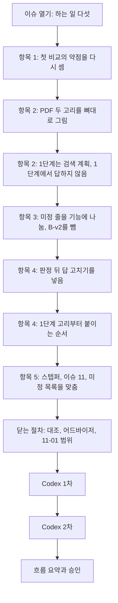

# 6단계 흐름 요약: 워크플로우 큰 그림과 붙이는 순서

이슈 #13 · 2026-10-26 ~ 2026-10-26

앞 단계에서 한 것: 이슈 #12에서 Baseline과 최소판을 380번 돌려 첫 비교를 했다(Baseline 37/190, 최소판 144/190). 그래서 이 단계: 그 비교에서 본 약점을 재료로 Agent-RAG의 흐름을 한 장으로 그리고, 남은 기능을 붙일 순서를 정했다.

이 이슈는 4단계(설계)의 워크플로우 큰 그림을 맡은 6단계 서브이슈다. 코드는 쓰지 않았다. 흐름은 「ReAct 기반 2단계 에이전트 플로우」 PDF의 두 고리를 뼈대로 삼았다. 1단계 고리는 문서 없이 검색 계획을 쓰고 판정받아 고친다. 2단계 고리는 검색 도구로 근거를 모으고 충분성을 판단해 재검색한다. 그 뒤 답을 쓰고 판정하고, 떨어지면 답을 고친다. 이 과정에서 기능이 둘 늘었다: 요청 분석과 1단계 고리, 답 고치기.

결과물은 전체 그림 페이지(`history/stage6/13-workflow-diagram.html`)와 결정 기록이다. 그림 페이지는 앞으로 기능을 붙일 때마다 진행 상태를 표시하는 기준이다. 항목 번호는 이슈 체크리스트의 차례(1~5)다.

| 숫자 | 값 |
|---|---|
| 결정 줄 | 4 (4단계 결정 파일 3, 6단계 결정 파일 1, 참고 자료 줄 1은 따로) |
| 판단 기록 줄 | 2 (닫는 절차 대조, Codex 2차) |
| 커밋 | 8 (이슈 번호가 붙은 것, 이 흐름 요약 전까지) |
| 최소판 틀림 | 46 (검색이 근거를 놓침 35, 근거를 받고 틀림 11. 놓친 질문 7개는 모두 근거가 한국어 문서에만 있음) |
| 붙일 기능 | 6 (API는 따로. 그중 새로 생긴 것 2) |
| Codex 지적 | 3 (1차 보통 2, 낮음 1, 모두 반영. 2차 새 지적 0) |
| 미정 목록에 더한 줄 | 3 (지운 줄 1, 다룰 단계를 고친 줄 7) |

## 흐름

흐름의 모양(항목 2)이 먼저 정해져야 미정 줄을 어느 기능에 넘길지(항목 3)와 붙이는 순서(항목 4)를 정할 수 있어 이 차례로 갔다. 항목 4에서 그림을 다시 보며 답 고치기가 빠진 것을 찾아 흐름의 모양이 한 번 더 바뀌었다.

## 1. 흐름의 모양

### 항목 2: PDF의 두 고리를 뼈대로 삼는다 (사용자 지적)

> 흐름은 PDF처럼 문서 없이 다듬는 1단계 고리와 검색 도구로 근거를 모으는 2단계 고리로 이뤄지고, 과제가 요구하는 단계는 그 안에 들어간다.

- **바뀐 것**: 처음 그림은 지금 최소판에 칸을 하나씩 끼워 넣는 모양이었다. 사용자가 PDF 구조를 반영하라고 해서 두 고리를 뼈대로 다시 그렸다.
- **정한 것**: 1단계 고리는 생성, 판정, 고치기를 되풀이한다. 2단계 고리는 검색어를 고르고, 검색 도구를 부르고, 받은 청크로 충분한지 판단해 모자라면 검색어를 고쳐 다시 검색한다(최대 2번). 그 뒤 답을 쓰고 판정한다.
- **이유**: 도메인 고르기 실험(10-18)이 이 PDF를 틀로 썼고, 생성 qwen3:8b와 판정 gemma3:4b의 짝도 그때 정했다. 같은 틀이라 앞 실험과 이어서 설명할 수 있다.
- **PDF와 다른 곳**: 둘이다. 하나는 1단계가 답 초안 대신 검색 계획을 만든다는 점이다(아래 카드). 다른 하나는 2단계의 판정이 두 번이라는 점이다. 2단계에 들어갈 때는 아직 답이 없으므로, 답을 쓰기 전에는 충분성만 보고 답을 쓴 뒤에 근거를 본다. 과제가 요구하는 순서(충분성 판단, 답 합성, Hallucination 검증)와도 맞다.
- **버린 것**: 판정을 하나로 두는 안이다. 관찰값 뒤에 바로 답을 쓰고 판정 하나가 근거와 완료 여부를 함께 보는 방식이라 PDF에는 더 가깝다. 그러나 과제의 "충분성을 먼저 보고 재검색"이 따로 보이는 칸이 없어진다.
- **예**: 과제의 "충분성 판단, 부족하면 쿼리를 재구성해 재검색(최대 2회)"은 2단계의 첫 판정(충분성)과 그 뒤의 리파이먼트(검색어 고치기)에 들어간다.

### 항목 2: 1단계에서 답을 내보내지 않는다 (사용자 지적)

> 모든 질문은 반드시 2단계(검색)를 거친다. 1단계의 판정은 문서 없이 한다.

- **정한 것**: 사용자가 정했다: "pdf를 따르는데 1단계에서 바로 답을 하지 않는 선이고, 1단계 judgement에 RAG를 붙히는건 일단 아니라고."
- **이유**: 과제가 요구하는 출력은 답, 참조 청크, 신뢰도 점수이고, 품질 검사는 답의 주장이 출처 문서에 근거하는지를 본다. 검색하지 않은 답에는 보일 청크도 견줄 근거도 없다. PDF 그림도 1단계를 통과하면 2단계로 넘어간다.
- **버린 것**: 문서 없이 답할 수 있는 질문은 검색을 건너뛰는 방식이다(필요할 때만 검색). 시간을 아낄 수 있지만 과제의 출력을 채우지 못한다.
- **한계**: 문서 없이 맞힐 질문을 가려낼 수 있는지는 재 보지 않았다. 도메인 고르기 실험의 문서 없는 판정 고리는 일반 프롬프트로 한 번 잰 것이라, 판정이 효과가 있는지를 가르는 근거로 쓰지 않는다.

### 항목 2: 1단계 고리는 검색 계획을 만든다

> 1단계에서 모델은 무엇을 찾을지와 한국어·영어 검색어를 쓰고, 판정 모델은 그 계획에 질문의 대상과 조건이 빠지지 않았는지 본다.

- **정한 것**: 계획에는 찾을 사실, 조건과 단위, 한국어 검색어와 영어 검색어가 들어간다. 과제의 "질문 분석과 검색 쿼리 생성(확장)"을 이 고리가 맡는다. 2단계의 쿼리 재구성은 근거가 모자랄 때 검색어를 고치는 일이라 자리가 다르다.
- **이유**: 최소판이 틀린 46번 가운데 35번은 검색이 근거를 놓친 경우였다. 놓친 질문 7개는 모두 근거가 한국어 문서에만 있었고, 그중 5개가 영어 질문이다. 검색 계획은 바로 이 검색어를 고친다.
- **버린 것**: PDF에 적힌 그대로, 문서 없이 짐작한 답을 먼저 쓰고 2단계에서 그 답을 확인하는 방식(안 A)이다.
- **한계**: 안 A를 버린 까닭은 확인하지 않은 짐작이다. 검색이 근거를 놓치면 짐작한 값이 그대로 답으로 나갈 수 있다고 봤지만 재 보지 않았다. Baseline이 문서 없이 한 번도 거절하지 않은 것(190번 가운데 틀린 숫자 152, 거절 0)도 지시문에 "모르면 모른다고 답하라"가 없어서일 수 있다. 검색 계획이 검색 실패를 실제로 줄이는지는 이 기능을 붙일 때 잰다.
- **예**: 이트륨 질문(q03-en)이면 계획은 "찾을 것: 이트륨의 상온 밀도(g/cm3) / 검색어: yttrium density, 이트륨 밀도"가 된다. 최소판은 이 질문에서 이름이 비슷한 이터븀 문서를 가져와 5번 모두 답하지 못했다.

### 항목 4: 판정에서 떨어진 답은 고쳐서 다시 판정받는다 (사용자 지적)

> 판정에서 떨어진 답은 고쳐서 다시 판정받는다. 근거가 모자라 떨어졌으면 재검색으로 돌아가고, 고치기 한도를 넘으면 사람 검수 표시를 붙인다.

- **바뀐 것**: 처음 그림과 스텝퍼의 워크플로우 줄은 판정에서 떨어지면 사람 검수 표시를 붙이고 끝났다. 사용자가 PDF 2단계의 답안 수정이 빠졌다고 짚어 넣었다.
- **정한 것**: 다만 효과를 모르니 따로 재서 남길지 정한다. 판정을 먼저 붙여 재고, 답 고치기를 더해 다시 잰다. 틀린 답이 맞게 바뀐 수와 맞은 답이 틀리게 바뀐 수를 함께 세어, 맞은 답이 늘지 않으면 뺀다. 재검색으로 돌아갈 때도 재검색은 모두 합쳐 2번까지다.
- **이유**: PDF 2단계의 리파이먼트에 있는 단계다. 과제는 요구하지 않는다.
- **한계**: 근거를 받고도 틀린 11개(영어 질량 질문에서 계산을 쓰지 않은 6, q18-ko에서 다른 시험의 값을 쓰거나 답하지 않은 5)를 판정이 잡을 수 있을지, 판정 모델(gemma3:4b)이 맞은 답을 틀렸다고 보아 오히려 망치지는 않을지는 재 보지 않았다.
- **예**: q18-ko에서 다른 시험의 값 "29.6개월"을 쓴 답이 있다고 하자. 판정만 붙였을 때는 답을 그대로 두고 사람 검수 표시를 붙인다. 답 고치기까지 붙이면 생성 모델이 판정의 지적과 청크를 받아 다시 쓰고, 고친 답이 다시 판정받는다.

### 닫는 절차: 재검색을 다 써도 근거가 모자라면 답 쓰기로 넘긴다 (완료 기준 대조 중 발견)

> 재검색 2번을 다 쓰고도 근거가 모자라면 사람에게 바로 넘기지 않고, 답 쓰기에서 "답할 수 없다"는 답을 쓴다.

- **바뀐 것**: 그림에서는 이때 바로 사람 검수 표시로 갔지만, 결정 기록은 답 쓰기로 넘긴다였다. 닫기 전에 대조하다 찾아서 그림을 결정에 맞췄다.
- **이유**: 7단계에서 답이 없는 질문에 시스템이 거절하는지를 본다. 거절도 답 쓰기에서 나오는 답이어야 그 판정을 할 수 있다.

## 2. 붙이는 순서

### 항목 4: 1단계 고리부터 붙이고, 도구 호출 검색과 한 서브이슈에서 따로 잰다 (사용자 지적)

> 1단계 고리부터 붙인다. 순서는 요청 분석과 1단계 고리, 도구 호출 검색, 답변 합성, 충분성 판단과 재검색, 판정과 신뢰도 점수, 답 고치기, API다.

- **바뀐 것**: 처음 제안은 도구 호출 검색을 먼저 붙이고, 1단계 고리는 다음 서브이슈로 따로 붙이는 것이었다. 사용자가 바탕인 1단계부터 잡고, 한 서브이슈 안에서 하나씩 재면 된다고 해 바꿨다.
- **정한 것**: 요청 분석과 1단계 고리, 도구 호출 검색은 한 서브이슈에서 차례로 붙이고 따로 잰다. 답변 합성 뒤에는 개발용 질문으로 그때까지 붙인 것을 다시 돌린다.
- **이유**: 1단계 고리는 계획의 검색어를 지금 검색 코드에 넣기만 하면 모델의 도구 호출 없이도 효과를 잴 수 있다. 질문 38개 안에 잴 재료도 있다(근거가 한국어 문서에만 있는 영어 질문 5개). 거꾸로 2단계를 먼저 만들면 첫 검색어가 나중에 바뀌어 앞의 비교를 다시 해야 한다.
- **버린 것**: 두 기능을 서브이슈로 나누는 안이다. Codex 검토와 흐름 요약이 한 벌 더 들어 0.5~1일이 더 든다(어림). 한 서브이슈 안에서도 두 번에 나눠 재면 무엇 때문에 달라졌는지 가를 수 있다.

### 항목 4: 11-01 목표는 워크플로우 전체다 (사용자 지적)

> 11-01까지 답 고치기를 포함한 워크플로우 전체를 만든다. API는 그 뒤다.

- **정한 것**: 사용자가 정했다: "11-01까지 하려는게 워크플로우 작업인데 이것도 워크플로우잖아. 미룬 다른것들이 결국에 워크플로우 만들고나서의 작업들인것이고." AI는 답 고치기를 10-29 일정 점검 때 미룰 후보로 두자고 추천했었다.
- **한계**: 지난주 속도(서브이슈 하나에 하루쯤)로 어림하면 남은 일은 5~6일이고, 쓸 수 있는 날은 10-27~10-31의 5일이다. 0~1일 모자랄 수 있다. 충분성 판단과 재검색을 붙이기 전에 개발용 질문이 갖춰져야 한다.

### 항목 3: B-v2를 하지 않고, 판정 프롬프트는 처음부터 만든다

> 도메인 고르기 실험의 문서 없는 판정 고리를 새 프롬프트로 다시 재는 일(B-v2)은 하지 않는다. 판정 프롬프트는 판정 기능을 붙일 때 처음부터 만든다.

- **이유**: 1단계 고리가 답이 아니라 검색 계획을 검사하게 되면서, 문서 없이 쓴 답을 검사하는 고리가 흐름에서 사라졌다. 예전 v2에 적어 둔 생각(불통과를 주려면 틀린 곳과 까닭을 적는다 등)은 재료로만 쓰고, 효과는 판정을 붙이기 전과 후를 같은 질문으로 견줘 본다.
- **버린 것**: B-v2를 남기는 안이다. 흐름의 어느 칸에도 쓰이지 않는 실험이 남는다. 대신 "문서 없는 판정이 계산 실수를 고치는가"는 재지 않게 된다.

## 세부로 정한 것

- 항목 1: 첫 비교의 약점을 실행 기록 두 파일에서 채점 프로그램으로 다시 세어 판단 기록의 숫자와 같음을 확인했다.
- 항목 3: 미정 줄을 붙일 기능에 나눴다. 사람 검수 표시가 붙은 답의 채점과 판정 프롬프트는 판정과 신뢰도 점수, 재검색 때 청크 합치기는 충분성 판단과 재검색(첫 검색부터 검색어가 둘이라 요청 분석과 1단계 고리에서도), 답에 문서 이름 밝히기와 계산 실수 줄이기는 답변 합성, 검색 도구 수는 도구 호출 검색에서 다룬다 (어드바이저 지적).
- 항목 4: 새 기능 둘은 스텝퍼 6단계 번호 뒤(8번, 9번)에 붙였다. 다른 문서가 1~7번을 가리키고 있어서다. 붙이는 순서는 번호 순서가 아니다.
- 항목 4: 요청 분석과 1단계 고리도 질문 38개로 만들고 확인한다.
- 닫는 절차: 그림을 저장소에 넣고, 지금 기준의 대응표(과제의 단계, 그림의 칸, 받는 것과 넘기는 것, 붙일 기능)를 더했다 (어드바이저 지적).
- 닫는 절차: 미정 목록에 셋을 올렸다. LangGraph와 ReAct를 고른 이유(2026-10-11 결정에 비어 있음, 어드바이저 지적), 1단계 고리와 답 고치기의 반복 한도와 종료 조건(Codex 지적).

## 검토에서 있었던 일

- 어드바이저(닫기 전): AI가 승인받지 않은 "11-01 목표는 답 고치기까지"를 네 곳에 적은 것을 짚었다. 되돌리고 사용자에게 물었다(위 11-01 카드). 그 밖에 그림이 비공개 링크에만 있음, 옛 대응표, 첫 검색의 검색어 둘, LangGraph 이유의 빈칸을 짚었고 모두 고쳤다.
- Codex 1차(보통 2, 낮음 1): 판정에서 근거 부족이면 재검색으로 가는 화살표가 그림에 없음(결정에는 있었음), 답 고치기의 반복 한도를 넘기는 기록이 없음, "1단계 결과 정리" 칸을 최소판에 있는 칸으로 칠함. 모두 반영했다.
- Codex 2차: 셋 모두 해소, 새 지적 없음. 완료 기준의 "11-01까지에 드는 날"이 없다는 말을 남겨 어림을 더했다.
- 흐름 요약을 사용자가 읽고, 이유 칸에 확인하지 않은 짐작(안 A의 위험)이 사실처럼 적힌 것을 짚었다. 결정 기록과 이 글을 "한계"로 고쳤다.

## 계획과 달라진 것

- 기능이 둘 늘었다(요청 분석과 1단계 고리, 답 고치기). 이슈를 열 때는 기존 기능의 순서만 정할 생각이었다.
- 11-01 목표가 판정까지에서 워크플로우 전체로 넓어졌다.
- 설명을 채팅에서 한눈 그림 페이지로 옮겼다. 앞으로 워크플로우 작업은 이 그림으로 진행을 따라가고, 기능마다 그 부분을 확대한 페이지를 만든다. 이 일하는 방식은 이슈를 닫은 뒤 `chore-` 브랜치에서 결정 기록에 적는다.

## 뒤 단계가 기대는 것

| 내용 | 어디 | 쓰는 곳 |
|---|---|---|
| 전체 그림(칸, 화살표, 붙이는 순서, 대응표) | `history/stage6/13-workflow-diagram.html` | 기능 서브이슈마다 진행 표시와 확대 페이지, 8단계 리포트 |
| 흐름의 모양 | `decisions/stage4.md` 2026-10-26 세 줄 | 기능마다의 설계 |
| 붙이는 순서, 11-01 범위와 어림 | `decisions/stage6.md` 2026-10-26 | 다음 서브이슈, 10-29 일정 점검 |
| 기능마다 넘긴 미정 줄 | `DECISIONS.md` 미정 목록 | 서브이슈를 열 때 체크리스트로 옮김 |
| 첫 비교의 약점 숫자 | `decisions/judgments.md` 2026-10-24 | 기능마다 붙이기 전과 후의 비교 |

## 남은 것

- 미정 목록에 더한 셋: LangGraph와 ReAct를 고른 이유, 1단계 고리의 반복 한도와 초과 처리, 답 고치기의 반복 한도와 종료 조건.
- 칸마다의 정확한 입출력과 프롬프트는 그 기능을 붙일 때 정한다.
- 10-29 일정 점검: API와 두 번째 5단계 작업을 11-01 뒤로 미룰지, 어림이 맞는지.

## 다시 볼 곳

| 내용 | 상태 | 쓰이는 곳 |
|---|---|---|
| 1단계 고리가 무엇을 만드는가(짐작한 답과 검색 계획) | 이트륨 질문의 예로 이해함. 안 A를 버린 까닭은 짐작이라 1단계 고리를 붙일 때 결과로 다시 본다 | 항목 2 |
| 필요할 때만 검색하는 방식 | 이 과제에서는 하지 않기로 함. 리포트의 개선 아이디어 후보로 이야기만 했고 정하지 않음 | 항목 2 |
| PDF와 다른 곳(저지먼트 두 번) | 지금 그림으로 가기로 함. 하나로 두는 안도 있음 | 항목 2, 4 |
| 기능에 넘긴 미정 줄들이 언제 왜 생겼는지 | 그 기능을 붙일 때 생긴 까닭부터 다시 설명하기로 함 | 항목 3 |

## 원본

- 결정: `decisions/stage4.md` 2026-10-26 세 줄, `decisions/stage6.md` 2026-10-26 한 줄, `decisions/references.md` S13
- 판단: `decisions/judgments.md` 2026-10-26 두 줄, 2026-10-24 "첫 비교" 줄들
- 검토: `CODEX_REVIEW.md`(닫을 때 커밋한 뒤 지움, git 기록에 남음)
- 그림: `history/stage6/13-workflow-diagram.html`
- 참고: 「ReAct 기반 2단계 에이전트 플로우」 PDF(저장소 밖, `decisions/references.md` S13)
