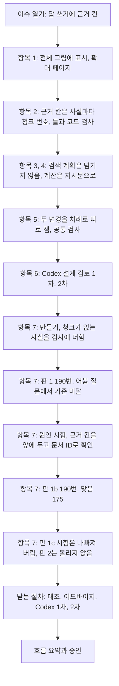

# 6단계 흐름 요약: 답변 합성

이슈 #15 · 2026-10-27 ~ 2026-10-28

앞 단계에서 한 것: 이슈 #14에서 검색 계획(질문의 한국어판과 영어판)으로도 검색하는 다른 판 검색을 붙여, 근거를 찾은 실행이 190번 가운데 175번이 되었다. 그래서 이 단계: 그 청크를 받는 「답 쓰기」 칸이 답에 쓴 사실마다 근거 청크를 밝히게 하고, 근거를 받고도 틀리는 답을 줄였다.

이 이슈는 전체 그림의 「답 쓰기」 칸에 근거 칸을 더한 서브이슈다. 근거 칸은 답에 쓴 사실마다 그 사실이 든 청크의 번호를 적는 칸이고, 코드가 번호를 문서 이름과 줄로 바꿔 기록한다. 처음 판(판 1)은 근거 칸을 답 뒤에 두었다가 어븀 질문을 망쳐 기준에 못 미쳤다. 원인을 시험한 뒤 근거 칸을 맨 앞에 두고 문서 ID로 확인하게 한 판(판 1b, 다른 문서에서는 판 1′로 적음)이 맞은 답 175로 가장 좋아 이 판으로 정했다. 계획에 있던 계산 지시 판(판 2)은 판 1b가 같은 문제를 이미 풀어 돌리지 않았다.

결과물은 코드(`src/agent/answer.py`, `run_answer.py`, `compare_answer.py`와 시험), 실행 기록과 견주기 요약(`data/agent/answer_cite/`), 원인 시험(`research_notes/stage6_answer_tests/`), 확대 페이지(`history/stage6/15-answer-synthesis.html`)다. 확대 페이지는 정할 것을 정하던 자리이고 맨 위 "정리" 칸에 같은 질문이 판마다 실제로 어떻게 나왔는지가 있다. 이 글은 그 흐름을 다시 보는 글이다. 항목 번호는 이슈 체크리스트의 차례(1~8)다.

| 숫자 | 값 |
|---|---|
| 결정 줄 | 13 (6단계 결정 파일, 2026-10-28) |
| 판단 기록 줄 | 10 |
| 커밋 | 45 (이슈 번호가 붙은 것, 이 흐름 요약 전까지) |
| 190번 실행 | 2번 (판 1, 판 1b). 모든 판은 이슈 #14 기록의 같은 청크로 답 쓰기만 다시 돌렸다 |
| 맞은 답 (190번 가운데) | 판 0(이슈 #14의 지금 시스템) 167, 판 1 163, 판 1b 175 |
| 근거를 받고도 틀린 답 | 판 0 8, 판 1 12, 판 1b 0 |
| 판 0에서 맞았는데 틀리게 바뀐 답 | 판 1 9, 판 1b 0 |
| 원인 시험 | 6차례, 어븀 질문 등 질문 2~4개를 씨앗 5개로 (결과 숫자에 쓰지 않음) |
| Codex 지적 | 설계 검토 1차 7(심각 1, 보통 5, 낮음 1), 2차 낮음 1 / 닫는 검토 1차 6(보통 5, 낮음 1), 2차 낮음 1(1차 6개 가운데 해소 5, 절반만 됨 1) |

## 흐름

정할 것 일곱을 결과를 보기 전에 모두 정하고 Codex 설계 검토를 받은 뒤에 만들었다. 모든 판은 이슈 #14 기록의 청크를 그대로 다시 써서 「답 쓰기」만 다시 돌렸다. 그래서 판끼리 다른 것은 지시문 하나뿐이다. 판 1이 기준에 못 미친 뒤에는 미리 정한 대로 기록을 읽어 원인을 가르고, 짧은 시험으로 고칠 곳을 찾은 다음 새 판을 190번 쟀다.

## 1. 답 쓰기의 꼴

### 항목 2: 근거 칸에 사실마다 청크 번호를 적고, 문서 이름은 코드가 붙인다 (사용자 지적)

> 답 꼴에 근거 칸을 더해 답에 쓴 사실마다 그 사실이 든 청크 번호를 적게 한다. 서버에 칸의 꼴을 적은 틀을 보내 꼴 오류를 막고, 코드가 번호를 문서 이름과 줄로 바꾸고 사실의 숫자가 그 청크 글에 있는지 기록한다.

- **바뀐 것**: AI는 처음에 답 전체에 청크 번호 목록 하나만 붙이는 안을 추천했다. 사용자가 사실마다 청크를 밝혀야 "해당 내용이 정확히 어디서 가져오는지를 안다"고 해 사실마다 적는 안으로 바꿨다. 이어 사용자가 "문제점을 발견한 거면 수정을 해야지"라고 해, 꼴 오류를 뒤에서 검사하는 대신 틀로 막고, 목록에 없는 번호도 틀로 막게 했다.
- **정한 것**: 답 꼴은 근거 칸, 생각 과정, 답의 세 칸이다. 채점은 답 칸만 본다. 근거가 없으면 답할 수 없다고 쓰고 근거 칸을 비운다.
- **이유**: 사실마다 청크가 남아야 판정 기능이 주장마다 근거를 보고, API가 참조 청크를 돌려줄 수 있다. 개발용 질문에는 두 문서의 값을 견주는 질문이 있어 목록 하나로는 어느 값이 어느 문서에서 왔는지 가를 수 없다. 서버의 기본 JSON 설정은 괄호와 따옴표만 맞추고 칸의 꼴은 보장하지 않아, 이슈 #14에서 판정 모델이 꼴 오류를 냈다.
- **버린 것**: 답 글 안에 `0.3687 kg [2]`처럼 적는 안은 채점이 답의 마지막 숫자를 고르므로 2를 답으로 센다. 생각 과정 안에 `[2]`를 적는 안은 코드가 글에서 번호를 뽑아야 해 꼴을 어기면 빠진다.
- **한계**: 코드는 사실의 숫자만 청크 글과 대조한다. 숫자가 없는 사실(원소 이름 같은 것)의 근거는 판정에서 본다(미정 목록).
- **예**: 판 1b에서 어븀 질문의 근거 칸은 `"Erbium has a density of 9.066 g/cm³ near room temperature." · chunks [11]`(어븀의 상온 밀도는 9.066 g/cm³, 11번 청크)이고, 코드가 이것을 `wiki-ko-erbium` 14~23번째 줄로 바꿔 기록했다.

### 항목 3: 답 쓰기에 검색 계획을 넘기지 않는다

> 답 쓰기는 지금처럼 질문 글과 청크만 받는다. 검색 계획의 찾을 것 목록은 넘기지 않는다.

- **정한 것**: 검색 계획의 한국어판과 영어판은 검색어로만 쓰이고, 찾을 것 목록은 기록에만 남는 흐름을 바꾸지 않는다.
- **이유**: 판 0에서 근거를 받고도 틀린 8번은 모두 청크에서 밀도를 바르게 읽고 계산을 숫자로 하지 않은 것이었다. 무엇을 찾을지 몰라 틀린 답은 없었다.
- **버린 것**: 찾을 것 목록만 넘기는 안은 목록이 틀리면 답을 끈다. 예로 란타넘 질문의 계획에는 문서에서 찾을 사실이 아닌 "g을 kg로 바꾸기"가 찾을 것으로 들어 있었다. 계획 전체를 넘기는 안은 잘못 옮긴 말("상온"을 "방사능 온도"로)까지 끼어든다.
- **한계**: 질문 38개가 모두 숫자 하나를 묻는 질문이라 나온 판단이다. 여러 사실을 잇는 개발용 질문에서 다시 본다.

### 항목 4, 7: 계산 실수는 지시문으로 고치기로 했으나, 판 1b가 먼저 풀어 판 2는 돌리지 않았다 (사용자 지적)

> 계산을 숫자로 하라는 지시문(판 2)을 만들어 두었지만, 근거 칸을 맨 앞에 둔 판 1b에서 근거를 받고도 틀린 답이 0이 되어 질문 38개로는 판 2가 고칠 답이 남지 않았다.

- **처음**: 생각 과정에 "할 일을 말로 적지 말고 질문과 청크의 숫자를 넣어 실제로 계산하라"는 줄을 넣는 판 2를 판 1 위에 얹어 재기로 했다. 생각 모드(모델이 답 전에 긴 생각 글을 쓰는 기능)는 사용자가 답이 오래 걸려 꺼려, 다른 고침을 먼저 찾고 마지막에만 묻기로 했다.
- **걸린 것**: 판 1이 기준에 못 미쳐 판 2는 판 1b 위로 옮겼다. 판 1b에서 근거를 받고도 틀린 답이 0이 되어, 판 2를 남기는 기준(근거를 받고도 틀렸던 답이 맞게 바뀐 수가 틀리게 바뀐 수보다 많음)을 채울 수 없게 되었다.
- **정한 것**: 판 2는 질문 38개로 돌리지 않는다. 계산 지시는 코드에 남기고, 개발용 질문에서 계산을 건너뛰는 답이 다시 나오면 꺼낸다.
- **이유**: 질량 질문의 근거를 받은 90번에서, 판 0은 생각 과정에 부피 숫자 60을 쓴 82번이 모두 맞고 쓰지 않은 8번이 모두 틀렸다. 판 1b는 숫자로 계산한 답이 90번이었다.
- **한계**: 판 1b는 판 0에서 근거 칸, 칸 순서, 문서 ID 확인 줄의 셋을 한꺼번에 바꾼 판이다. 셋 가운데 어느 것이 계산을 고쳤는지는 나눠 보지 않았다(Codex 닫는 검토 1차로 말을 좁힘).
- **예**: 란타넘 질문 q08-en 씨앗 2. 판 0의 생각 과정은 `"… use the density of lanthanum at room temperature (6.145 g/cm³) to find the mass. Convert grams to kilograms at the end."`(밀도로 질량을 구하고 마지막에 kg로 바꾼다)라고 할 일만 적고 답을 `0.00092175 kg`로 지어 썼다. 판 1b는 `"60 cm³ × 6.145 g/cm³ = 368.7 g … 368.7 g ÷ 1000 = 0.3687 kg"`로 계산해 맞았다.

## 2. 재는 법

### 항목 5: 변경마다 판을 하나씩 만들고, 앞 판과만 견준다 (사용자 지적)

> 판 0에 근거 칸을 더한 판 1은 판 0과, 판 1에 계산 지시를 더한 판 2는 판 1과 견주기로 했다. 두 판의 다른 점이 변경 하나뿐이라 바뀐 것이 어느 변경 때문인지 맞춰진다.

- **바뀐 것**: AI가 두 변경을 차례로 붙이자고 했을 때, 사용자가 변경마다 실제로 무엇을 해결하는지 비교 대상을 제대로 해야 따로 돌렸을 때 정확히 매치된다고 짚었다. 그래서 변경마다 해결하려는 것, 견주는 상대, 볼 숫자를 짝지었다. 근거 칸은 인용을 더하는 변경이라 맞은 답이 줄지 않는지를 보고, 계산 지시는 근거를 받고도 틀린 답이 맞게 바뀌는지를 본다.
- **정한 것**: 판마다 이슈 #14 기록의 질문과 씨앗마다 답 쓰기에 넘긴 청크 목록을 그대로 다시 써서 답 쓰기만 다시 돌린다. 돌리기 전에 다시 만든 참고 글과 질문 글이 190줄 모두 이슈 #14 기록과 글자까지 같은지 본다.
- **이유**: 다른 칸의 입력을 그대로 두어야 판끼리의 차이가 답 쓰기 하나로 좁혀진다. 190번에 약 40분으로, 계획 쓰기까지 다시 돌릴 때보다 짧다.
- **한계**: 판 1이 기준에 못 미친 뒤 만든 판 1b는 판 1에서 두 가지(칸 순서, 문서 ID 확인 줄)를 더 바꿨다. 판 1b는 판 0과 견주었고, 판 1b 안의 세 변경은 질문 둘로 한 원인 시험으로만 나눠 보았다.

### 항목 5, 6, 7: 근거 칸은 판마다 같은 공통 검사로 보고, 하나라도 걸리면 기록을 읽는다 (Codex 지적, 사용자 지적)

> 꼴 오류, 정답 근거 청크를 근거 칸에 넣은 수, 잘못 붙은 인용, 인용 누락, 답 언어, 끊김, 청크가 없는 사실을 판마다 센다. 하나라도 나오면 기록을 읽어 원인을 가른다.

- **바뀐 것**: 처음 기준은 근거 칸이 근거 청크를 가리켰는지뿐이었다. Codex 설계 검토 1차가 청크 번호를 모두 적어도 통과한다고 짚어, 사실의 숫자가 없는 청크를 그 사실의 근거로 적은 "잘못 붙은 인용"과, 숫자로 답했는데 근거 칸이 빈 "인용 누락"을 더했다. 사용자는 "필요하지 않은 청크 말고 필요한 청크만 가지고 대답을해야돼"라고 했다. 만든 뒤 짧은 실행에서 모델이 청크 번호 없이 단위 환산 공식을 적은 것이 보여, 청크가 없는 사실도 세게 했다.
- **정한 것**: 맞던 답이 틀리게 바뀌면 1번이라도 기록을 읽어, 원래 약점이 무작위로 나온 것인지 근거 칸이 답을 망친 것인지 가른다. 답 쓰기는 온도 0.7이라 지시문이 바뀌면 변경과 상관없이 몇몇 답이 뒤집힐 수 있어 "뺀다"가 아니라 "가른다"로 두었다.
- **이유**: 근거 칸이 엉뚱한 청크를 적어도 통과되면 답변 합성의 완료 기준 "근거 청크를 인용해 답한다"를 지켰는지 알 수 없다. 결과를 보기 전에 정해 결과에 맞춰 기준을 고르지 않게 했다.
- **한계**: 숫자 대조는 사실과 청크 글에 같은 값이 있는지만 본다. 두 언어 문서의 값이 조금 다르면(루테튬 영어 9.840, 한국어 9.841) 잘못 붙은 인용으로 세어진다.

## 3. 재 보고 판단한 것

### 항목 7: 판 1은 어븀 질문을 망쳐 기준에 못 미쳤다

> 근거 칸을 답 뒤에 둔 판 1은 맞은 답이 167에서 163으로 줄었다. 줄어든 4는 모두 어븀 질문에서 이웃 청크(한국어 이터븀)를 근거로 골라 틀린 것이다.

- **정한 것**: 판 1은 기록으로만 남기고, 원인을 시험해 고친 판을 만든다.
- **이유**: 판 0은 같은 청크로 어븀 질문을 5번 모두 맞혔다. 판 1은 씨앗 5개 모두 10번 청크(이터븀, 6.90 g/cm³)를 근거로 적어 무작위가 아니었다. 나머지 맞음에서 틀림으로 바뀐 5와 틀림에서 맞음으로 바뀐 5는 계산을 건너뛰는 원래 약점이 자리만 바뀐 것이었다.
- **예**: 어븀 질문 q09-en 씨앗 1의 판 1 출력은 `"… The density of erbium near room temperature is given as 6.90 g/cm³ … 60 cm³ × 6.90 g/cm³ = 414 g …"`, 답 `0.414 kg`, 근거 칸 `chunks [10]`이었다. 근거는 바로 다음 11번 청크(어븀, 9.066 g/cm³)다.

### 항목 7: 근거 칸을 맨 앞에 두고 문서 ID로 확인하게 한 판 1b로 정한다 (사용자 지적)

> 근거 칸을 근거 칸, 생각 과정, 답의 순서로 맨 앞에 두고, 값을 쓰기 전에 문서 ID의 영어 이름으로 질문과 같은 것인지 확인하게 했다. 어븀 질문이 5번 모두 맞았고, 190번에서 맞은 답 175, 나빠진 답 0이었다.

- **과정**: 원인 시험에서 서버의 틀을 빼도 판 1과 답 글까지 같아 틀은 원인이 아니었다. 판 0에 근거 칸 하나만 더해도 5번 가운데 3번 틀려, 근거 칸 그 자체가 모델의 이름 헷갈림(영어 erbium과 한국어 어븀, 이터븀)을 건드렸다. 제목으로 확인하라는 줄은 효과가 없었고(1/5), 문서 ID로 확인하라는 줄은 4/5였다. 사용자가 근거를 먼저 쓰고 답을 쓰게 하는 순서만 바꿔도 결과가 다르다고 해 시험했다. 순서만 바꾸면 0/5, 순서와 문서 ID 확인 줄을 함께 넣으면 5/5였다.
- **정한 것**: 판 1b의 지시문은 판 1에서 답 꼴 줄의 칸 순서를 바꾸고 문서 ID 확인 줄 하나를 더한 것이다. 틀의 칸 순서도 같이 바꾼다.
- **이유**: 모델은 글을 앞에서부터 쓰고 뒤의 글은 앞의 글을 따른다. 판 1은 생각 과정에 6.90을 이미 쓴 뒤에 근거 칸을 채웠다. 근거 칸을 먼저 쓰게 하면 근거를 고르는 단계에서 문서 ID(`wiki-ko-erbium`)로 확인하고, 답은 고른 근거를 따른다.
- **한계**: 판 1b에도 남은 것이 있다. 한국어 질문에 영어 청크를 옮긴 뒤 생각 과정까지 영어로 쓴 답이 3번, 한 문단이 두 청크로 나뉠 때 값이 없는 쪽 번호를 적은 답이 5번(q19-ko)이다. 둘 다 답은 맞았다.
- **예**: 어븀 질문 q09-en 씨앗 1의 판 1b 출력은 근거 칸 `"Erbium has a density of 9.066 g/cm³ near room temperature." · chunks [11]`이 맨 앞에 오고, 생각 과정 `"… 60 cm³ × 9.066 g/cm³ = 543.96 g …"`, 답 `0.544 kg`이었다.

### 항목 7: 남은 두 가지를 고친 판 1c는 나빠져 버린다 (사용자 지적)

> 판 1b 지시문의 두 줄을 고친 판 1c를 짧게 시험했으나, 남은 두 가지 어느 쪽도 고쳐지지 않고 맞은 답이 20에서 14로 줄었다. 판 1b를 그대로 둔다.

- **처음**: AI는 남은 두 가지를 개발용 질문으로 다시 돌릴 때 고치자고 추천했다.
- **걸린 것**: 사용자가 "지금 한번더 수정해도 다 문제가 해결이 될수도 있는거 아니야?"라고 해, 미룰 근거가 약했다고 보고 지금 시험했다. 고친 줄은 둘이다. 근거 칸 줄의 "그 사실이 든 참고 글의 번호"를 "그 사실의 값이 든 참고 글의 번호"로, 언어 줄을 "생각 과정과 답은 참고 글이 다른 언어여도 질문의 언어로, 사실은 참고 글의 언어 그대로 옮겨도 된다"로 바꿨다.
- **정한 것**: 판 1c는 190번 돌리지 않고 버린다. 남은 두 가지는 한계로 기록하고 개발용 질문으로 다시 돌릴 때 본다.
- **이유**: 시험한 네 질문(q07-en, q18-ko, q19-ko, q09-en, 씨앗 5개씩)에서 판 1b는 맞음 20, 언어 같음 17이었고 판 1c는 14, 15였다. q19-ko의 근거 칸은 5번 모두 여전히 값이 없는 쪽 청크였다.
- **한계**: 지시문 두 줄만 바꿨는데 어븀 질문이 5번 맞음에서 1번 맞음으로 무너졌다. 판 1b의 어븀 5/5도 지시문에 따라 쉽게 흔들리는 결과이고, 질문 38개에 맞춘 고침일 수 있다.

## 세부로 정한 것

- 항목 5: 판 0은 이슈 #14 기록에서 처음 계획의 검색이 따로 있는 실행은 그것을, 없는 실행은 최종 검색을 쓴다. 지금 시스템은 처음 계획으로 검색하기 때문이다(Codex 지적).
- 항목 5: 근거 칸이 빈 것과 거절은 따로 센다. 숫자로 답하고 근거 칸만 비운 답은 거절이 아니라 인용 누락이다(Codex 지적).
- 항목 7: 생각 과정의 숫자 계산을 세는 규칙은 사이에 단위가 끼어도 잡게 고쳤다. 처음 규칙은 판 0에서 13번만 잡았고, 고친 규칙은 부피 숫자로 센 82번과 같은 82번을 잡는다.
- 항목 7: 숫자 대조는 실제 부호를 지키고, 글자에 바로 붙은 하이픈(Tb-144, 사마륨-149)만 이름과 번호를 잇는 것으로 본다. 코퍼스에서 글자 뒤에 붙은 "-숫자"는 모두 이런 이름과 번호였다. 판 1과 판 1b를 다시 계산해 바뀌는 검사는 0이었다(Codex 지적).
- 항목 7: 견주는 프로그램은 두 판의 출처 실행, 판 0 고르기, 질문 글, 청크 순서, 근거 청크 번호가 같은지 먼저 본다(Codex 지적).
- 항목 7: 그래프 전체를 짧게 돌려 보려고 이슈 #14의 실행 프로그램에 짧은 확인용 선택지 하나를 더했다. 주지 않으면 이전과 똑같이 돈다(어드바이저 지적).

## 검토에서 있었던 일

- Codex 설계 검토 1차 지적 7(심각 1, 보통 5, 낮음 1), 모두 맞아 고쳤다. 심각 1은 판 0을 고친 계획의 기록으로 잡은 것으로, 어븀 대신 q09-ko 5번의 입력이 지금 시스템과 달랐다. 근거 칸의 검사가 청크 번호를 모두 적어도 통과하는 빈틈과 판 2에 근거 칸 검사가 없는 빈틈은 사용자가 공통 검사로 정했다. 2차는 1차 7개 모두 해소, 새 지적 낮음 1(확대 페이지의 청크 수)이었다.
- Codex 닫는 검토 1차 지적 6(보통 5, 낮음 1), 모두 맞아 고쳤다. 계산 개선을 칸 순서 하나의 효과처럼 쓴 말, 판 2 기준의 개선 수, 숫자의 부호, 판끼리 입력이 같은지의 확인, 확대 페이지와 이슈에 남은 옛 계획, 원인 시험 기록의 청크 번호다.
- 닫는 검토 2차는 첫 실행이 모델 서버의 용량 오류로 멈췄다(외부 요인). 멈추기 전에 재현한 두 가지(글자에 붙은 빼기 부호, 출처 실행 대조)를 고치고 다시 돌렸다. 부호는 "뒤가 정수로 끝날 때만 하이픈을 이름으로 본다"로 고쳤는데, 다시 돌린 2차가 이것이 문장 끝 마침표를 소수점으로 읽는다고 짚어 처음 규칙으로 되돌렸다. 다시 돌린 2차는 1차 6개 가운데 5개를 해소, 부호 하나를 절반만 됨으로 보았고, 새 지적 낮음 1(문장 끝의 "Tb-144."를 -144로 읽음)을 냈다. 새 지적은 고쳤다. 절반만 됨의 반례("온도는-5°C"처럼 글자에 붙은 음수)는 코퍼스에 그런 꼴이 없어 남겼다.
- 닫는 절차의 어드바이저 점검이 실행 프로그램을 바꾼 것에 결정 줄이 없는 것과, 판 1b를 그래프 전체로 한 번도 돌리지 않은 것을 짚었다. 결정 줄을 더하고 판 1b로 그래프 전체를 두 번 돌려 확인했다.

## 계획과 달라진 것

- 판 1이 기준에 못 미쳐 판 1b를 새로 두고 190번을 한 번 더 돌렸다.
- 판 2(계산 지시)는 돌리지 않았다. 이슈 체크리스트 7번째 일의 완료 기준을 판 1b 190번으로 고쳤다.
- 판 1c를 시험하고 버렸다.

## 뒤 단계가 기대는 것

- 「답 쓰기」는 판 1b(`cite-en-v1b`)다. 지금 그래프의 기본은 아직 이슈 #14의 답 쓰기이고, 충분성 판단과 재검색을 붙일 때 판 1b를 기본으로 쓰는 실행 프로그램과 함께 정한다(미정 목록).
- 근거 칸과 코드가 바꾼 문서 이름과 줄. 판정이 주장마다 근거를 보고, API가 참조 청크를 돌려주는 바탕이다.
- 공통 검사와 견주는 프로그램(`compare_answer.py`). 뒤 판도 같은 검사로 견준다.

## 남은 것

- 개발용 질문으로 다시 돌릴 때 볼 것(미정 목록): 계산을 건너뛰는 답이 다시 나오는지(나오면 판 2를 판 1b와 견줌), 생각 과정이 참고 글의 언어를 따르는 답, 나뉜 청크의 번호, 영어 질문과 한국어 청크의 이름 잇기.
- 근거를 못 찾은 15번 가운데 6번은 비슷한 다른 값으로 답했다. 재검색과 판정의 몫이다.
- 숫자 없는 사실의 근거 확인은 판정에서 한다(미정 목록).

## 다시 볼 곳

| 내용 | 상태 | 쓰이는 곳 |
|---|---|---|
| 판마다 같은 질문이 실제로 어떻게 나왔는지(지시문에서 바뀐 글, 모델 출력, 남는 기록) | 확대 페이지 맨 위 "정리" 칸에 실제 기록으로 적음 | 다음 기능과 견줄 때, 멘토에게 설명할 때 |
| 근거 칸은 인용을 더하는 변경이고, 틀린 답을 고치는 것은 계산 지시였다 | 확대 페이지 정할 것 5와 이 글 항목 5 | 기능마다 견줄 상대를 정할 때 |
| 판 1b의 어븀 5/5는 지시문 두 줄로 1/5까지 흔들렸다 | 판단 기록과 미정 목록 | 개발용 질문으로 다시 돌릴 때 |

## 원본

- 결정: `decisions/stage6.md` 2026-10-28 "답변 합성의 인용 꼴" 줄부터 "실행 프로그램에 짧은 확인용 선택지" 줄까지 13줄(파일에서는 줄 제목 앞에 기능 번호가 붙어 있음)
- 판단: `decisions/judgments.md` 2026-10-28 8줄
- 검토: `CODEX_REVIEW.md`(닫을 때 지움, 커밋 기록에 남음)
- 실행 기록: `data/agent/answer_cite/`(`runs_v1.jsonl`, `runs_v1b.jsonl`, `summary_v1.md`, `summary_v1b.md`), 원인 시험: `research_notes/stage6_answer_tests/`
- 페이지: `history/stage6/15-answer-synthesis.html`(확대 페이지), `history/stage6/13-workflow-diagram.html`(전체 그림)
